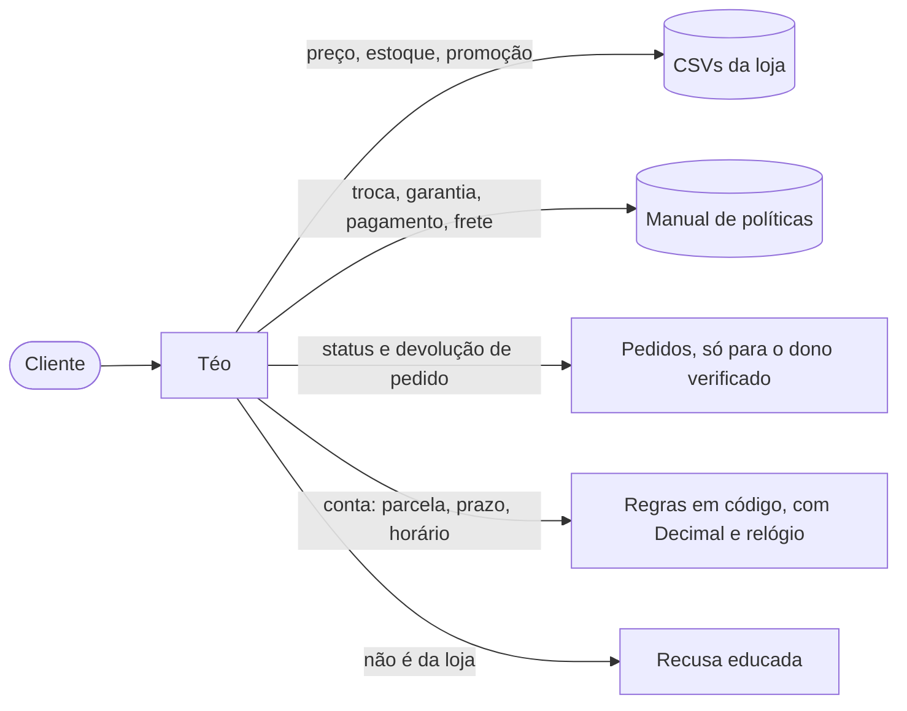
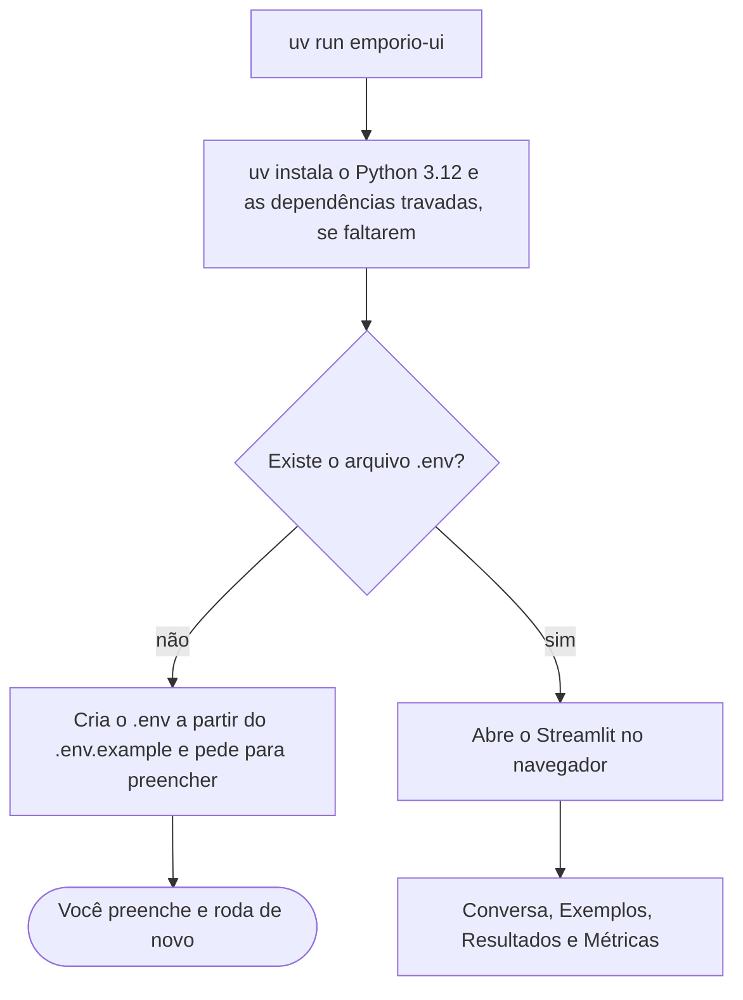
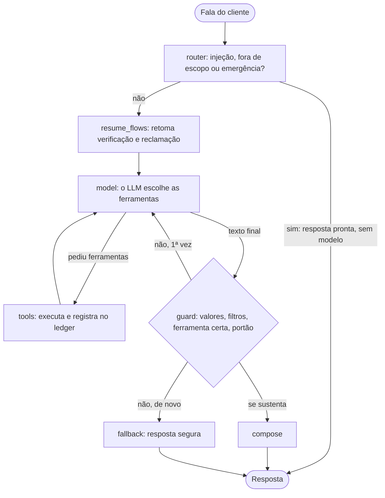
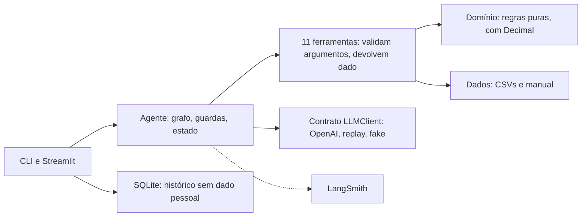
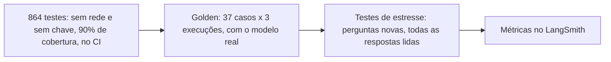
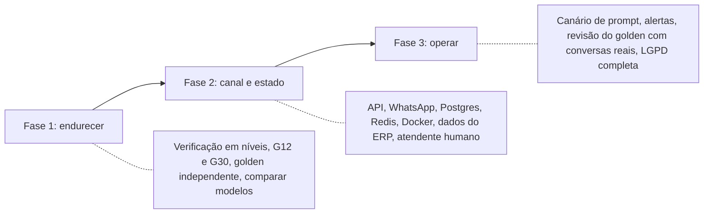

# Empório da Música: Téo, o assistente de atendimento

[](https://github.com/oericdacosta/emporio-assistant/actions/workflows/ci.yml)


Protótipo de um agente de atendimento por mensagens de texto para a Empório da Música, uma loja
fictícia de instrumentos musicais em Campo Grande/MS. Feito para o desafio técnico de AI Engineer da
Artefact.

O Téo responde sobre catálogo, preços, pagamento, frete, horário, pedidos, devolução e garantia, usando
os dados reais da loja (os CSVs e o manual de políticas), e recusa com educação o que não é assunto da
loja. Ele nunca inventa preço, prazo ou regra: o que tem resposta "certa" sai de código; o modelo só
conversa.



## Sumário

1. [Como o desafio foi atendido](#1-como-o-desafio-foi-atendido)
2. [Início rápido](#2-início-rápido)
3. [Como usar](#3-como-usar)
4. [Exemplos de conversa](#4-exemplos-de-conversa)
5. [Arquitetura](#5-arquitetura)
6. [Decisões técnicas](#6-decisões-técnicas)
7. [Testes e avaliação](#7-testes-e-avaliação)
8. [Premissas assumidas](#8-premissas-assumidas)
9. [Limitações conhecidas](#9-limitações-conhecidas)
10. [O que faria com mais tempo](#10-o-que-faria-com-mais-tempo)
11. [Uso de assistentes de código](#11-uso-de-assistentes-de-código)
12. [Estrutura do projeto](#12-estrutura-do-projeto)
13. [Documentação completa](#13-documentação-completa)

---

## 1. Como o desafio foi atendido

Cada pedido do enunciado e onde ele está resolvido:

| O desafio pede | Como foi atendido | Onde ver |
|---|---|---|
| Projeto em Python | Python 3.12, tipos estritos | `src/emporio/` |
| Persona alinhada à identidade e ao tom da loja | O Téo: amigo que entende de música, informal e profissional, respostas curtas de WhatsApp, como o manual pede (seção 7.1) | [Decisão D18](docs/decisoes-tecnicas.md#d18-estratégia-de-prompt), `prompts/system.md` |
| Responder com base no contexto disponível | 11 ferramentas sobre os CSVs e o manual; resposta sem origem é barrada pela guarda | [Arquitetura](docs/arquitetura.md#5-as-11-ferramentas) |
| Saber quando consultar dados e quando consultar políticas | Ferramentas de catálogo, loja e pedido para dados; `search_policy` para regras, e o modelo escolhe, com a escolha visível no `--trace` | [D1](docs/decisoes-tecnicas.md#d1-a-abordagem-function-calling-com-ferramentas-determinísticas), [D6](docs/decisoes-tecnicas.md#d6-consulta-às-políticas-sem-embeddings) |
| Lidar com perguntas fora do escopo | Roteador de regras antes do modelo, mais regra no prompt e filtros de saída | [D8](docs/decisoes-tecnicas.md#d8-o-roteador-de-escopo-antes-do-modelo) |
| Framework / abordagem justificados | Function calling com ferramentas determinísticas e grafo LangGraph; sem RAG | [D1](docs/decisoes-tecnicas.md#d1-a-abordagem-function-calling-com-ferramentas-determinísticas), [D3](docs/decisoes-tecnicas.md#d3-orquestração-do-turno-do-laço-próprio-ao-langgraph) |
| Modelo e provedor justificados | OpenAI `gpt-4.1-mini` atrás de um contrato próprio | [D4](docs/decisoes-tecnicas.md#d4-modelo-e-provedor) |
| Interface (CLI, API, UI) | CLI e Streamlit, abertos com um comando | [D12](docs/decisoes-tecnicas.md#d12-interface) |
| Persistência do histórico | SQLite sem dado pessoal, 30 dias, retomável | [D10](docs/decisoes-tecnicas.md#d10-persistência-do-histórico) |
| Tratamento dos dados | Carga validada, `Decimal`, relatório de qualidade, status que manda sobre o estoque | [Dados e políticas](docs/dados-e-politicas.md) |
| Estratégia de retrieval e de prompt justificadas | Sem embeddings, política por tópico; prompt curto, com prefixo estável | [D6](docs/decisoes-tecnicas.md#d6-consulta-às-políticas-sem-embeddings), [D18](docs/decisoes-tecnicas.md#d18-estratégia-de-prompt) |
| Repositório público com histórico real | 145 commits em 35 pull requests, validados pelo CI | [Histórico](https://github.com/oericdacosta/emporio-assistant/commits/main) |
| Instruções para rodar | [Início rápido](#2-início-rápido): um comando, em qualquer sistema | abaixo |
| Limitações conhecidas e o que faria com mais tempo | Documentadas com números, e um plano até a produção | [Limitações](docs/limitacoes-e-evolucao.md) |
| **Uso de assistentes de código** | Claude Code como revisor e avaliador do código e auxiliar na escrita, e apoio à pesquisa e ao raciocínio sobre a orquestração e o planejamento; também o NotebookLM, para estudar papers, artigos e documentações; a ideia e as decisões são minhas, e o Claude Code foi avaliador e revisor do código. | [Uso de IA](docs/uso-de-ia.md) |
| 3 a 5 conversas de exemplo, ao menos uma não trivial | 5 conversas, com consulta a dados em tempo real e aplicação de regras | [Exemplos](#4-exemplos-de-conversa) |
| Premissas documentadas para o que estava ambíguo | Tabela de suposições | [Premissas](#8-premissas-assumidas) |

## 2. Início rápido

### Pré-requisitos

- [uv](https://docs.astral.sh/uv/), o gerenciador de pacotes e de ambientes do projeto. Ele também baixa o
  Python 3.12 se você não o tiver. Não precisa instalar mais nada.
- Uma chave de API da OpenAI.

Instalar o `uv` (uma vez):

| Sistema | Comando |
|---|---|
| Linux e macOS | `curl -LsSf https://astral.sh/uv/install.sh \| sh` |
| Windows (PowerShell) | `winget install astral-sh.uv` ou `powershell -c "irm https://astral.sh/uv/install.ps1 \| iex"` |

### Rodar, em três passos

```bash
# 1. baixar o projeto
git clone https://github.com/oericdacosta/emporio-assistant.git
cd emporio-assistant

# 2. rodar (na primeira vez, cria o arquivo .env e pede para você preenchê-lo)
uv run emporio-ui

# 3. abra o .env, preencha OPENAI_API_KEY e LLM_MODEL e rode o mesmo comando de novo
uv run emporio-ui
```

O mesmo comando vale em Linux, macOS e Windows. Onde houver `make` (Linux, WSL, macOS), `make run` faz
exatamente a mesma coisa. O `uv run` cria o ambiente, instala as dependências travadas (`uv.lock`) e abre
a interface no navegador.



> Windows e macOS: o comando é o mesmo, mas o projeto foi desenvolvido e testado em Linux (Ubuntu e
> WSL). Se algo se comportar diferente no seu sistema, a causa mais provável é o ambiente.

### Configuração (`.env`)

| Variável | Obrigatória | O que faz |
|---|---|---|
| `OPENAI_API_KEY` | Sim, para conversar | Chave da OpenAI |
| `LLM_MODEL` | Sim, para conversar | Modelo da OpenAI. Não há padrão no código, de propósito. O projeto foi medido com `gpt-4.1-mini` |
| `AGENT_NOW` | Não | Congela o relógio, por exemplo `2026-03-23T10:00`. O `.env.example` já traz essa data, porque os pedidos da loja são de 2025 e 2026. Apague a linha para usar o relógio real |
| `LANGSMITH_API_KEY` | Não | Liga o tracing e a aba Métricas. Sem ela o app funciona e só avisa |
| `LANGSMITH_TRACING` | Não | `true` (padrão) ou `false` |
| `LANGSMITH_PROJECT` | Não | Projeto dos traces (padrão: `emporio-teo`) |
| `EMPORIO_HISTORY_DB` | Não | Caminho do SQLite do histórico (padrão: `history/sessions.db`) |
| `EMPORIO_DATA_DIR` | Não | Pasta dos CSVs (padrão: `data/raw/`) |

> Sem chave? Você ainda vê as abas Exemplos (as 5 conversas gravadas) e Resultados (os números dos
> testes do autor), que não chamam o modelo.

## 3. Como usar

### Interface web (Streamlit)

`uv run emporio-ui` (ou `make run`). A interface tem quatro abas:

| Aba | O que mostra | Precisa de chave? |
|---|---|---|
| Conversa | O chat com o Téo, com exemplos clicáveis e 👍/👎 em cada resposta | Sim (OpenAI) |
| Exemplos | As 5 conversas de exemplo, com as consultas que o agente fez em cada turno | Não |
| Resultados | Os números medidos pelo autor (turnos, tempo, custo, guarda, erros de ferramenta e por ferramenta). Qualquer pessoa que baixar o projeto vê os mesmos | Não |
| Métricas | As métricas das suas próprias conversas, lidas do seu LangSmith. Aparece ao ligar o modo avaliador na barra lateral | LangSmith |

### Linha de comando

```bash
uv run emporio                                   # conversa interativa
uv run emporio --trace                           # mostra consultas, tokens e latência de cada turno
uv run emporio -m "Quanto custa o Takamine GD20?"   # uma mensagem, imprime a resposta e sai
uv run emporio --now 2026-02-20T10:00 -m "Posso devolver o pedido 7?"
uv run emporio --session ID                      # retoma uma conversa salva
uv run emporio --check-data                      # valida os CSVs e o manual e sai
```

Dentro da conversa: `/ajuda`, `/novo` (outra conversa; a anterior fica salva), `/esquecer` (apaga o histórico
e a verificação de identidade), `/trace` (liga ou desliga o trace) e `/sair`.

A CLI sai com códigos distintos (ok, erro inesperado, uso inválido, configuração, provedor indisponível,
cassete, Ctrl-C), então pode ser usada em scripts.

### Atalhos (`make`)

| Comando | O que faz |
|---|---|
| `make run` | Um comando só: instala o que falta e abre a interface web |
| `make chat` | Abre a conversa na linha de comando |
| `make test` | Roda os 864 testes (sem chave e sem rede) |
| `make cov` | Testes com cobertura de linhas e ramos |
| `make lint`, `make type`, `make fmt` | `ruff`, `mypy` estrito, formatação |
| `make eval EVAL_REPEAT=3` | O golden com o modelo real, 3 execuções por caso (custa tokens) |
| `make eval-regression`, `make eval-capability` | Só a suíte de regressão (portão) ou só a de capacidade |
| `make policies` | Extrai o manual do PDF para Markdown |

## 4. Exemplos de conversa

Cinco conversas gravadas com o modelo real (`gpt-4.1-mini`), em [`examples/conversations/`](examples/conversations/).
Cada uma traz, abaixo de cada resposta, as consultas que o agente fez (que mostram *quando* ele consulta
dados e quando consulta política). Também aparecem na aba Exemplos da interface.

| # | Conversa | O que mostra |
|---|---|---|
| 1 | [Busca no catálogo que continua](examples/conversations/01-busca-com-contexto.md) | Lista violões até R$ 1000 e responde "qual o mais barato?" e "quanto fica em 3x?": o agente lembra da lista, e a parcela é calculada em código |
| 2 | [Loja fechada, acessório e volta ao assunto](examples/conversations/02-loja-fechada-e-fora-de-escopo.md) | Domingo: informa que está fechada e quando abre. Recusa cordas e cabos, recusa revelar o prompt, e volta a responder o preço normalmente |
| 3 | [Devolução por arrependimento](examples/conversations/03-devolucao-fora-do-prazo.md) | Não trivial. A regra geral; depois verifica o pedido e confere o prazo de 7 dias contra a data de recebimento, em código |
| 4 | [Defeito e reclamação](examples/conversations/04-defeito-e-reclamacao.md) | Não trivial. Acolhe, explica a regra de 30 dias e registra um protocolo com prazo de retorno |
| 5 | [Status de pedido com verificação](examples/conversations/05-status-de-pedido-com-verificacao.md) | Não trivial. Com o e-mail errado, não revela nada nem confirma que o pedido existe; com o certo, informa status e rastreio |

Um trecho da conversa 3, a aplicação de uma regra da política a um pedido real:

> **Cliente:** Me arrependi da minha compra, posso devolver meu pedido?
>
> **Téo:** Pode sim! Você tem até 7 dias corridos após o recebimento para devolver o produto, sem precisar
> justificar. Ele precisa estar na embalagem original, sem uso e com todos os acessórios. Me passa o número do
> pedido e o e-mail do cadastro (ou os 4 últimos dígitos do telefone) para eu verificar seu caso?
> *(consultou: `search_policy`)*
>
> **Cliente:** É o pedido 7, recebi dia 17/02. Meu e-mail é leticia.rocha@jmail.com
>
> **Téo:** Letícia, o prazo para devolução por arrependimento venceu em 24/02/2026, então não dá para fazer a
> devolução agora. Quer que eu encaminhe sua situação para a equipe analisar?
> *(consultou: `verify_customer`, `check_return_eligibility`)*

Quem verificou a cliente e calculou o prazo foi o código. O modelo só entendeu que era um arrependimento e
escreveu a resposta com o veredito pronto.

## 5. Arquitetura

Cada mensagem vira um turno, um grafo de nós (LangGraph). O modelo escolhe ferramentas e redige; o código
executa, valida e confere.



Em camadas, de fora para dentro:



Quatro ideias seguram o desenho:

- O modelo conversa, o código decide. Preço, horário, prazo e identidade são código testável.
- O modelo só vê o mundo pelas ferramentas, e nunca recebe uma exceção: recebe dados para se corrigir.
- A resposta é conferida antes de sair. Todo valor, percentual, parcela e rastreio precisa ter origem.
- O agente não conhece as ferramentas concretas (um teste de arquitetura garante), então o motor pode
  mudar sem mexer nelas.

Detalhes, com mais diagramas, em [docs/arquitetura.md](docs/arquitetura.md).

## 6. Decisões técnicas

Todas estão explicadas, com a escolha, o motivo, as alternativas descartadas, o custo aceito e quando eu
reveria, em [docs/decisoes-tecnicas.md](docs/decisoes-tecnicas.md). Resumo:

| Decisão | Escolha | Por que, em uma linha | Alternativa descartada |
|---|---|---|---|
| [Abordagem](docs/decisoes-tecnicas.md#d1-a-abordagem-function-calling-com-ferramentas-determinísticas) | Function calling com ferramentas determinísticas | Dados pequenos e estruturados, com regras de conta: consulta exata, não similaridade | RAG, contexto inteiro, text-to-SQL, multiagente |
| [Orquestração](docs/decisoes-tecnicas.md#d3-orquestração-do-turno-do-laço-próprio-ao-langgraph) | Grafo LangGraph | O fluxo ganhou ramos (roteador, retry, fallback); cada ramo virou uma aresta. Era um laço próprio no começo | Laço à mão, LangChain, PydanticAI |
| [Modelo](docs/decisoes-tecnicas.md#d4-modelo-e-provedor) | OpenAI `gpt-4.1-mini`, atrás do contrato `LLMClient` | Medido: 35 de 37 no golden, 1,7 s, cerca de US$ 0,0017 por turno | Modelo maior, local, outro provedor |
| [Dados](docs/decisoes-tecnicas.md#d5-tratamento-dos-dados) | CSVs intactos, objetos imutáveis, `Decimal` | Dinheiro não pode ser `float`; os números do manual vêm de um JSON com hash | pandas, banco SQL |
| [Políticas](docs/decisoes-tecnicas.md#d6-consulta-às-políticas-sem-embeddings) | `search_policy` por tópico, texto literal | Roteamento determinístico e visível no trace | Embeddings, manual no prompt |
| [Anti-alucinação](docs/decisoes-tecnicas.md#d7-a-guarda-de-fundamentação) | Ledger de valores, determinístico | Verificação barata e igual em toda execução | LLM como juiz |
| [Escopo](docs/decisoes-tecnicas.md#d8-o-roteador-de-escopo-antes-do-modelo) | Regras antes do modelo | Mais barato e não depende de o modelo obedecer | Classificador com LLM |
| [Identidade](docs/decisoes-tecnicas.md#d9-identidade-do-cliente) | Pedido mais uma prova, em código | O número do pedido é sequencial, então não prova nada | Deixar o modelo decidir |
| [Histórico](docs/decisoes-tecnicas.md#d10-persistência-do-histórico) | SQLite sem dado pessoal, 30 dias | Retomar sem guardar quem a pessoa é | JSON, histórico por cliente |
| [Interface](docs/decisoes-tecnicas.md#d12-interface) | CLI e Streamlit, um comando só | O foco é o agente, e o avaliador precisa ver e testar | API, notebook |
| [Streaming](docs/decisoes-tecnicas.md#d13-sem-streaming-de-texto) | Só eventos de progresso | A guarda precisa do texto completo | Streaming de tokens |
| [Avaliação](docs/decisoes-tecnicas.md#d14-avaliação) | Golden determinístico, 3 execuções | Passar *sempre* importa mais que passar *uma vez* | Avaliar no olho, LLM como juiz |
| [Prompt](docs/decisoes-tecnicas.md#d18-estratégia-de-prompt) | Curto, em seções, prefixo estável | Aproveita o cache (89% da entrada) e as garantias ficam em código | Manual inteiro no prompt |

O que não usamos, e por quê: embeddings e banco vetorial, LangChain, LiteLLM, pandas, banco SQL para os
dados, Redis, FastAPI, Docker, MCP, multiagente, *fine-tuning*, LLM como juiz e streaming de tokens. Cada um
tem a razão e o momento em que passaria a fazer sentido na
[tabela do anexo](docs/decisoes-tecnicas.md#anexo-tecnologias-que-não-usamos-e-quando-passariam-a-fazer-sentido).

## 7. Testes e avaliação



- 864 testes passam em cerca de 25 s, sem rede e sem chave (o modelo é um *fake* roteirizado), com 90% de
  cobertura. O CI roda lint, tipos estritos, testes, varredura de segredos e o padrão dos commits.
- Golden de 37 casos derivado dos dados (nenhum valor digitado à mão), executado 3 vezes por caso, com
  verificações determinísticas. Última rodada: 35 de 37, com regressão em 28 de 29. Latência mediana de
  1,7 s.
- Três testes de estresse com perguntas novas, lendo todas as respostas: cerca de 10% das conversas
  ainda tinham algum problema real, e as defesas novas criaram defeitos menores. Está tudo documentado, com
  os números, em [docs/avaliacao.md](docs/avaliacao.md).

As duas falhas do golden: G12 (frete para outra cidade) escolhe a ferramenta errada em 1 de 3
execuções, e a guarda a barra, então o cliente recebe a resposta segura; G30 (entrega aos sábados) infere
"de segunda a sexta" de "dias úteis", sem o manual afirmar isso.

## 8. Premissas assumidas

O desafio diz para assumir uma interpretação razoável quando algo é ambíguo e documentá-la. As principais:

- O status do produto manda sobre o estoque: descontinuado e "em breve" nunca são vendidos, mesmo com estoque.
- Uma promoção só vale se estiver ativa e o produto também (o CSV não tem datas); com várias, vale a
  maior, sem somar; o PIX não acumula com promoção.
- O manual se contradiz em alguns pontos (telefone e WhatsApp, e-mail, parcela mínima): cada decisão está
  registrada e é usada sempre da mesma forma.
- A loja não registra a data real de recebimento: a previsão de entrega serve de aproximação, o agente
  avisa isso, e a data informada pelo cliente tem precedência.
- Identidade = número do pedido mais o e-mail ou os 4 últimos dígitos do telefone, porque os dados não
  têm outro identificador.
- O relógio de demonstração é 23/03/2026 (segunda-feira, 10:00), porque os dados são de 2025 e 2026.
- Reclamações são gravadas localmente; o envio à gerência é simulado.

A lista completa, com o motivo de cada uma, está em
[docs/dados-e-politicas.md](docs/dados-e-politicas.md#9-suposições-assumidas).

## 9. Limitações conhecidas

O que mais pesa:

- O G12 e o G30 falham em parte, as defesas criaram quatro regressões (medidas, ainda não corrigidas) e
  cerca de 10% das conversas de estresse tinham algum problema.
- Só existe o adaptador da OpenAI, e nenhum outro modelo foi comparado.
- A identidade é de um fator só. O e-mail de alguém não é segredo, e esse é o ponto mais fraco em segurança.
- A guarda cobre valores, percentuais, parcelas e rastreio, mas não prazos em dias, datas nem estoque.
- Os dados são estáticos, as promoções não têm vigência e a data de recebimento é aproximada.
- Não há canal real (API HTTP, WhatsApp), e a reclamação é simulada.
- Tudo roda numa máquina: SQLite local, bloqueio de identidade em memória, sem Docker nem deploy.
- O que o cliente digita vai à OpenAI e ao LangSmith. O aviso existe na CLI, mas ainda falta na interface web.
- Windows e macOS não foram testados; o desenvolvimento foi em Linux.

A lista completa, por área e com o impacto de cada ponto, está em
[docs/limitacoes-e-evolucao.md](docs/limitacoes-e-evolucao.md#1-limitações-conhecidas).

## 10. O que faria com mais tempo



Em ordem de valor por esforço:

1. Verificação de identidade em níveis (e depois código de uso único).
2. Fechar o G12 e o G30 e as regressões que as defesas criaram.
3. Golden maior e escrito por outra pessoa, com mais execuções por caso, e comparar modelos (um menor,
   um maior e um local) no mesmo golden.
4. API HTTP e canal WhatsApp, com PostgreSQL e Redis, e dados vindos do sistema da loja.
5. Contêiner, homologação, canário e rollback de prompt, aproveitando que cada turno já leva o hash dele.
6. Atendente humano de verdade para onde o agente encaminha.

O plano completo até a produção, com a arquitetura alvo, custo, escala, operação e um checklist, está em
[docs/limitacoes-e-evolucao.md](docs/limitacoes-e-evolucao.md#3-rumo-à-produção-a-arquitetura-alvo).

## 11. Uso de assistentes de código

A ideia e as decisões são minhas. Usei o **Claude Code** (Anthropic) como **avaliador e revisor do código e
como auxiliar na escrita**: ele não escreveu o projeto sozinho, e eu também não o escrevi sem ele. Ele
revisou e avaliou o que eu fazia, apontou problemas e riscos, sugeriu melhorias e me ajudou a escrever
trechos. Também o usei para **pesquisar e reunir informações**, **relacioná-las ao problema da loja** e
como interlocutor para **raciocinar sobre a orquestração do agente e o planejamento do projeto**. **Também usei o NotebookLM**
(Google) para **ler papers, artigos e documentações**, tirar dúvidas e **encontrar conexões** entre as
fontes, o que me ajudou a planejar **o que fazer, quando fazer e como fazer** com as tecnologias que eu
escolhi.

O ponto de partida de cada etapa veio de mim; eu defini o escopo, **escolhi as tecnologias e as
alternativas**, **escrevi e revisei o código**, os testes e os evals com o auxílio do Claude Code, e
controlo o repositório: **branches, commits e
pull requests são feitos por mim**.

O fluxo foi: planejar antes de codar, pesquisar com a data registrada (e estudar as fontes no NotebookLM),
decidir, implementar em pequenos passos com testes, **medir com o modelo real**, analisar a causa de cada falha
e só então commitar.
O que vinha da IA era ponto de partida, não verdade: foi reconferido na fonte e, nas decisões que importam,
decidido com **medidas do próprio projeto** (o golden, os testes de estresse com todas as respostas lidas e o
CI). Detalhes, incluindo onde a IA não bastou, em [docs/uso-de-ia.md](docs/uso-de-ia.md).

## 12. Estrutura do projeto

```
.
├── src/emporio/
│   ├── agent/          # o turno: grafo, guarda, roteador, filtros, portão, estado, sessão
│   ├── tools/          # as 11 ferramentas e o registro que as valida
│   ├── domain/         # regras puras: preço, horário, devolução, frete, disponibilidade
│   ├── data/           # carga dos CSVs, busca de produtos, manual de políticas, qualidade
│   ├── llm/            # contrato LLMClient, cliente OpenAI, gravação e replay
│   ├── cli/            # a linha de comando
│   ├── web/            # a interface Streamlit: chat, exemplos, resultados, métricas
│   ├── prompts/        # system.md: o prompt do Téo
│   ├── identity.py     # verificação do cliente e bloqueio
│   ├── privacy.py      # redação de dados pessoais
│   ├── observability.py# tracing no LangSmith que nunca derruba o atendimento
│   └── app.py          # a fiação: monta o agente com as ferramentas reais
├── data/
│   ├── raw/            # os CSVs e o PDF do desafio, intactos
│   ├── policies.md     # o manual extraído, uma seção por capítulo
│   ├── policy_rules.json   # os números do manual, com o hash do texto
│   └── policies_notes.json # decisões sobre as contradições do manual
├── examples/conversations/  # as 5 conversas de exemplo (.md e .json)
├── evals/              # golden.yaml, execução, relatórios e a foto das métricas
├── tests/              # 864 testes: unit, integration, contract, evals, live
├── scripts/            # extração do manual, spike, gravar exemplos, exportar métricas
├── docs/               # a documentação completa
├── .github/workflows/  # CI
├── Makefile
└── pyproject.toml
```

## 13. Documentação completa

| Documento | O que explica |
|---|---|
| [docs/arquitetura.md](docs/arquitetura.md) | Camadas, o fluxo de um turno, as 11 ferramentas, as defesas, o estado e a persistência, observabilidade |
| [docs/decisoes-tecnicas.md](docs/decisoes-tecnicas.md) | Cada decisão, as alternativas descartadas e por quê, e as tecnologias que não usamos |
| [docs/dados-e-politicas.md](docs/dados-e-politicas.md) | Os dados, as inconsistências, as contradições do manual e as regras de negócio |
| [docs/seguranca-e-privacidade.md](docs/seguranca-e-privacidade.md) | Modelo de ameaças, identidade, injeção de prompt, dados pessoais e LGPD |
| [docs/avaliacao.md](docs/avaliacao.md) | Testes, golden, rodadas, testes de estresse, métricas e o que as falhas ensinaram |
| [docs/limitacoes-e-evolucao.md](docs/limitacoes-e-evolucao.md) | Limitações, o que faria com mais tempo e o caminho até a produção |
| [docs/uso-de-ia.md](docs/uso-de-ia.md) | Como o Claude Code (revisor do código e auxiliar na escrita) e o NotebookLM apoiaram o trabalho, e quem fez o quê |
| [evals/README.md](evals/README.md) | Como rodar e ler as avaliações |
| [data/README.md](data/README.md) | Os dados e a proteção contra deriva do manual |

## Licença

[MIT](LICENSE), © 2026 Eric da Costa.
