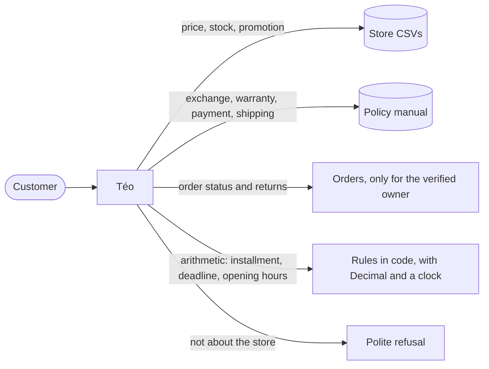
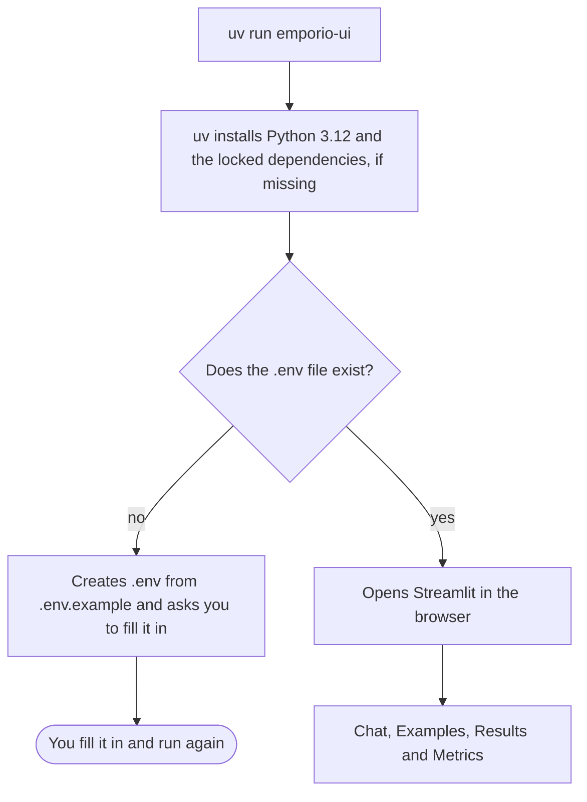
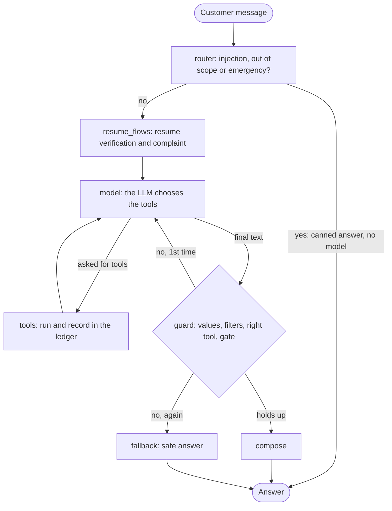
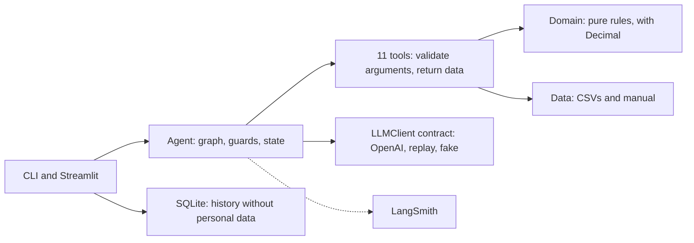
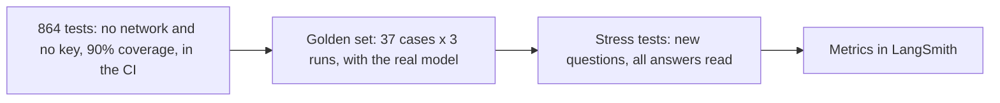
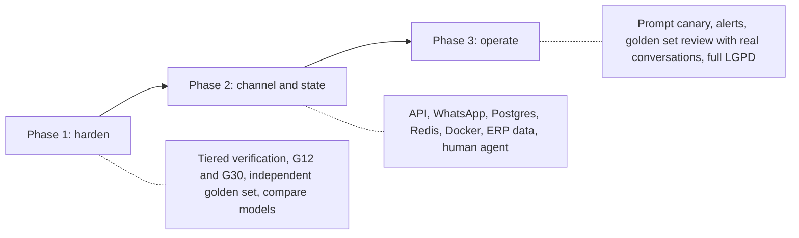

# Empório da Música: Téo, the customer service assistant

[](https://github.com/oericdacosta/emporio-assistant/actions/workflows/ci.yml)


A prototype of a text-message customer service agent for Empório da Música, a fictitious musical
instrument store in Campo Grande/MS (Brazil). Built for Artefact's AI Engineer technical challenge.

Téo answers about the catalog, prices, payment, shipping, opening hours, orders, returns and warranty, using
the store's real data (the CSVs and the policy manual), and politely refuses what is not the store's
business. It never invents a price, a deadline or a rule: whatever has a "right" answer comes from code; the
model only talks. The store, its customers and the agent's answers are in Brazilian Portuguese; this
documentation is in English.



## Contents

1. [How the challenge was met](#1-how-the-challenge-was-met)
2. [Quick start](#2-quick-start)
3. [How to use](#3-how-to-use)
4. [Example conversations](#4-example-conversations)
5. [Architecture](#5-architecture)
6. [Technical decisions](#6-technical-decisions)
7. [Tests and evaluation](#7-tests-and-evaluation)
8. [Assumptions made](#8-assumptions-made)
9. [Known limitations](#9-known-limitations)
10. [What I would do with more time](#10-what-i-would-do-with-more-time)
11. [Use of coding assistants](#11-use-of-coding-assistants)
12. [Project structure](#12-project-structure)
13. [Full documentation](#13-full-documentation)

---

## 1. How the challenge was met

Each request of the brief and where it is solved:

| The challenge asks | How it was met | Where to look |
|---|---|---|
| A Python project | Python 3.12, strict types | `src/emporio/` |
| A persona aligned with the store's identity and tone | Téo: a friend who knows music, informal and professional, short WhatsApp-style answers, as the manual asks (section 7.1) | [Decision D18](docs/technical-decisions.md#d18-prompt-strategy), `prompts/system.md` |
| Answer based on the available context | 11 tools over the CSVs and the manual; an answer without a source is blocked by the guard | [Architecture](docs/architecture.md#5-the-11-tools) |
| Know when to consult data and when to consult policies | Catalog, store and order tools for data; `search_policy` for rules, and the model chooses, with the choice visible in `--trace` | [D1](docs/technical-decisions.md#d1-the-approach-function-calling-with-deterministic-tools), [D6](docs/technical-decisions.md#d6-policy-lookup-without-embeddings) |
| Handle out-of-scope questions | A rule-based router before the model, plus a prompt rule and output filters | [D8](docs/technical-decisions.md#d8-the-scope-router-before-the-model) |
| Framework / approach justified | Function calling with deterministic tools and a LangGraph graph; no RAG | [D1](docs/technical-decisions.md#d1-the-approach-function-calling-with-deterministic-tools), [D3](docs/technical-decisions.md#d3-turn-orchestration-from-a-hand-written-loop-to-langgraph) |
| Model and provider justified | OpenAI `gpt-4.1-mini` behind our own contract | [D4](docs/technical-decisions.md#d4-model-and-provider) |
| Interface (CLI, API, UI) | CLI and Streamlit, opened with a single command | [D12](docs/technical-decisions.md#d12-interface) |
| History persistence | SQLite with no personal data, 30 days, resumable | [D10](docs/technical-decisions.md#d10-history-persistence) |
| Data handling | Validated load, `Decimal`, quality report, status that takes precedence over stock | [Data and policies](docs/data-and-policies.md) |
| Retrieval and prompt strategy justified | No embeddings, policy by topic; short prompt, with a stable prefix | [D6](docs/technical-decisions.md#d6-policy-lookup-without-embeddings), [D18](docs/technical-decisions.md#d18-prompt-strategy) |
| Public repository with real history | 145 commits in 35 pull requests, validated by the CI | [History](https://github.com/oericdacosta/emporio-assistant/commits/main) |
| Instructions to run | [Quick start](#2-quick-start): one command, on any system | below |
| Known limitations and what I would do with more time | Documented with numbers, and a plan to production | [Limitations](docs/limitations-and-evolution.md) |
| **Use of coding assistants** | Claude Code as a reviewer and evaluator of the code and a writing aid, and as support for research and for reasoning about the orchestration and the plan; also NotebookLM, to study papers, articles and documentation; the idea and the decisions are mine, and Claude Code was an evaluator and reviewer of the code. | [AI usage](docs/ai-usage.md) |
| 3 to 5 example conversations, at least one non-trivial | 5 conversations, with live data lookups and rule application | [Examples](#4-example-conversations) |
| Assumptions documented for what was ambiguous | Table of assumptions | [Assumptions](#8-assumptions-made) |

## 2. Quick start

### Prerequisites

- [uv](https://docs.astral.sh/uv/), the project's package and environment manager. It also downloads
  Python 3.12 if you do not have it. You do not need to install anything else.
- An OpenAI API key.

Install `uv` (once):

| System | Command |
|---|---|
| Linux and macOS | `curl -LsSf https://astral.sh/uv/install.sh \| sh` |
| Windows (PowerShell) | `winget install astral-sh.uv` or `powershell -c "irm https://astral.sh/uv/install.ps1 \| iex"` |

### Run, in three steps

```bash
# 1. download the project
git clone https://github.com/oericdacosta/emporio-assistant.git
cd emporio-assistant

# 2. run (the first time, it creates the .env file and asks you to fill it in)
uv run emporio-ui

# 3. open .env, fill in OPENAI_API_KEY and LLM_MODEL and run the same command again
uv run emporio-ui
```

The same command works on Linux, macOS and Windows. Where `make` exists (Linux, WSL, macOS), `make run` does
exactly the same thing. `uv run` creates the environment, installs the locked dependencies (`uv.lock`) and
opens the interface in the browser.



> Windows and macOS: the command is the same, but the project was developed and tested on Linux (Ubuntu
> and WSL). If something behaves differently on your system, the most likely cause is the environment.

### Configuration (`.env`)

| Variable | Required | What it does |
|---|---|---|
| `OPENAI_API_KEY` | Yes, to chat | OpenAI key |
| `LLM_MODEL` | Yes, to chat | OpenAI model. There is no default in the code, on purpose. The project was measured with `gpt-4.1-mini` |
| `AGENT_NOW` | No | Freezes the clock, for example `2026-03-23T10:00`. `.env.example` already brings this date, because the store's orders are from 2025 and 2026. Delete the line to use the real clock |
| `LANGSMITH_API_KEY` | No | Turns on tracing and the Metrics tab. Without it the app works and only warns |
| `LANGSMITH_TRACING` | No | `true` (default) or `false` |
| `LANGSMITH_PROJECT` | No | Project of the traces (default: `emporio-teo`) |
| `EMPORIO_HISTORY_DB` | No | Path of the history SQLite (default: `history/sessions.db`) |
| `EMPORIO_DATA_DIR` | No | Folder of the CSVs (default: `data/raw/`) |

> No key? You can still see the Examples tab (the 5 recorded conversations) and the Results tab (the
> author's test numbers), which do not call the model.

## 3. How to use

### Web interface (Streamlit)

`uv run emporio-ui` (or `make run`). The interface has four tabs, all in English. Téo itself answers in
Portuguese, and the clickable example questions are in Portuguese too:

| Tab | What it shows | Needs a key? |
|---|---|---|
| Chat | The chat with Téo, with clickable examples and 👍/👎 on each answer | Yes (OpenAI) |
| Examples | The 5 example conversations, with the queries the agent made in each turn | No |
| Results | The numbers measured by the author (turns, time, cost, guard, tool errors and per tool). Anyone who downloads the project sees the same ones | No |
| Metrics | The metrics of your own conversations, read from your LangSmith. It appears when you turn on evaluator mode in the sidebar | LangSmith |

### Command line

```bash
uv run emporio                                   # interactive conversation
uv run emporio --trace                           # shows the queries, tokens and latency of each turn
uv run emporio -m "Quanto custa o Takamine GD20?"   # one message, prints the answer and exits
uv run emporio --now 2026-02-20T10:00 -m "Posso devolver o pedido 7?"
uv run emporio --session ID                      # resumes a saved conversation
uv run emporio --check-data                      # validates the CSVs and the manual and exits
```

Inside the conversation (the commands are in Portuguese): `/ajuda` (help), `/novo` (another conversation;
the previous one stays saved), `/esquecer` (erases the history and the identity verification), `/trace`
(turns the trace on or off) and `/sair` (quit).

The CLI exits with distinct codes (ok, unexpected error, invalid usage, configuration, provider
unavailable, cassette, Ctrl-C), so it can be used in scripts.

### Shortcuts (`make`)

| Command | What it does |
|---|---|
| `make run` | A single command: installs what is missing and opens the web interface |
| `make chat` | Opens the conversation on the command line |
| `make test` | Runs the 864 tests (no key and no network) |
| `make cov` | Tests with line and branch coverage |
| `make lint`, `make type`, `make fmt` | `ruff`, strict `mypy`, formatting |
| `make eval EVAL_REPEAT=3` | The golden set with the real model, 3 runs per case (costs tokens) |
| `make eval-regression`, `make eval-capability` | Only the regression suite (the gate) or only the capability one |
| `make policies` | Extracts the manual from the PDF to Markdown |

## 4. Example conversations

Five conversations recorded with the real model (`gpt-4.1-mini`), in [`examples/conversations/`](examples/conversations/).
Each one shows the scenario, the dialogue as the agent really spoke it (in Portuguese) and a note on what
happens under the hood, with the queries the agent made in each turn (which show *when* it consults data and
when it consults policy). They also appear in the Examples tab of the interface.

| # | Conversation | What it shows |
|---|---|---|
| 1 | [Catalog search that continues across questions](examples/conversations/01-busca-com-contexto.md) | Lists guitars up to R$ 1000 and answers "which is the cheapest?" and "how much in 3x?": the agent remembers the list, and the installment is computed in code |
| 2 | [Closed store, out-of-scope accessory and back on topic](examples/conversations/02-loja-fechada-e-fora-de-escopo.md) | Sunday: says the store is closed and when it opens. Refuses strings and cables, refuses to reveal the prompt, and goes back to answering the price normally |
| 3 | [Return by regret, from the general rule to the order deadline](examples/conversations/03-devolucao-fora-do-prazo.md) | Non-trivial. The general rule; then it verifies the order and checks the 7-day deadline against the receipt date, in code |
| 4 | [Defective product: the store rule and a complaint protocol](examples/conversations/04-defeito-e-reclamacao.md) | Non-trivial. Shows empathy, explains the 30-day rule and registers a protocol with a return time |
| 5 | [Order status with identity verification](examples/conversations/05-status-de-pedido-com-verificacao.md) | Non-trivial. With the wrong e-mail, it reveals nothing and does not confirm that the order exists; with the right one, it gives status and tracking |

An excerpt of conversation 3, the application of a policy rule to a real order (the customer and Téo speak
Portuguese):

> **User:** Me arrependi da minha compra, posso devolver meu pedido?
>
> **Assistant:** Pode sim! Você tem até 7 dias corridos após o recebimento para devolver o produto, sem precisar
> justificar. Ele precisa estar na embalagem original, sem uso e com todos os acessórios. Me passa o número do
> pedido e o e-mail do cadastro (ou os 4 últimos dígitos do telefone) para eu verificar seu caso?
> *(consulted: `search_policy`)*
>
> **User:** É o pedido 7, recebi dia 17/02. Meu e-mail é leticia.rocha@jmail.com
>
> **Assistant:** Letícia, o prazo para devolução por arrependimento venceu em 24/02/2026, então não dá para fazer a
> devolução agora. Quer que eu encaminhe sua situação para a equipe analisar?
> *(consulted: `verify_customer`, `check_return_eligibility`)*

The code verified the customer and calculated the deadline. The model only understood that it was a regret
return and wrote the answer with the verdict already given.

## 5. Architecture

Each message becomes a turn, a graph of nodes (LangGraph). The model chooses tools and writes; the code
runs, validates and checks.



In layers, from the outside in:



Four ideas hold the design together:

- The model talks, the code decides. Price, opening hours, deadline and identity are testable code.
- The model only sees the world through the tools, and it never receives an exception: it receives data to
  correct itself.
- The answer is checked before it goes out. Every value, percentage, installment and tracking code must
  have a source.
- The agent does not know the concrete tools (an architecture test guarantees it), so the engine can change
  without touching them.

Details, with more diagrams, in [docs/architecture.md](docs/architecture.md).

## 6. Technical decisions

All of them are explained, with the choice, the reason, the discarded alternatives, the accepted cost and
when I would revisit, in [docs/technical-decisions.md](docs/technical-decisions.md). Summary:

| Decision | Choice | Why, in one line | Discarded alternative |
|---|---|---|---|
| [Approach](docs/technical-decisions.md#d1-the-approach-function-calling-with-deterministic-tools) | Function calling with deterministic tools | Small, structured data with arithmetic rules: exact lookup, not similarity | RAG, whole context, text-to-SQL, multi-agent |
| [Orchestration](docs/technical-decisions.md#d3-turn-orchestration-from-a-hand-written-loop-to-langgraph) | LangGraph graph | The flow gained branches (router, retry, fallback); each branch became an edge. It was a hand-written loop at first | Hand-written loop, LangChain, PydanticAI |
| [Model](docs/technical-decisions.md#d4-model-and-provider) | OpenAI `gpt-4.1-mini`, behind the `LLMClient` contract | Measured: 35 of 37 on the golden set, 1.7 s, about US$ 0.0017 per turn | A larger model, local, another provider |
| [Data](docs/technical-decisions.md#d5-data-handling) | Intact CSVs, immutable objects, `Decimal` | Money cannot be `float`; the numbers of the manual come from a JSON with a hash | pandas, SQL database |
| [Policies](docs/technical-decisions.md#d6-policy-lookup-without-embeddings) | `search_policy` by topic, literal text | Deterministic routing, visible in the trace | Embeddings, manual in the prompt |
| [Anti-hallucination](docs/technical-decisions.md#d7-the-grounding-guard) | Ledger of values, deterministic | A cheap check, identical in every run | LLM as a judge |
| [Scope](docs/technical-decisions.md#d8-the-scope-router-before-the-model) | Rules before the model | Cheaper and does not depend on the model obeying | LLM classifier |
| [Identity](docs/technical-decisions.md#d9-customer-identity) | Order plus a proof, in code | The order number is sequential, so it proves nothing | Let the model decide |
| [History](docs/technical-decisions.md#d10-history-persistence) | SQLite with no personal data, 30 days | Resume without keeping who the person is | JSON, history per customer |
| [Interface](docs/technical-decisions.md#d12-interface) | CLI and Streamlit, a single command | The focus is the agent, and the evaluator needs to see and test | API, notebook |
| [Streaming](docs/technical-decisions.md#d13-no-text-streaming) | Only progress events | The guard needs the full text | Token streaming |
| [Evaluation](docs/technical-decisions.md#d14-evaluation) | Deterministic golden set, 3 runs | Passing *always* matters more than passing *once* | Evaluate by eye, LLM as a judge |
| [Prompt](docs/technical-decisions.md#d18-prompt-strategy) | Short, in sections, stable prefix | It uses the cache (89% of the input) and the guarantees stay in code | The whole manual in the prompt |

What we do not use, and why: embeddings and a vector database, LangChain, LiteLLM, pandas, a SQL database
for the data, Redis, FastAPI, Docker, MCP, multi-agent, *fine-tuning*, LLM as a judge and token streaming.
Each one has its reason and the moment when it would start to make sense in the
[annex table](docs/technical-decisions.md#annex-technologies-we-do-not-use-and-when-they-would-start-to-make-sense).

## 7. Tests and evaluation



- 864 tests pass in about 25 s, without network and without a key (the model is a scripted *fake*), with 90%
  coverage. The CI runs lint, strict types, tests, a secrets scan and the commit standard.
- A golden set of 37 cases derived from the data (no value typed by hand), run 3 times per case, with
  deterministic checks. Last round: 35 of 37, with regression at 28 of 29. Median latency of 1.7 s.
- Three stress tests with new questions, reading all the answers: about 10% of the conversations still
  had some real problem, and the new defenses created minor defects. Everything is documented, with the
  numbers, in [docs/evaluation.md](docs/evaluation.md).

The two failures of the golden set: G12 (shipping to another city) chooses the wrong tool in 1 of 3 runs,
and the guard blocks it, so the customer receives the safe answer; G30 (delivery on Saturdays) infers
"Monday to Friday" from "business days", without the manual stating it.

## 8. Assumptions made

The challenge says to assume a reasonable interpretation when something is ambiguous and to document it. The
main ones:

- The product status takes precedence over stock: discontinued and "coming soon" are never sold, even with
  stock.
- A promotion only counts if it is active and the product is too (the CSV has no dates); with several, the
  largest applies, with no stacking; PIX does not stack with a promotion.
- The manual contradicts itself in a few points (phone and WhatsApp, e-mail, minimum installment): each
  decision is recorded and always used the same way.
- The store does not record the real receipt date: the delivery estimate serves as an approximation, the
  agent warns about it, and the date given by the customer takes precedence.
- Identity = order number plus the e-mail or the last 4 digits of the phone, because the data has no other
  identifier.
- The demo clock is 23/03/2026 (Monday, 10:00), because the data is from 2025 and 2026.
- Complaints are stored locally: the forwarding to management is simulated.

The full list, with the reason for each, is in
[docs/data-and-policies.md](docs/data-and-policies.md#9-assumptions-made).

## 9. Known limitations

What weighs the most:

- G12 and G30 fail in part, the defenses created four regressions (measured, not yet fixed) and about 10% of
  the stress conversations had some problem.
- Only the OpenAI adapter exists, and no other model was compared.
- Identity is single-factor. Someone's e-mail is not a secret, and this is the weakest point in security.
- The guard covers values, percentages, installments and tracking, but not deadlines in days, dates or stock.
- The data is static, the promotions have no validity and the receipt date is approximate.
- There is no real channel (HTTP API, WhatsApp), and the complaint is simulated.
- Everything runs on one machine: local SQLite, in-memory identity lockout, no Docker and no deploy.
- What the customer types goes to OpenAI and LangSmith. The notice exists in the CLI, but is still missing
  in the web interface.
- Windows and macOS were not tested; development was on Linux.

The full list, by area and with the impact of each point, is in
[docs/limitations-and-evolution.md](docs/limitations-and-evolution.md#1-known-limitations).

## 10. What I would do with more time



In order of value per effort:

1. Tiered identity verification (and later a one-time code).
2. Close G12 and G30 and the regressions the defenses created.
3. A bigger golden set written by someone else, with more runs per case, and compare models (a smaller one,
   a bigger one and a local one) on the same golden set.
4. HTTP API and WhatsApp channel, with PostgreSQL and Redis, and data coming from the store's system.
5. Container, staging, canary and prompt rollback, taking advantage of the fact that each turn already
   carries its hash.
6. A real human agent for where the assistant hands over.

The full plan to production, with the target architecture, cost, scale, operation and a checklist, is in
[docs/limitations-and-evolution.md](docs/limitations-and-evolution.md#3-towards-production-the-target-architecture).

## 11. Use of coding assistants

The idea and the decisions are mine. I used **Claude Code** (Anthropic) as an **evaluator and reviewer of
the code and as a writing aid**: it did not write the project alone, and I did not write it without it
either. It reviewed and evaluated what I was doing, pointed out problems and risks, suggested improvements
and helped me write parts. I also used it to **research and gather information**, to **relate it to the
store's problem** and as a counterpart to **reason about the agent's orchestration and the planning of the
project**. **I also used NotebookLM** (Google) to **read papers, articles and documentation**, ask questions
and **find connections** between the sources, which helped me plan **what to do, when to do it and how** with
the technologies I chose.

The starting point of each stage came from me; I defined the scope, **chose the technologies and the
alternatives**, **wrote and reviewed the code**, the tests and the evals with the help of Claude Code, and I
control the repository: **branches, commits and pull requests are made by me**.

The flow was: plan before coding, research with the date recorded (and study the sources in NotebookLM),
decide, implement in small steps with tests, **measure with the real model**, analyze the cause of each
failure and only then commit. What came from the AI was a starting point, not truth: it was rechecked at
the source and, in the decisions that matter, decided with **measurements from the project itself** (the
golden set, the stress tests with all the answers read and the CI). Details, including where the AI was not
enough, in [docs/ai-usage.md](docs/ai-usage.md).

## 12. Project structure

```
.
├── src/emporio/
│   ├── agent/          # the turn: graph, guard, router, filters, gate, state, session
│   ├── tools/          # the 11 tools and the registry that validates them
│   ├── domain/         # pure rules: price, opening hours, return, shipping, availability
│   ├── data/           # CSV loading, product search, policy manual, quality
│   ├── llm/            # LLMClient contract, OpenAI client, recording and replay
│   ├── cli/            # the command line
│   ├── web/            # the Streamlit interface: chat, examples, results, metrics
│   ├── prompts/        # system.md: Téo's prompt
│   ├── identity.py     # customer verification and lockout
│   ├── privacy.py      # personal data redaction
│   ├── observability.py# LangSmith tracing that never takes the service down
│   └── app.py          # the wiring: assembles the agent with the real tools
├── data/
│   ├── raw/            # the challenge's CSVs and PDF, intact
│   ├── policies.md     # the extracted manual, one section per chapter
│   ├── policy_rules.json   # the numbers of the manual, with the hash of the text
│   └── policies_notes.json # decisions about the contradictions in the manual
├── examples/conversations/  # the 5 example conversations (.md and .json)
├── evals/              # golden.yaml, runner, reports and the metrics snapshot
├── tests/              # 864 tests: unit, integration, contract, evals, live
├── scripts/            # manual extraction, spike, record examples, export metrics
├── docs/               # the full documentation
├── .github/workflows/  # CI
├── Makefile
└── pyproject.toml
```

## 13. Full documentation

| Document | What it explains |
|---|---|
| [docs/architecture.md](docs/architecture.md) | Layers, the flow of a turn, the 11 tools, the defenses, state and persistence, observability |
| [docs/technical-decisions.md](docs/technical-decisions.md) | Each decision, the discarded alternatives and why, and the technologies we do not use |
| [docs/data-and-policies.md](docs/data-and-policies.md) | The data, the inconsistencies, the contradictions in the manual and the business rules |
| [docs/security-and-privacy.md](docs/security-and-privacy.md) | Threat model, identity, prompt injection, personal data and LGPD |
| [docs/evaluation.md](docs/evaluation.md) | Tests, golden set, rounds, stress tests, metrics and what the failures taught |
| [docs/limitations-and-evolution.md](docs/limitations-and-evolution.md) | Limitations, what I would do with more time and the path to production |
| [docs/ai-usage.md](docs/ai-usage.md) | How Claude Code (code reviewer and writing aid) and NotebookLM supported the work, and who did what |
| [evals/README.md](evals/README.md) | How to run and read the evaluations |
| [data/README.md](data/README.md) | The data and the protection against drift in the manual |

## License

[MIT](LICENSE), © 2026 Eric da Costa.
