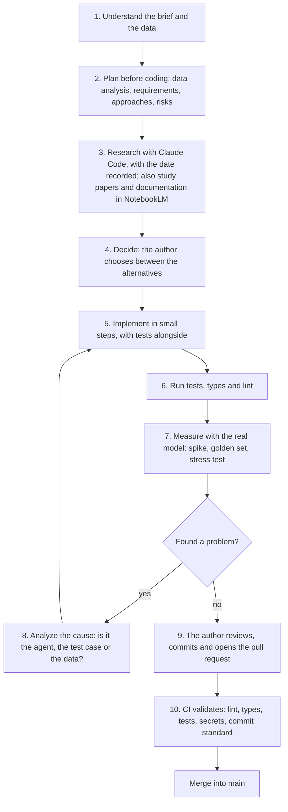
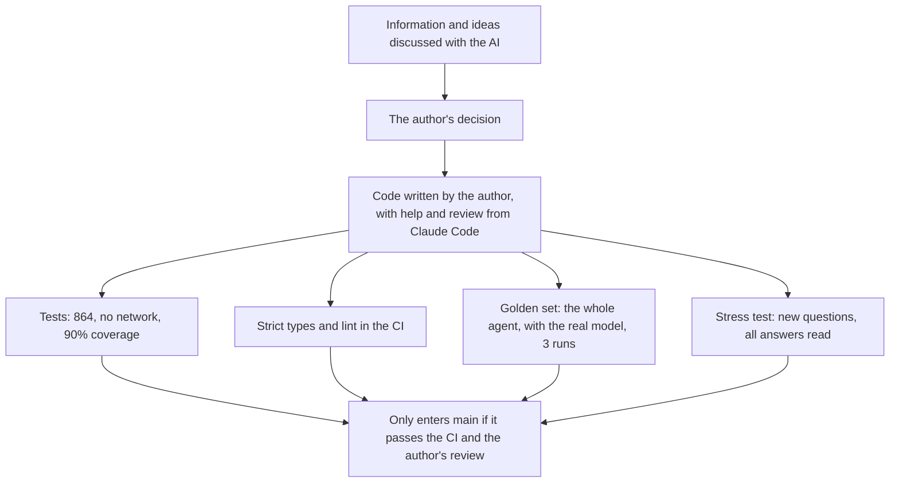

# Use of coding assistants

The challenge asks: *"if you make use of any AI resource (Copilot, Claude, Cursor, etc.), explain which one
you chose and how you used it. We want to understand your workflow."* This document answers candidly.

**Summary.** The idea and the decisions are mine. I used **Claude Code** (Anthropic) as a **reviewer and
evaluator of the code, and as a writing aid**: it reviewed and evaluated what I was doing, pointed out
problems and risks, suggested improvements and helped me write parts, and I decided what went in. I also
used it to **research and gather information**, to **relate** what I found to the store's problem, and as a
counterpart to **reason about the agent's orchestration and the planning of the project**. **I also used
NotebookLM** (Google) to **read papers, articles and documentation**, ask questions and **find connections**
between those sources, which helped me plan **what to do, when to do it and how** with the technologies I
chose.

The starting point of each stage came from me; the AI helped me think better and faster about it. What
matters here is **at which moments** I used it and **what I did to avoid trusting it blindly**.

## Contents

1. [The tools and the role of each one](#1-the-tools-and-the-role-of-each-one)
2. [The workflow](#2-the-workflow)
3. [Who did what](#3-who-did-what)
4. [How I validated what came from the AI](#4-how-i-validated-what-came-from-the-ai)
5. [Where the AI was not enough](#5-where-the-ai-was-not-enough)
6. [Points of attention](#6-points-of-attention)

---

## 1. The tools and the role of each one

| Tool | What I used it for | Why this one |
|---|---|---|
| **Claude Code** | Researching, relating what I found to the store's problem and reasoning about the orchestration and the plan | **It sees the whole project**: the questions depended on the real context (the CSVs, the manual, what already existed) |
| **NotebookLM** (also) | Reading papers, articles and documentation; asking questions; finding connections between the sources; planning what, when and how | It answers **from the sources I load**, citing the passage, so the doubt is settled in the original text |

### Claude Code: researching and reasoning about the project

**Claude Code**, Anthropic's command-line agent, works inside the repository: it reads the code and the
data, and searches the web when needed. Its role, in order of importance for the project:

1. **Reviewing and evaluating the code.** Reading what I wrote, pointing out defects, risks and cases I had
   not covered, and suggesting improvements. It also **helped me write** parts of the code, the tests and
   the documentation, which I reviewed, adjusted and decided whether they went in.
2. **Research and gathering information.** Comparing models, providers, frameworks and approaches, reading
   documentation, and recording the date of each query.
3. **Relating the information.** Helping connect what the research brought to the concrete problem of the
   store: data, manual, risks and constraints.
4. **Reasoning together.** Acting as a counterpart for me to **devise the agent's orchestration** and the
   **planning of the project**: discussing the alternatives I raised, pointing out risks and testing my
   arguments.

### Also: NotebookLM, to study the sources and plan

Besides Claude Code, **I also used NotebookLM**, from Google, which works on a set of sources that I choose.
I built notebooks with **papers, internet articles and the documentation of the technologies I chose** (for
example, LangGraph, the OpenAI API, LangSmith, Streamlit and Pydantic) and used them to:

1. **Read and ask questions.** Ask about a concept or a passage of documentation and receive the answer
   with the citation of the source, to check against the original.
2. **Find connections.** Cross what papers and articles say about agents, *tool calling*, evaluation and
   hallucination with what the documentation offers in practice.
3. **Plan the use of the technologies.** Turn that reading into a plan: **what to do, when to do it and how**
   with each technology, and in what order it would enter the project.

The two complement each other: NotebookLM to **study the sources**, Claude Code to **bring that into the
project** and reason about it.

### My role

The main part: **having the idea** and defining the problem and the scope, **choosing the technologies**,
**deciding between the alternatives**, **writing and reviewing the code**, the tests and the evals with the
help of Claude Code, running the experiments and **controlling the repository**. Nothing went in without me
reading it, understanding it and accepting it.

## 2. The workflow

The AI came in at stages **2, 3 and 8** (planning, researching and thinking about the cause of a problem)
and, at stage **5**, as a **reviewer and writing aid**: it evaluated what I implemented and helped me with
parts. The decisions, the execution of the tests and measurements and the git work were mine. In practice:

1. **Plan before coding.** Before the first line of code there was a planning phase, with reports by
   topic: requirements, data analysis, agent architecture, prompts, security and LGPD, test and evaluation
   strategy, CI, risks. I defined the topic and the question; the AI helped gather information and confront
   the options. It was at that moment that the traps in the data and the contradictions in the manual were
   mapped.
2. **Research with a date.** The comparison of models, providers and frameworks was done with web research
   and recorded the **date of the query**, because price and version age. The verification gaps were
   declared in the report itself.
3. **Study the sources, also in NotebookLM.** With the technologies chosen, I also read in **NotebookLM** the
   papers, articles and documentation about them, settled my doubts in the original text and put together the
   order of work: what to do, when and how.
4. **Small steps.** The project has **145 commits in 35 pull requests**, each with one intention (domain,
   tools, guard, CLI, evaluation...). The history is real, over **two days**, and not a single commit.
5. **Measure before believing.** A *spike* tested *tool calling* against the real tools before building the
   agent, and the golden set and the stress tests measured the result afterwards.

## 3. Who did what

```mermaid
flowchart LR
    subgraph AUT["The author: devises, decides, implements and controls"]
        A1["Has the idea and defines the problem, the scope and the priorities"]
        A2["Chooses the technologies and decides between the alternatives"]
        A3["Writes the code, the tests and the evals, with help, and reviews everything"]
        A4["Runs git: branches, commits and pull requests"]
    end
    subgraph IA["Claude Code: code reviewer, writing aid and research support"]
        I0["Reviews and evaluates the code and helps write"]
        I1["Researches and gathers information"]
        I2["Relates what it found to the problem"]
        I3["Discusses the orchestration and the plan"]
    end
    subgraph NB["Also: NotebookLM, study support"]
        N1["Reads papers, articles and documentation"]
        N2["Answers questions citing the source"]
        N3["Helps plan what, when and how"]
    end
    AUT -->|"questions, hypotheses and direction"| IA
    IA -->|"information, connections and counterpoints"| AUT
    AUT -->|"chosen sources and questions"| NB
    NB -->|"answers with citations and connections"| AUT
```

Concrete examples of what stayed **with the author**:

- **The orchestration.** The shape of the turn (router before the model, deterministic tools, guard before
  answering, fallback) came from me. The AI served to discuss and press on that idea, not to propose it
  ready-made.
- **The code.** The domain, the tools, the graph, the guard, the CLI, the interface and the tests were
  written by me **with the help of Claude Code**, which reviewed and evaluated what I was doing, pointed out
  problems and suggested improvements, and helped me write parts. I decided what went in and reviewed the
  result.
- **Git.** **Branches, commits and pull requests are mine**, and I choose what goes into each commit. That
  is why the history follows the project's standard (Conventional Commits, validated in the CI).
- **What stays out of the repository.** I decided to keep the planning reports and the drafts of the stress
  tests **out** of the repository; what goes in is the code, the data, the evals and the documentation.
- **Refusing shortcuts.** I refused to add experimental pieces to the solution (such as MCP or a
  demonstration RAG) that did not solve a problem of the project. The solution stayed with what the problem
  asks for.
- **Accepting what the measurement showed.** When the stress test revealed that the defenses created new
  defects, the decision was to **document it with the numbers** and not hide it.

## 4. How I validated what came from the AI

Information coming from an AI is a **starting point, not truth**. Nothing the research or the discussion
brought entered the project without going through one of these filters:

- **Check at the source.** Price, version and model capability were rechecked in the official documentation,
  and what could not be confirmed was declared as a gap. In NotebookLM, each answer points to the passage it
  came from, and that is where I checked before using it.
- **Choose the sources well.** NotebookLM only knows what is in the notebooks, so the quality of the answer
  depended on the sources I chose: official documentation and papers first, articles as a complement.
- **Measure in the project itself.** The choice of the model was not left to the research: it was decided
  with the **golden set and the real model** (see [D4](technical-decisions.md#d4-model-and-provider)).
- **Tests that test decisions, not just functions.** For example, an architecture test stops the agent from
  importing the concrete tools, and another guarantees that no model name is written in the code.
- **Read everything.** In the stress test, **all the answers were read** (159 in the first, 167 in the
  second), not just the automatic checks.
- **The CI as a third party.** Lint, types, tests, a secrets scan over the whole history and the commit
  standard, on every pull request.

## 5. Where the AI was not enough

An honest account of AI use includes its limits. Some, real ones:

| What happened | What it showed |
|---|---|
| The **first research reports** had prices and versions to recheck | AI research is a starting point: the gaps were declared and the final decisions rested on **measurements from the project itself** |
| The architecture discussion tended to **add pieces** (more layers, more technology) | More components is not more solution. The criterion was always the store's problem, and what solved nothing was left out, with the reason in the [annex of the decisions](technical-decisions.md#annex-technologies-we-do-not-use-and-when-they-would-start-to-make-sense) |
| The **business rules** (what the store accepts, how to resolve the contradictions in the manual) have no answer in research | Those decisions were mine, made from the data, and are recorded in [data-and-policies.md](data-and-policies.md#9-assumptions-made) |
| The **agent's defects** only appeared with the real model and with new questions | No discussion replaces measurement. The golden set became a regression gate, and the balance is in [evaluation.md](evaluation.md#the-balance) |

## 6. Points of attention

- **The AI speeds up research, it does not replace it.** It brings information fast, but the responsibility
  to check lies with whoever decides. That is why each piece of research has a date and declared gaps.
- **A study plan is not a project plan.** NotebookLM helped organize what, when and how to do with each
  technology, but the real order was adjusted by what the tests and measurements showed.
- **The AI knows what is in its context.** Decisions that depend on knowledge of the business (what the
  store accepts, what the real customer asks) need people from the store: here they were assumed and
  documented in [data-and-policies.md](data-and-policies.md#9-assumptions-made).
- **A good reviewer also errs.** Claude Code pointed out problems in the code, but not every suggestion was
  good: I checked each one against the tests and the data before accepting it.
- **A good counterpart is not a good judge.** Discussing with the AI helped me see alternatives and risks,
  but the verdict on what works came from the tests and the measurements, and even so limits remained (see
  [limitations-and-evolution.md](limitations-and-evolution.md)).
- **In the documentation, the AI helped organize and review the text.** The content, the decisions and the
  numbers are mine; the numbers come from the evaluation reports and the exported metrics, which are in the
  repository (`evals/reports/`) and can be checked.
