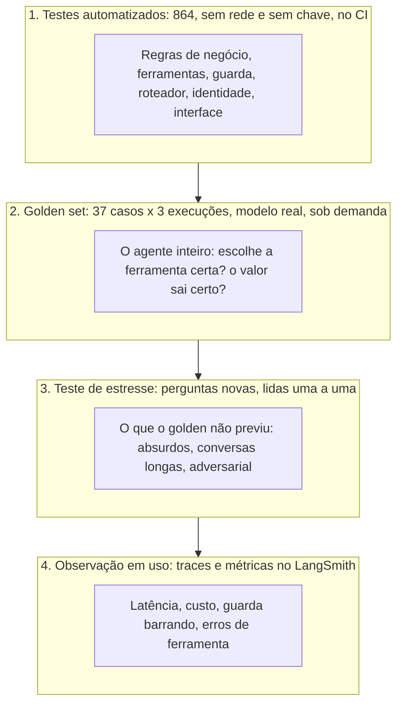
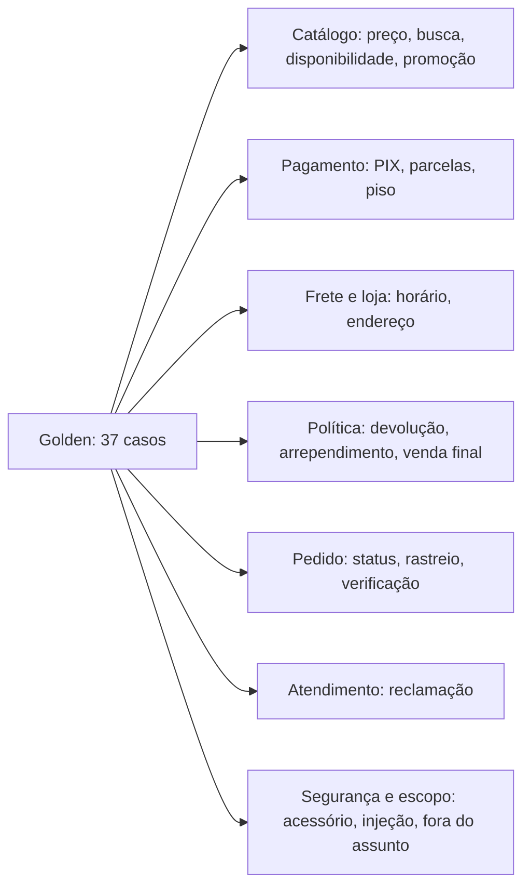
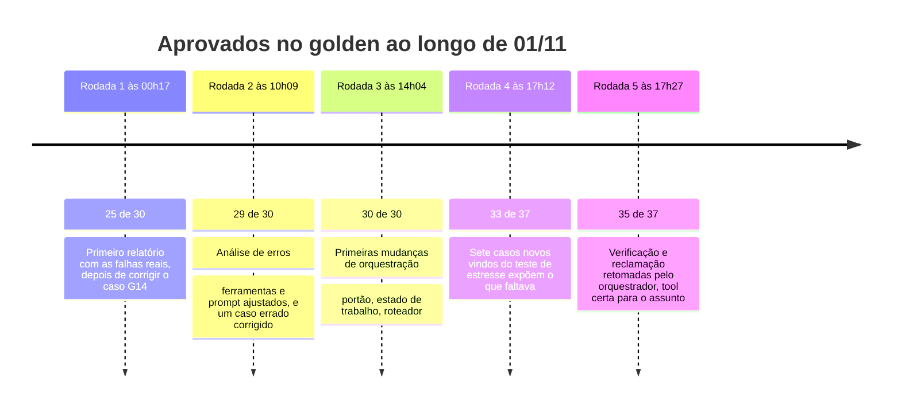
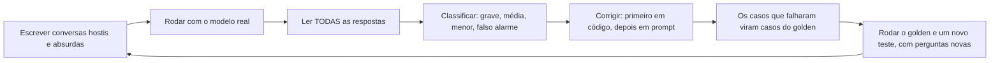
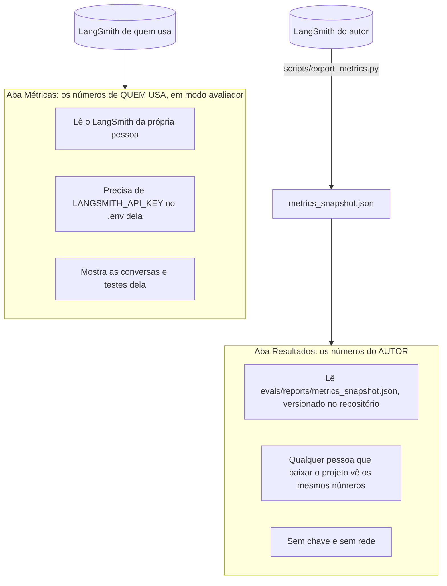
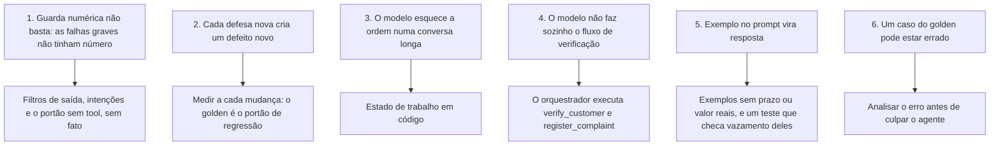

# Avaliação: como sabemos que o Téo funciona

"Parece que funciona" não é uma medida. Este documento mostra como o projeto é testado e avaliado, o que
foi medido, o que falhou e o que cada falha ensinou. Os números são reais, vieram de execuções com o modelo
de verdade, e as falhas estão aqui sem edição.

## Sumário

1. [Quatro camadas de verificação](#1-quatro-camadas-de-verificação)
2. [Testes automatizados](#2-testes-automatizados)
3. [O golden set](#3-o-golden-set)
4. [As rodadas de avaliação](#4-as-rodadas-de-avaliação)
5. [Testes de estresse](#5-testes-de-estresse)
6. [As abas Resultados e Métricas](#6-as-abas-resultados-e-métricas)
7. [O que as falhas ensinaram](#7-o-que-as-falhas-ensinaram)
8. [Como rodar tudo](#8-como-rodar-tudo)
9. [Limites desta avaliação](#9-limites-desta-avaliação)

---

## 1. Quatro camadas de verificação

Cada camada pega um tipo de erro que a anterior não pega, e custa mais.



| Camada | O que pega | Custo | Roda no CI? |
|---|---|---|---|
| Testes automatizados | Regra errada, contrato quebrado, regressão de código | Zero | Sim |
| Golden set | O agente escolhendo a ferramenta errada, valor errado, tom robótico | Tokens | Não, sob demanda |
| Teste de estresse | Falhas que ninguém previu | Tokens e leitura humana | Não |
| Observação | Deriva de custo, latência e qualidade ao longo do tempo | Quase zero | Não |

## 2. Testes automatizados

864 testes passam, com 90% de cobertura de linhas e ramos, e rodam em cerca de 25 segundos, sem rede
e sem chave: o modelo é substituído por um *fake* roteirizado, e os testes bloqueiam a rede para nenhum
deles chamar o provedor por acidente.

| Pasta | Testes | O que cobre |
|---|---|---|
| `tests/unit/` | 742 | Domínio (preço, horário, devolução, frete), dados, busca, políticas, ferramentas, guarda, filtros, roteador, estado, sessão, identidade, cliente do modelo, CLI, métricas |
| `tests/integration/` | 44 | Conversas completas com modelo roteirizado, a CLI como processo real, a interface Streamlit de ponta a ponta |
| `tests/evals/` | 54 | O próprio sistema de avaliação: checagens, relatório, integração com LangSmith, coerência do golden com os dados |
| `tests/contract/` | 22 | O contrato das ferramentas: campos monetários sempre texto, esquemas, nomes fixos |
| `tests/live/` | 8 | Conversas contra o provedor real. Nunca rodam no CI: exigem `EMPORIO_LIVE=1` e chave |

Algumas verificações que merecem destaque, por testarem decisões de projeto e não só funções:

- Arquitetura: um teste lê o código com `ast` e falha se o pacote `agent/` importar `emporio.tools`.
- Nenhum nome de modelo no código-fonte (`src/`): a configuração é por variável de ambiente.
- Contrato de dinheiro: nenhum campo `*_brl` pode ser um número cru, porque a guarda não o enxergaria.
- Deriva do manual: se `policies.md` mudar sem o `policy_rules.json` ser conferido, um teste falha.
- Dados reais: o teste de qualidade fixa as inconsistências conhecidas (produtos 96, 130 e 136, pedidos 3
  e 20, e assim por diante). Se alguém mexer nos CSVs, o teste avisa.
- A interface: testes do Streamlit sem navegador verificam as abas, os avisos e o resumo de métricas.

## 3. O golden set

O golden é um conjunto de 37 conversas de referência (`evals/golden.yaml`), cada uma com o que o agente
deve e não deve fazer. Cobre as 13 intenções do atendimento:



| Intenção | Casos | Intenção | Casos |
|---|---|---|---|
| Disponibilidade | 3 | Pagamento | 5 |
| Reclamação | 3 | Preço de produto | 1 |
| Status de pedido | 4 | Busca de produto | 3 |
| Fora do escopo | 4 | Promoção | 3 |
| Segurança | 4 | Elegibilidade de devolução | 1 |
| Frete | 3 | Política de devolução | 2 |
| Informações da loja | 1 | | |

Como um caso é escrito. Nenhum valor é digitado à mão. Um marcador como `{price:95}` é calculado dos CSVs
na hora da avaliação (`evals/facts.py`), e `assume:` declara a situação dos dados de que o caso depende
("o produto 95 está disponível", "a promoção está inativa"). Um teste confere. Se os dados mudarem, o golden
acompanha ou avisa, em vez de ficar mentindo em silêncio.

```yaml
- id: G13-loja-fechada-no-domingo
  intent: store_info
  now: "2026-03-22T10:00:00-04:00"      # o relógio do caso: um domingo
  turns: ["Vocês estão abertos agora? E qual o endereço?"]
  hard:
    tools:
      must: [{name: get_store_info}]     # tem de consultar a loja
    contains:
      - ['fechad', 'nao (estamos|abrimos)']   # diz que está fechada
      - ['segunda', 'amanha']                 # e quando abre
      - '{address}'                           # com o endereço correto, vindo dos dados
    forbidden: ['(?<!nao )estamos abertos']   # nunca afirma que está aberta
```

Duas severidades.

- HARD reprova o caso: ferramenta chamada ou não, valor exato, termo proibido, resposta segura entregue
  no lugar da resposta, tom robótico.
- SOFT só é reportado: frases esperadas (que mudam de modelo para modelo) e itens de completude.

Padrões são expressões regulares comparadas com a resposta sem acento e em minúsculas, e um item em lista
vale como "qualquer um destes".

Duas suítes.

- `regression` (29 casos): o que o agente já acerta. Tem de ficar em 100%: se um caso cai, o comando
  sai com erro. É o portão contra regressão.
- `capability` (8 casos): os casos difíceis, ainda não dominados. Só medem o quanto falta e não
  quebram. Um caso sobe para `regression` quando passa em todas as execuções por um tempo.

Três execuções por caso, e duas métricas. Em atendimento ao cliente, passar "uma vez das três" não basta:

| Métrica | Pergunta que responde | Por que importa |
|---|---|---|
| `pass@1` | Em média, uma execução passa? | A taxa por execução |
| `pass@3` | Ao menos uma das três passou? | O modelo *consegue* acertar |
| `pass^3` | Todas as três passaram? | O modelo acerta sempre: é o que o cliente sente |

Um caso com `pass@3` alto e `pass^3` baixo é um caso instável, e é o que mais interessa achar.

## 4. As rodadas de avaliação

Foram cinco rodadas completas do golden com o modelo real, no mesmo dia, cada uma depois de uma onda de
correções. O relatório de cada uma está versionado em `evals/reports/`.



| # | Rodada | Prompt | Aprovados | Custo da rodada | Latência mediana | O que a rodada ensinou |
|---|---|---|---|---|---|---|
| 1 | Primeira, após corrigir o G14 | `418fde966d` | 25/30 | n/d | 1,7 s | Falhas reais: o exemplo do prompt trazia prazo de devolução digitado (o agente copiava em vez de consultar) |
| 2 | Análise de erros | `21eda0c10c` | 29/30 | n/d | 1,8 s | 3 falhas eram do agente (descrição de ferramenta e prompt) e 1 era do caso, que punia a regra geral citada corretamente |
| 3 | Orquestração | `26b9b13d76` | 30/30 | US$ 0,19 | 1,8 s | O portão "sem tool, sem fato" chegou a barrar frases legítimas (G20, G22) antes do ajuste |
| 4 | Com 7 casos novos | `26b9b13d76` | 33/37 | US$ 0,24 | 2,0 s | Reprovaram G12, G28, G31, G32 |
| 5 | Rodada final | `26b9b13d76` | 35/37 | US$ 0,21 | 1,7 s | G28, G31 e G32 passaram. G12 e G30 ficaram instáveis |

> O custo e a latência das rodadas 3 a 5 vêm dos experimentos do LangSmith. As rodadas 1 e 2 não têm
> experimento (o LangSmith foi ligado depois), então aparecem só com o que o relatório registrou.

### O resultado final em detalhe

35 de 37 casos aprovados (pass^3). Por suíte: regressão 28/29 e capacidade 7/8. Em 111 execuções
(37 × 3): 17 com aviso SOFT, a guarda barrou 14 (a maioria se corrigiu no retry e uma virou resposta segura),
latência mediana de 1,7 s e máxima de 6,4 s, 1,45 milhão de tokens de entrada, 89% deles vindos do
cache, e 10,8 mil de saída.

Por intenção, 12 das 13 estão em 100% em `pass^3`. A exceção é frete: 1 de 3 casos em `pass^3` e 6 de
9 execuções.

### As duas falhas

G12 ("Quanto fica o frete pra Dourados?"): instável, passou 2 de 3 execuções. O esperado é consultar
`estimate_shipping` ou `search_policy`. Em uma das execuções o modelo chamou `get_store_info` (a ferramenta
errada para frete), a guarda de intenções barrou duas vezes, e o cliente recebeu a resposta segura:
"Essa informação eu não tenho confirmada aqui... pode me chamar no WhatsApp". Ou seja: o sistema falhou de
forma segura (nenhum valor inventado), mas a resposta foi menos útil do que deveria. A defesa
funcionou, e o modelo ainda escolhe mal a ferramenta em uma execução de cada três.

G30 ("Vocês entregam aos sábados?"): falhou em 2 de 3 execuções. O manual diz "1 a 3 dias úteis" e não
fala de sábado. Em duas execuções o modelo inferiu "a entrega é de segunda a sexta, não aos sábados", e o
caso espera que ele diga que "dias úteis" é o que o manual informa, ou que vai confirmar com a equipe. É a
classe de erro mais difícil de pegar em código: uma inferência plausível, sem número, que o manual não
sustenta. A guarda numérica não a vê. Está em `capability`, que é o lugar dela.

## 5. Testes de estresse

O golden mede o que eu previ. Para achar o que eu não previ, foram feitos três testes de estresse
manuais: conversas novas, escritas para tentar quebrar o agente, com todas as respostas lidas uma a uma
(não só as checagens automáticas).



| | Teste 1 | Teste 2 | Teste 3 (final) |
|---|---|---|---|
| Conversas e turnos | 91 conversas, 159 turnos | 99 conversas, 167 turnos | Os 4 casos que falhavam, o golden e o teste 2 de novo, mais 37 variações |
| Cobriu | Catálogo, políticas, pedidos, segurança, injeção, fora de escopo, entradas absurdas, conversas longas (até 26 turnos) | Perguntas novas nas mesmas áreas | As mesmas perguntas do teste 2, mais variações novas |
| Respondeu sem erro | 159 de 159 | Sem exceção do provedor | Sem exceção |
| Latência mediana | 1,4 s | +13% (cerca de 1,6 s) | 1,5 s |
| Custo por turno | US$ 0,0013 | US$ 0,0020 (+51%) | US$ 0,0019 (+45% sobre o teste 1) |
| Entrada vinda do cache | 87% | n/d | n/d |
| Falhas reais | 10 (5 graves, 5 médias) mais 7 menores | ~9 conversas com problema | 7 corrigidas das 9; 4 regressões novas |
| A guarda e o portão barraram | 0 turnos (a guarda numérica) | As defesas novas pegaram 3 erros reais antes do cliente | 9 a 15 vezes por teste (o portão) |

### O que o teste 1 achou

As falhas graves eram afirmações inventadas ou erradas que não têm número (estacionamento e política de
cachorro, nota fiscal, divisão de pagamento, um produto de exemplo do prompt citado como se fosse real) e
uma recusa indevida de um pedido já verificado. As médias eram de fluxo e escopo: reclamação sem protocolo,
busca que inventa um teto de preço, código em Python escrito a pedido, esquema das ferramentas despejado e
frete para Miami tratado como cidade brasileira.

A guarda numérica não barrou nenhuma resposta em 159 turnos. O teste não a exercitou,
e todas as falhas estavam fora do alcance dela. Dali saiu a conclusão de que faltavam camadas.

### O que mudou depois

Sete melhorias de orquestração, não de prompt (código antes de texto): evidência exigida em código,
estado de trabalho da conversa, roteador de escopo, contratos de ferramenta com sinal (filtro de preço que o
cliente nunca deu, busca que relaxa, destino do frete), fluxo de reclamação com estado, ferramenta de total
do carrinho, e ganchos finais controlados pelo estado. Os testes passaram de 589 para 758.

### O balanço

Do teste 2 para o 3: das 9 conversas com problema real, 7 foram corrigidas (conserto e aula inventados,
ar-condicionado e animais inventados, "status do 17?" sem verificar, troca de pedido na conversa,
reclamação com e-mail e com telefone, e memória em conversa longa). Duas melhoraram só em parte.

Mas apareceram 4 regressões novas, causadas pelas próprias defesas: frete para o exterior (Paraguai,
Miami, Portugal) voltou a ser respondido como entrega normal; "quero fechar um pedido" respondeu com o horário
da loja; um cliente desabafando recebeu a resposta segura; uma queixa com e-mail virou protocolo em vez de
checar a devolução.

E o resultado agregado: a taxa de conversas com problema real ficou em torno de 10% nos dois testes (10
de 91 antes, 9 de 99 depois). Mudou quais, não quantas. Com perguntas diferentes e uma execução cada, não
dá para afirmar que isso seja uma melhoria global. Esse é o número que mais pesa no balanço: as defesas resolveram
classes inteiras de erro e criaram outras, de menor gravidade.

## 6. As abas Resultados e Métricas

A interface web tem duas abas de números, com donos diferentes:



A aba Resultados mostra o resumo do período e o por ferramenta, sobre os 729 turnos do projeto
de testes do autor (conversas de desenvolvimento, testes de estresse e exemplos). A aba Métricas mostra,
além disso, os turnos da conversa atual, a resposta segura, a aprovação do cliente e o desempenho por versão do
prompt.

Os dez indicadores do resumo:

| Indicador | O que mede | Valor nos testes do autor |
|---|---|---|
| Turnos | Quantas respostas | 729 |
| Tempo mediano | Metade dos turnos respondeu em menos que isso (p50) | 1,6 s |
| Tempo dos mais lentos | 95% responderam em menos que isso (p95) | 3,3 s |
| Custo total | Soma do custo no LangSmith | US$ 1,26 |
| Custo por turno | Custo total dividido pelos turnos | US$ 0,0017 |
| Corrigidas pela guarda | Turnos em que a guarda barrou a 1ª resposta e o modelo se corrigiu | 7% |
| Guarda barrou | Turnos em que a guarda barrou ao menos uma resposta | 7% |
| Erros de tool | Consultas que voltaram com erro, entre todas as consultas | 10% |
| Consultas por turno | Média de ferramentas chamadas em cada turno | 1,0 |
| Entrada vinda do cache | Parte dos tokens de entrada reaproveitada do cache do provedor | 79% |

Como ler esses números com cuidado.

- O período mistura tráfego de desenvolvimento e de estresse, que tentava quebrar o agente. Isso
  explica os 10% de erros de ferramenta (argumentos que o modelo errou e se corrigiu) e a alta taxa de
  correção pela guarda. Não é o perfil de um uso normal.
- A foto é de uma data e do prompt `26b9b13d76`. Quem mexer no prompt deve rodar o golden de novo e
  reexportar (`uv run python scripts/export_metrics.py`).
- Os traces comuns costumam ficar só cerca de 14 dias no plano gratuito do LangSmith (confira no seu plano): por isso a foto existe.
- A foto só tem números: nenhum texto de conversa.

## 7. O que as falhas ensinaram



1. Cada camada de defesa cobre uma classe de erro. A guarda numérica era precisa e estreita; o que
   escapava eram afirmações sem número. Daí o portão "sem tool, sem fato".
2. Defesa nova cria defeito novo. O portão barrou frases legítimas; a regra de "tool certa" fez um
   "quero fechar um pedido" responder com horário. Por isso o golden é um portão de regressão e cada rodada
   é registrada.
3. Memória em conversa longa é um problema de código, não de prompt. O estado de trabalho resolveu.
4. O modelo não executa o fluxo de verificação de forma confiável. Quando o cliente já deu o pedido e a
   prova, o orquestrador chama `verify_customer` em código.
5. Exemplos no prompt vazam. Um exemplo com prazo de devolução digitado virou a resposta do agente. Hoje os
   exemplos não trazem valores reais, e a guarda barra os nomes e e-mails fictícios deles, com um teste que
   confere que essa lista cobre o arquivo do prompt.
6. O instrumento também erra. Um dos casos do golden (G27) punia o agente por acertar; foi a análise
   de erros que revelou. Antes de consertar o agente, conferir o caso.

## 8. Como rodar tudo

```bash
make test                       # os 864 testes, sem chave e sem rede
make cov                        # com cobertura de linhas e ramos
make lint && make type          # ruff e mypy estrito

make eval                       # o golden, 1 execução por caso (chama o modelo: custa tokens)
make eval EVAL_REPEAT=3         # 3 por caso: um caso só passa se passar nas três
make eval-regression            # o portão: só a suíte regression, sai com 1 se algum cair
make eval-capability            # só a suíte capability: mede o que falta, não quebra
make eval-regress               # compara com a referência antes de mexer em prompt ou modelo

uv run python -m evals.run --only G1 --label depois-do-ajuste   # um caso, sem sobrescrever o relatório
uv run python scripts/record_examples.py                        # regrava as 5 conversas de exemplo
uv run python scripts/export_metrics.py                         # reexporta a foto das métricas do LangSmith
```

Os relatórios saem em `evals/reports/` (Markdown versionado) e, com `LANGSMITH_API_KEY`, cada execução vira
também um experimento no LangSmith, com o dataset `emporio-golden`. O portão não depende do
LangSmith: o relatório e o código de saída saem das execuções locais.

## 9. Limites desta avaliação

Onde esta avaliação não é confiável:

| Limite | Efeito |
|---|---|
| Três execuções por caso | Os números são grosseiros: 1/3 e 2/3 pesam parecido, e não há intervalo de confiança |
| O golden foi escrito por quem escreveu o agente | Risco de viés e de sobreajuste. Os testes de estresse, com perguntas novas, existem para compensar, mas também foram escritos pelo autor |
| Os testes de estresse tiveram uma execução por conversa | Uma falha vista uma vez pode ser rara ou frequente: a frequência não foi medida |
| Temperatura 0 nos evals, 0,2 no app | Os evals medem o modelo mais estável do que o cliente verá |
| Um só modelo e um só provedor | Não há comparação lado a lado com outros modelos |
| Sem avaliação humana de qualidade | Tom, empatia e clareza foram lidos pelo autor, sem nota de terceiros nem pesquisa com clientes |
| Dados fictícios e relógio congelado | Não mede o comportamento com a carga e a variedade de um atendimento real |
| As métricas misturam desenvolvimento e estresse | Não representam um uso normal |
| Os testes ao vivo (`tests/live`) não rodam no CI | Uma regressão de modelo só aparece quando alguém roda o golden |

O que eu faria com mais tempo para fechar esses limites está em [limitacoes-e-evolucao.md](limitacoes-e-evolucao.md).
