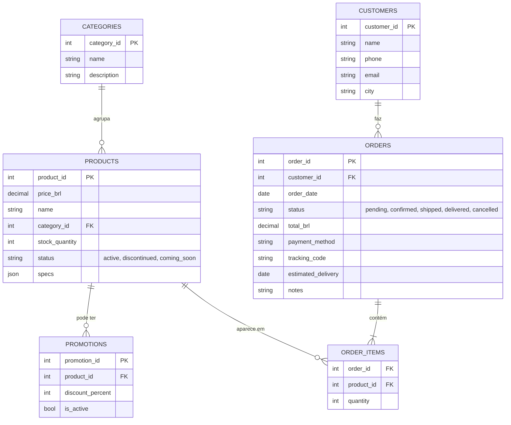
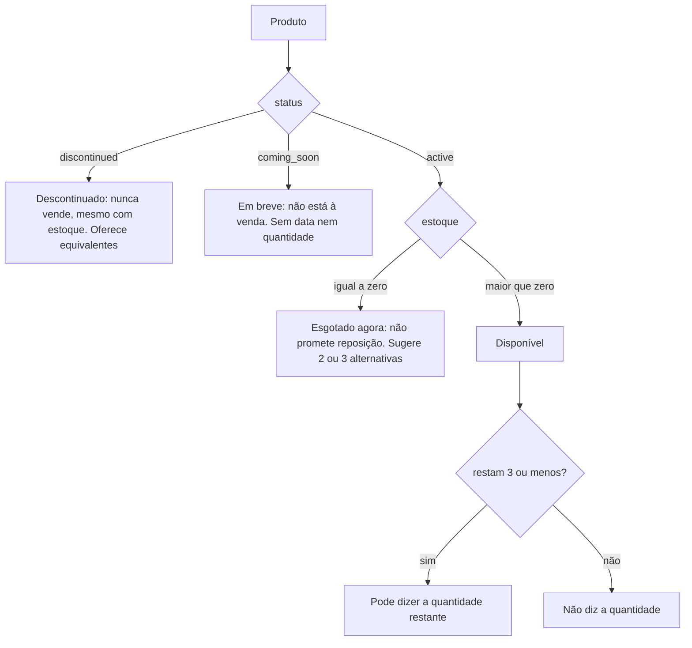
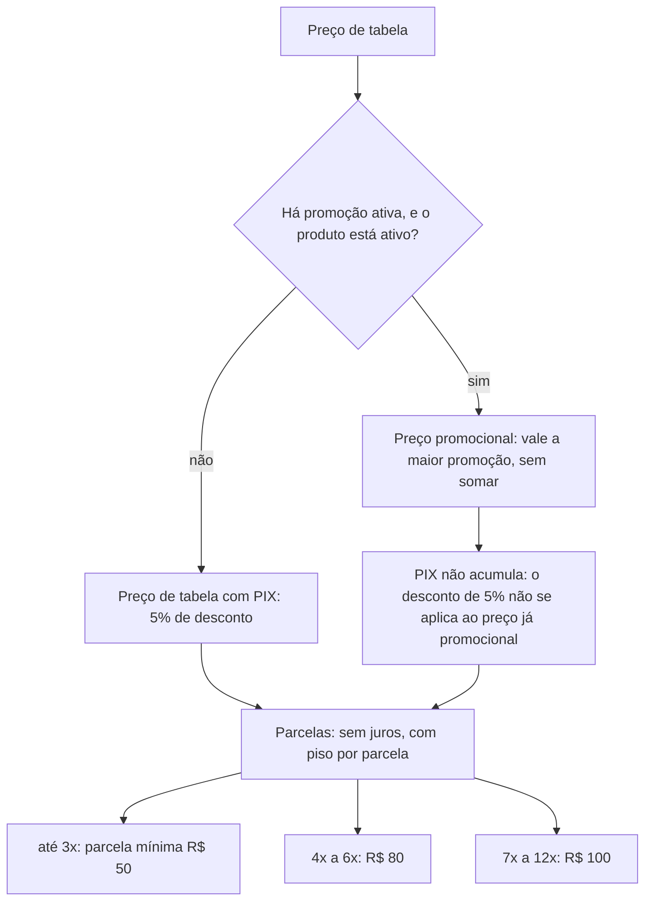
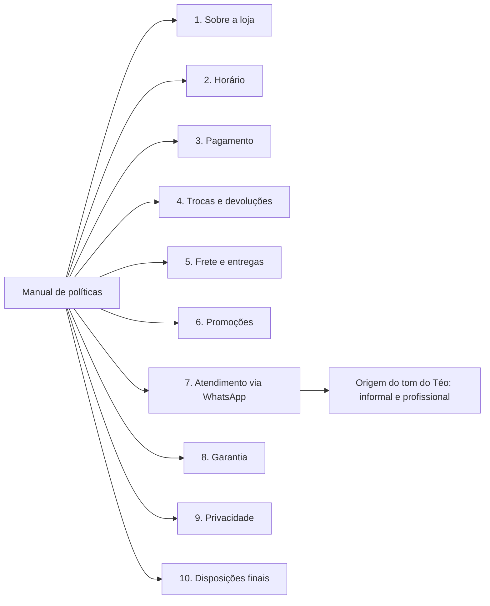
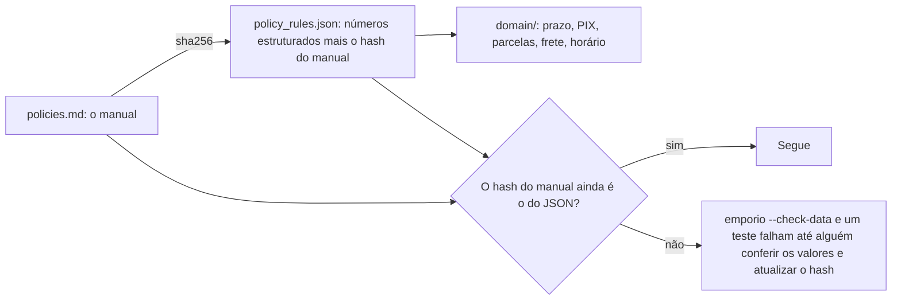
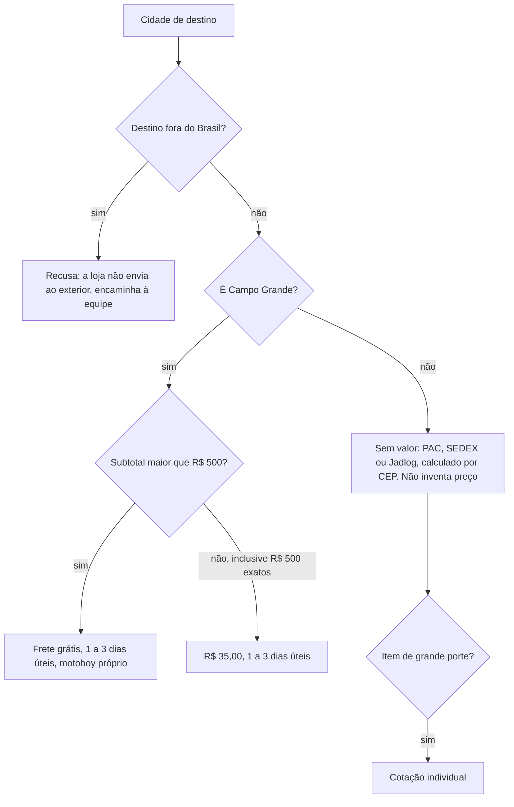
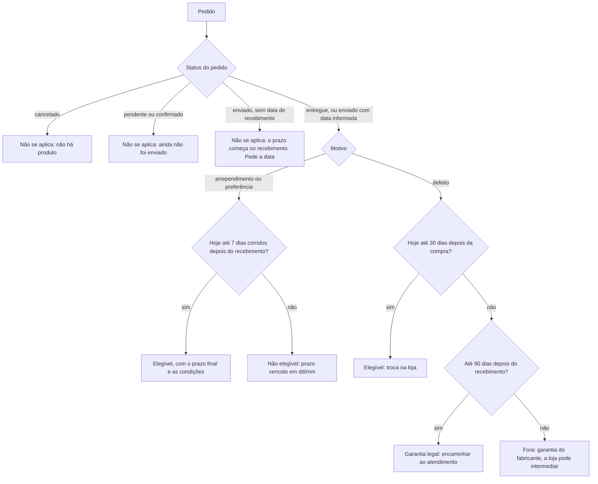

# Dados e políticas

O desafio entrega seis tabelas CSV e um manual de políticas em PDF, e diz: *"você não é obrigado a utilizar
todos os dados; faça o tratamento que julgar necessário"*. Este documento mostra o que há nos dados, o que
está estranho neles, como cada problema é tratado e quais regras do manual viraram código.

## Sumário

1. [O que foi entregue](#1-o-que-foi-entregue)
2. [As tabelas e como se relacionam](#2-as-tabelas-e-como-se-relacionam)
3. [O que está estranho nos dados](#3-o-que-está-estranho-nos-dados)
4. [Como um produto fica "à venda"](#4-como-um-produto-fica-à-venda)
5. [O manual de políticas](#5-o-manual-de-políticas)
6. [Contradições do manual e a decisão tomada](#6-contradições-do-manual-e-a-decisão-tomada)
7. [Do manual ao código: regras e proteção contra deriva](#7-do-manual-ao-código-regras-e-proteção-contra-deriva)
8. [As regras de negócio, uma a uma](#8-as-regras-de-negócio-uma-a-uma)
9. [Suposições assumidas](#9-suposições-assumidas)

---

## 1. O que foi entregue

| Arquivo | Linhas de dados | O que é |
|---|---|---|
| `categories.csv` | 9 | Categorias de instrumentos |
| `products.csv` | 65 | Catálogo: preço, estoque, status, especificações |
| `promotions.csv` | 25 (4 ativas) | Descontos por produto |
| `customers.csv` | 50 | Nome, telefone, e-mail, cidade |
| `orders.csv` | 20 | Pedidos, com status, total, pagamento, rastreio e previsão |
| `order_items.csv` | 22 | Itens de cada pedido |
| `politicas_da_loja.pdf` | 8 páginas, 10 capítulos | Manual interno de atendimento |

Todos ficam intactos em `data/raw/`. O que o projeto deriva deles (manual em Markdown, regras em JSON,
notas de decisão) fica ao lado, em `data/`.

## 2. As tabelas e como se relacionam

O que não existe nos dados, e que molda várias decisões: não há CPF, senha ou código secreto do cliente;
não há data real de recebimento (só a *previsão* de entrega); as promoções não têm data de vigência (só um
indicador `is_active`); e não há um id aleatório de pedido (os ids são sequenciais).

## 3. O que está estranho nos dados

O projeto não "limpa" os dados. Ele detecta e trata cada problema em código. O relatório de qualidade
(`CsvRepository.quality_report()`, em `data/quality.py`) levanta as contagens abaixo, e os testes as fixam.

| # | O que está estranho | Onde | Como o agente trata |
|---|---|---|---|
| 1 | Produto ativo com estoque zero | Produto 96 (Giannini GF-3D) | Fica "esgotado": não vendável, e o agente oferece alternativas |
| 2 | Produto "em breve" com estoque 2 | Produto 130 (Kala KA-ABP-CTG) | O status manda: nunca confirma unidades nem diz que está à venda |
| 3 | Produto descontinuado com estoque 13 | Produto 136 (Ibanez Bass 2X) | O status manda: saiu do catálogo, mesmo com estoque. Oferece equivalentes |
| 4 | Total do pedido diferente da soma dos itens | Pedidos 3 (R$ 3.450 contra R$ 3.498) e 20 (R$ 1.400 contra R$ 1.488) | Mostrado como "total registrado", sem recalcular nem prometer o valor |
| 5 | Parcela abaixo do piso da regra do manual | Pedidos 9, 16 e 18 | Só é relatado; a regra vale para novas consultas de parcelamento |
| 6 | Dois clientes com o mesmo e-mail | Clientes 11 e 43 (Bruno Carvalho Martins e Bruno Martins) | A verificação é por pedido, contra o dono dele. Veja a nota abaixo |
| 7 | Três categorias sem nenhum produto | Sopro (madeiras), Sopro (metais), Cordas orquestrais | O agente confirma com `search_products` e diz que não há, sem inventar instrumento |
| 8 | Descrição que contradiz o nome | Por exemplo, o produto 137 se chama "Yamaha Bass 3X" e a descrição fala em Ibanez | A descrição fica fora da busca: só nome, categoria, apelidos e especificações |
| 9 | Promoções inativas (21 de 25) | `promotions.csv` | Só vale promoção ativa em produto ativo. Promoção vencida: o agente diz com transparência e dá o preço atual |
| 10 | "Mais de 300 instrumentos" no manual, mas 65 no catálogo | Manual, seção 1 | O agente não repete o número; fala "nosso catálogo" |
| 11 | Sem data real de recebimento | `orders.csv` | `estimated_delivery` serve de aproximação, o veredito avisa isso, e a data informada pelo cliente tem precedência |
| 12 | Observação do pedido em texto livre | `orders.notes` | Tratada como dado, nunca como instrução: volta marcada e curta |

Nota sobre o item 6 (identidade). Como dois clientes dividem o mesmo e-mail, quem sabe esse e-mail
consegue provar a posse de pedidos dos dois. É mais um exemplo de por que a prova por e-mail é fraca. Está
assumido e discutido em [seguranca-e-privacidade.md](seguranca-e-privacidade.md).

Como o relatório é gerado. Na carga, cada linha passa por validação (Pydantic). Linha inválida é
rejeitada com arquivo, linha e motivo, e o `--check-data` falha se houver qualquer rejeição. As
inconsistências acima não são rejeições: são avisos, porque a linha é válida e o agente precisa saber
lidar com ela.

## 4. Como um produto fica "à venda"

A regra mais importante do catálogo: o status manda sobre o estoque.

E como o preço é composto:

Tudo isso está em `domain/pricing.py` e `domain/availability.py`, com `Decimal`, e cada regra tem teste. O
piso vale para o valor da parcela (não para o total) e é comparado sem arredondar; a parcela exibida
é arredondada (`HALF_UP`) e a última absorve a diferença de centavos.

## 5. O manual de políticas

O PDF vira texto com `scripts/extract_policies.py`, e o resultado (`data/policies.md`) é revisado à mão. Tem
10 capítulos:

O capítulo 7 (atendimento via WhatsApp) é a origem da persona: o manual pede tom informal e profissional,
e o Téo foi escrito para isso, com respostas curtas de WhatsApp.

## 6. Contradições do manual e a decisão tomada

O manual tem erros e contradições internas. Em vez de deixar o modelo escolher entre duas versões, cada
decisão foi tomada uma vez e registrada em `data/policies_notes.json`. Cada seção devolvida pela
ferramenta `search_policy` leva as notas do seu tópico.

| Contradição ou erro | O que o manual diz | Decisão |
|---|---|---|
| Telefone e WhatsApp | A tabela da empresa tem "Telefone / WhatsApp" com um número só (3341-4444), mas o canal de WhatsApp é outro (3321-4500) | Informar sempre o número junto do rótulo e nunca trocar um pelo outro |
| E-mail | A tabela grafa `empóriodamusica` com acento | É erro de digitação: o e-mail é `contato@emporiodamusica.com.br`, sem acento |
| Parcela mínima | A tabela resumida diz "parcela mínima de R$ 100,00", mas a regra detalhada tem faixas (R$ 50, R$ 80, R$ 100) | Vale a regra por faixa, que é a mais específica |
| "Exceto abaixo de R$ 50,00" | Frase ambígua na faixa de até 3x | Significa que a parcela de um parcelamento em até 3x não pode ser menor que R$ 50,00 |
| Tamanho do catálogo | "Mais de 300 instrumentos" | O catálogo atual tem 65 itens: não repetir o número |
| Defeito de fabricação | 30 dias (seção 4.2) e garantia legal (seção 8) | Troca em 30 dias corridos da compra; garantia legal de 90 dias do recebimento; depois, o fabricante, com a loja podendo intermediar |

## 7. Do manual ao código: regras e proteção contra deriva

Os números do manual não ficam digitados no código: vêm de `data/policy_rules.json`.

O JSON guarda o `sha256` do `policies.md` de onde saiu. Se alguém editar o manual, os valores no JSON podem
ficar desatualizados sem ninguém perceber; o hash impede isso. Atualizar o hash exige conferir os
números, e esse é o objetivo.

O `policy_rules.json` tem: prazo de arrependimento (7 dias), troca por defeito (30), garantia legal (90),
reembolso (10 dias úteis), garantia do fabricante (6 a 24 meses), desconto do PIX (5%), máximo de parcelas
(12), faixas de parcela, valor acima do qual se combinam formas de pagamento (R$ 2.000), frete grátis
(acima de R$ 500), taxa fixa (R$ 35), cidade local (Campo Grande), prazo local (1 a 3 dias úteis), as
modalidades de envio e o horário. A lógica (arredondamento, âncora de cada prazo, precedência) continua
em código.

## 8. As regras de negócio, uma a uma

### Horário e feriados

A loja abre de segunda a sexta, das 9h às 18h, e aos sábados das 9h às 13h; fecha aos domingos e feriados.
`domain/hours.py` é o único lugar que calcula se a loja está aberta. Os feriados vêm da biblioteca
`holidays` (nacionais e de Mato Grosso do Sul), então funcionam para qualquer ano. Feriados municipais,
como o aniversário de Campo Grande, não entram: é uma limitação conhecida.

### Frete

Dois detalhes que costumam errar: R$ 500,00 exatos ainda pagam R$ 35,00 ("acima de" não inclui o
limite), e fora de Campo Grande não existe valor nos dados: o agente explica as modalidades e que o
valor depende do CEP, em vez de inventar.

### Devolução, troca e garantia

O modelo nunca conta dias. Ele chama `check_return_eligibility` e diz o veredito que a ferramenta
devolver.

Detalhes: o dia do recebimento é o dia zero e o sétimo dia ainda vale; a data de recebimento que o
cliente informa vale mais que a previsão de entrega (que só serve de aproximação, e o veredito avisa
isso em `basis`); e sem nenhuma data no sistema, o veredito é `escalate`: consultar a gerência, em vez de
adivinhar. As exclusões do manual (itens personalizados, "venda final", boquilhas) não existem nos dados,
então a ferramenta as lista como aviso: o agente confirma com o cliente e encaminha, sem afirmar.

## 9. Suposições assumidas

O desafio diz: *"se algo estiver ambíguo, assuma uma interpretação razoável, documente e siga em frente"*.
As principais suposições do projeto:

| Suposição | Motivo |
|---|---|
| O status do produto manda sobre o estoque | Evita vender descontinuado ou "em breve" |
| Os campos estruturados são a fonte da verdade; a descrição é texto de marketing | Algumas descrições contradizem o nome |
| `estimated_delivery` aproxima a data de recebimento | A loja não registra a data real; o veredito avisa a suposição |
| Uma promoção só vale se ativa e o produto ativo | O CSV não tem datas de vigência |
| Com mais de uma promoção ativa no produto, vale a maior, sem somar | O manual diz que não são cumulativas |
| `total_brl` é o total registrado | Dois pedidos têm total diferente da soma dos itens |
| O relógio de demonstração é 23/03/2026, segunda-feira, 10:00 | Os dados são de 2025 e 2026; o último pedido é de 22/03/2026 |
| Identidade = número do pedido + e-mail ou 4 últimos dígitos do telefone | Os dados não têm outro identificador |
| Feriados municipais não entram | A biblioteca cobre nacionais e estaduais |
| Reclamações são gravadas localmente; o envio à gerência é simulado | Não há canal real de envio no protótipo |
