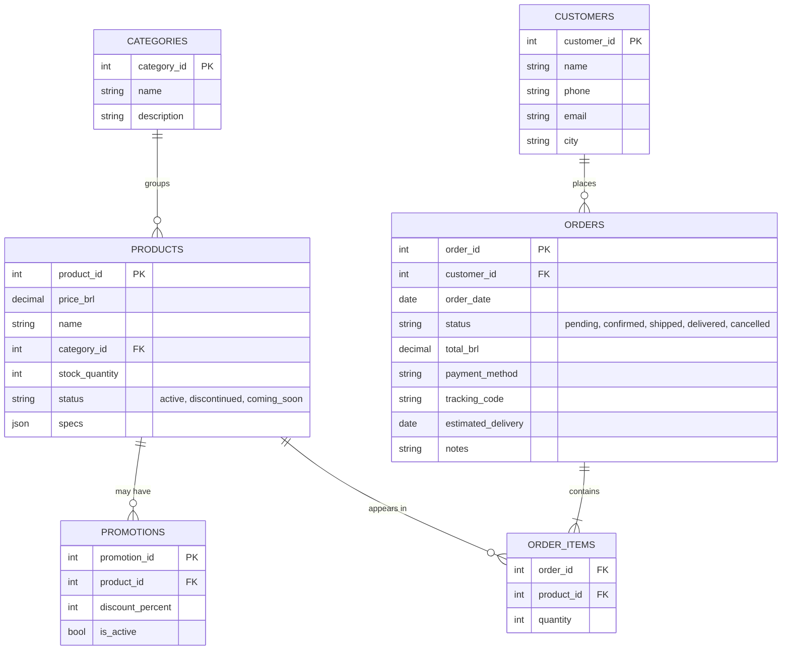
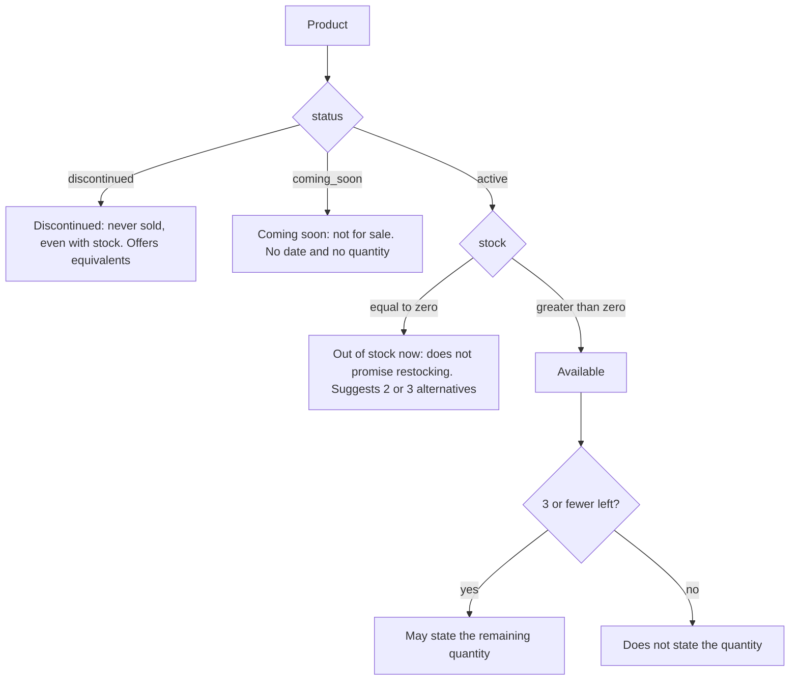
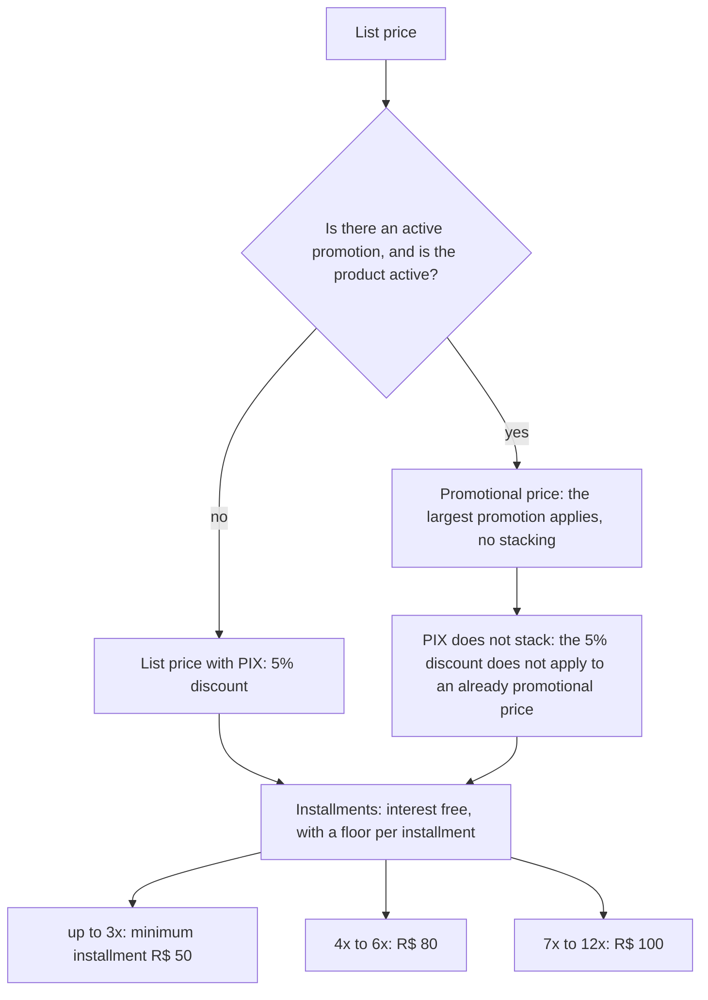
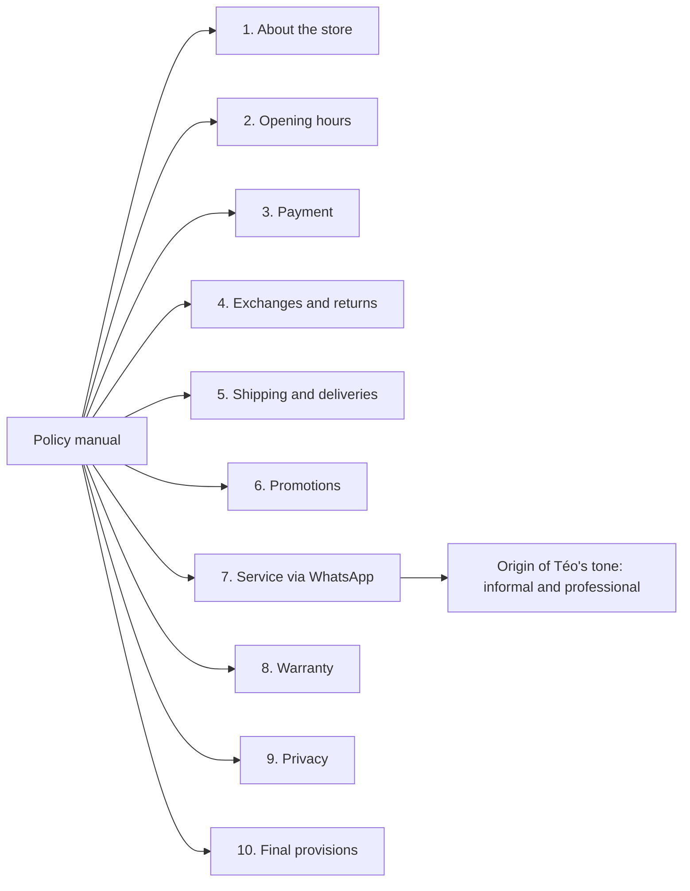
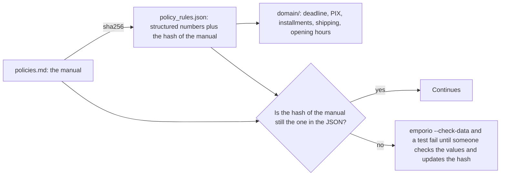
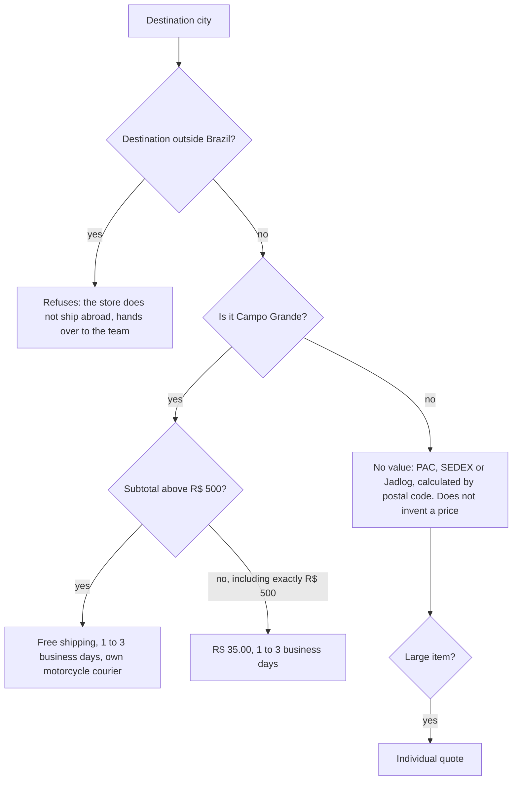
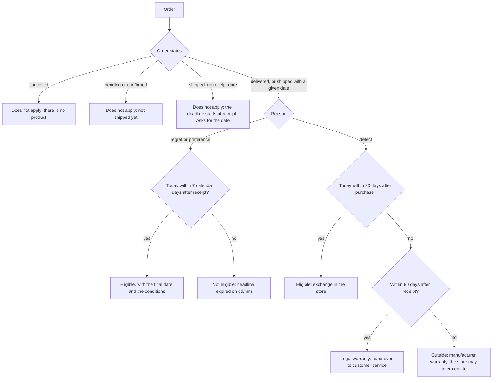

# Data and policies

The challenge delivers six CSV tables and a policy manual as a PDF, and says: *"you are not required to use
all the data; do the data handling you consider necessary"*. This document shows what is in the data, what
is odd about it, how each problem is handled and which rules of the manual became code.

## Contents

1. [What was delivered](#1-what-was-delivered)
2. [The tables and how they relate](#2-the-tables-and-how-they-relate)
3. [What is odd in the data](#3-what-is-odd-in-the-data)
4. [How a product becomes "for sale"](#4-how-a-product-becomes-for-sale)
5. [The policy manual](#5-the-policy-manual)
6. [Contradictions in the manual and the decision taken](#6-contradictions-in-the-manual-and-the-decision-taken)
7. [From the manual to the code: rules and protection against drift](#7-from-the-manual-to-the-code-rules-and-protection-against-drift)
8. [The business rules, one by one](#8-the-business-rules-one-by-one)
9. [Assumptions made](#9-assumptions-made)

---

## 1. What was delivered

| File | Data rows | What it is |
|---|---|---|
| `categories.csv` | 9 | Instrument categories |
| `products.csv` | 65 | Catalog: price, stock, status, specifications |
| `promotions.csv` | 25 (4 active) | Discounts per product |
| `customers.csv` | 50 | Name, phone, e-mail, city |
| `orders.csv` | 20 | Orders, with status, total, payment, tracking and delivery estimate |
| `order_items.csv` | 22 | Items of each order |
| `politicas_da_loja.pdf` | 8 pages, 10 chapters | Internal customer service manual |

All of them stay intact in `data/raw/`. What the project derives from them (manual in Markdown, rules in
JSON, decision notes) sits next to them, in `data/`. The data and the manual are in Portuguese, like the
store and its customers, and they are kept that way.

## 2. The tables and how they relate

What does not exist in the data, and shapes several decisions: there is no CPF, password or secret code for
the customer; there is no real receipt date (only the delivery *estimate*); the promotions have no validity
date (only an `is_active` flag); and there is no random order id (the ids are sequential).

## 3. What is odd in the data

The project does not "clean" the data. It detects and handles each problem in code. The quality report
(`CsvRepository.quality_report()`, in `data/quality.py`) produces the counts below, and the tests pin them.

| # | What is odd | Where | How the agent handles it |
|---|---|---|---|
| 1 | Active product with zero stock | Product 96 (Giannini GF-3D) | It is "out of stock": not sellable, and the agent offers alternatives |
| 2 | "Coming soon" product with stock 2 | Product 130 (Kala KA-ABP-CTG) | The status rules: it never confirms units and never says it is for sale |
| 3 | Discontinued product with stock 13 | Product 136 (Ibanez Bass 2X) | The status rules: it left the catalog, even with stock. It offers equivalents |
| 4 | Order total different from the sum of the items | Orders 3 (R$ 3,450 against R$ 3,498) and 20 (R$ 1,400 against R$ 1,488) | Shown as the "recorded total", without recalculating or promising the value |
| 5 | Installment below the manual's floor | Orders 9, 16 and 18 | Only reported; the rule applies to new installment queries |
| 6 | Two customers with the same e-mail | Customers 11 and 43 (Bruno Carvalho Martins and Bruno Martins) | Verification is per order, against its owner. See the note below |
| 7 | Three categories with no product | Wind (woodwind), Wind (brass), Orchestral strings | The agent confirms with `search_products` and says there are none, without inventing an instrument |
| 8 | A description that contradicts the name | For example, product 137 is called "Yamaha Bass 3X" and the description talks about Ibanez | The description stays out of the search: only name, category, aliases and specifications |
| 9 | Inactive promotions (21 of 25) | `promotions.csv` | Only an active promotion on an active product counts. Expired promotion: the agent says so transparently and gives the current price |
| 10 | "More than 300 instruments" in the manual, but 65 in the catalog | Manual, section 1 | The agent does not repeat the number; it says "our catalog" |
| 11 | No real receipt date | `orders.csv` | `estimated_delivery` serves as an approximation, the verdict says so, and the date given by the customer takes precedence |
| 12 | Free-text order note | `orders.notes` | Treated as data, never as an instruction: it comes back marked and short |

Note on item 6 (identity). Since two customers share the same e-mail, whoever knows that e-mail can prove
ownership of orders of both. It is one more example of why proof by e-mail is weak. It is assumed and
discussed in [security-and-privacy.md](security-and-privacy.md).

How the report is produced. On load, each row goes through validation (Pydantic). An invalid row is
rejected with file, line and reason, and `--check-data` fails if there is any rejection. The inconsistencies
above are not rejections: they are warnings, because the row is valid and the agent needs to know how to
handle it.

## 4. How a product becomes "for sale"

The most important rule of the catalog: the status takes precedence over stock.

And how the price is composed:

All of this is in `domain/pricing.py` and `domain/availability.py`, with `Decimal`, and every rule has a
test. The floor applies to the value of the installment (not to the total) and is compared without
rounding; the displayed installment is rounded (`HALF_UP`) and the last one absorbs the difference in
cents.

## 5. The policy manual

The PDF becomes text with `scripts/extract_policies.py`, and the result (`data/policies.md`) is reviewed by
hand. It has 10 chapters:

Chapter 7 (service via WhatsApp) is the origin of the persona: the manual asks for an informal and
professional tone, and Téo was written for that, with short WhatsApp-style answers.

## 6. Contradictions in the manual and the decision taken

The manual has errors and internal contradictions. Instead of letting the model choose between two
versions, each decision was made once and recorded in `data/policies_notes.json`. Each section returned by
the `search_policy` tool carries the notes of its topic.

| Contradiction or error | What the manual says | Decision |
|---|---|---|
| Phone and WhatsApp | The company table has "Telefone / WhatsApp" with a single number (3341-4444), but the WhatsApp channel is another (3321-4500) | Always give the number together with its label and never swap one for the other |
| E-mail | The table spells `empóriodamusica` with an accent | It is a typo: the e-mail is `contato@emporiodamusica.com.br`, without an accent |
| Minimum installment | The summary table says "minimum installment of R$ 100.00", but the detailed rule has tiers (R$ 50, R$ 80, R$ 100) | The rule by tier applies, as it is the most specific |
| "Except below R$ 50.00" | An ambiguous sentence in the up-to-3x tier | It means that the installment of a plan in up to 3x cannot be smaller than R$ 50.00 |
| Catalog size | "More than 300 instruments" | The current catalog has 65 items: do not repeat the number |
| Manufacturing defect | 30 days (section 4.2) and legal warranty (section 8) | Exchange within 30 calendar days of purchase; legal warranty of 90 days from receipt; after that, the manufacturer, with the store able to intermediate |

## 7. From the manual to the code: rules and protection against drift

The numbers of the manual are not typed in the code: they come from `data/policy_rules.json`.

The JSON keeps the `sha256` of the `policies.md` it came from. If someone edits the manual, the values in
the JSON may become outdated without anyone noticing; the hash prevents that. Updating the hash requires
checking the numbers, and that is the goal.

`policy_rules.json` has: the regret deadline (7 days), exchange for a defect (30), legal warranty (90),
refund (10 business days), manufacturer warranty (6 to 24 months), PIX discount (5%), maximum installments
(12), installment tiers, the value above which payment methods are combined (R$ 2,000), free shipping
(above R$ 500), flat fee (R$ 35), local city (Campo Grande), local deadline (1 to 3 business days), the
shipping modalities and the opening hours. The logic (rounding, the anchor of each deadline, precedence)
stays in code.

## 8. The business rules, one by one

### Opening hours and holidays

The store opens Monday to Friday, from 9h to 18h, and on Saturdays from 9h to 13h; it is closed on Sundays
and holidays. `domain/hours.py` is the only place that computes whether the store is open. The holidays
come from the `holidays` library (national and Mato Grosso do Sul), so they work for any year. Municipal
holidays, such as Campo Grande's anniversary, are not included: it is a known limitation.

### Shipping

Two details that are usually gotten wrong: exactly R$ 500.00 still pays R$ 35.00 ("above" does not include
the limit), and outside Campo Grande there is no value in the data: the agent explains the modalities and
that the value depends on the postal code, instead of inventing it.

### Return, exchange and warranty

The model never counts days. It calls `check_return_eligibility` and states the verdict the tool returns.

Details: the receipt day is day zero and the seventh day still counts; the receipt date the customer
provides is worth more than the delivery estimate (which only serves as an approximation, and the verdict
says so in `basis`); and with no date at all in the system, the verdict is `escalate`: consult management,
instead of guessing. The exclusions in the manual (customized items, "final sale", mouthpieces) do not
exist in the data, so the tool lists them as a warning: the agent confirms with the customer and hands
over, without asserting.

## 9. Assumptions made

The challenge says: *"if something is ambiguous, assume a reasonable interpretation, document it and move
on"*. The main assumptions of the project:

| Assumption | Reason |
|---|---|
| The product status takes precedence over stock | Avoids selling a discontinued or "coming soon" product |
| The structured fields are the source of truth; the description is marketing text | Some descriptions contradict the name |
| `estimated_delivery` approximates the receipt date | The store does not record the real date; the verdict warns about the assumption |
| A promotion only counts if it is active and the product is active | The CSV has no validity dates |
| With more than one active promotion on a product, the largest applies, with no stacking | The manual says they are not cumulative |
| `total_brl` is the recorded total | Two orders have a total different from the sum of the items |
| The demo clock is 23/03/2026, Monday, 10:00 | The data is from 2025 and 2026; the last order is from 22/03/2026 |
| Identity = order number + e-mail or last 4 digits of the phone | The data has no other identifier |
| Municipal holidays are not included | The library covers national and state ones |
| Complaints are stored locally; the forwarding to management is simulated | There is no real sending channel in the prototype |
