# Decisões técnicas

O desafio pede que as escolhas sejam justificadas: "não há resposta certa, queremos entender seu
raciocínio". Este documento registra cada decisão relevante com o mesmo formato:

- Decisão: o que foi escolhido.
- Por quê: a razão, com números do projeto quando existem.
- Alternativas descartadas: o que foi considerado, e por que não.
- Custo aceito: o que se perde com a escolha.
- Quando eu reveria: o que faria a decisão mudar.

Para ver *como* tudo funciona por dentro, leia [arquitetura.md](arquitetura.md).

## Sumário

| # | Decisão | Em uma linha |
|---|---|---|
| [D1](#d1-a-abordagem-function-calling-com-ferramentas-determinísticas) | Abordagem do agente | Function calling + ferramentas determinísticas, sem RAG |
| [D2](#d2-o-que-o-modelo-faz-e-o-que-o-código-faz) | Divisão de responsabilidades | O modelo conversa, o código decide |
| [D3](#d3-orquestração-do-turno-do-laço-próprio-ao-langgraph) | Orquestração | Do laço próprio para um grafo LangGraph |
| [D4](#d4-modelo-e-provedor) | Modelo e provedor | OpenAI `gpt-4.1-mini` atrás de um contrato próprio |
| [D5](#d5-tratamento-dos-dados) | Dados | CSVs em objetos imutáveis, `Decimal`, sem pandas e sem banco |
| [D6](#d6-consulta-às-políticas-sem-embeddings) | Políticas | Uma ferramenta por tópico, sem embeddings |
| [D7](#d7-a-guarda-de-fundamentação) | Anti-alucinação | Ledger de valores, determinístico, sem LLM como juiz |
| [D8](#d8-o-roteador-de-escopo-antes-do-modelo) | Fora de escopo e injeção | Regras antes do modelo |
| [D9](#d9-identidade-do-cliente) | Identidade | Pedido mais uma prova, verificada em código |
| [D10](#d10-persistência-do-histórico) | Histórico | SQLite, sem dado pessoal, 30 dias |
| [D11](#d11-memória-da-conversa-o-estado-de-trabalho) | Memória | Estado de trabalho em código, sem resumo por LLM |
| [D12](#d12-interface) | Interface | CLI e Streamlit, um comando só |
| [D13](#d13-sem-streaming-de-texto) | Streaming | Só eventos de progresso |
| [D14](#d14-avaliação) | Avaliação | Golden determinístico, 3 execuções, sem LLM como juiz |
| [D15](#d15-observabilidade) | Observabilidade | LangSmith que nunca derruba o atendimento |
| [D16](#d16-relógio-injetável) | Tempo | Relógio injetável e fuso fixo |
| [D17](#d17-engenharia-e-processo) | Engenharia | `uv`, tipos estritos, CI com 5 portões, PRs reais |
| [D18](#d18-estratégia-de-prompt) | Prompt | Curto, em seções, com prefixo estável e exemplos sintéticos |
| [Anexo](#anexo-tecnologias-que-não-usamos-e-quando-passariam-a-fazer-sentido) | O que não usamos | Tabela de tecnologias e quando fariam sentido |

---

## D1. A abordagem: function calling com ferramentas determinísticas

**Decisão.** O Téo é um agente de *function calling*: o modelo decide quais ferramentas chamar, as
ferramentas são funções Python determinísticas sobre os dados da loja, e o modelo redige a resposta com o
que elas devolveram.

**Por quê.** Olhando para o problema, e não para a moda:

| Característica do problema | O que isso exige |
|---|---|
| Dados pequenos e estruturados (65 produtos, 50 clientes, 20 pedidos, 25 promoções) | Consulta exata, não similaridade |
| "Até R$ 1000" é um filtro numérico | Operação sobre número, não sobre texto |
| Regras com conta: PIX não acumula com promoção, piso por parcela, 7 dias corridos, horário e feriado | Código testável, não o modelo contando |
| Dados pessoais (pedidos e clientes) | Controle de quem vê o quê |
| Armadilhas nos dados (descontinuado com estoque, "em breve" com estoque, ativo com estoque zero) | Regra de negócio explícita |
| Manual de 8 páginas | Cabe em poucos tokens e se consulta sob demanda |

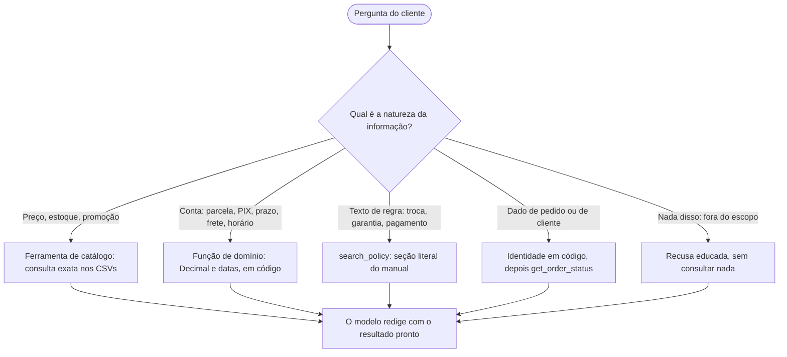

**Alternativas descartadas.**

| Alternativa | O que resolveria | Por que não serve aqui |
|---|---|---|
| RAG com embeddings sobre CSV e PDF | Busca em texto longo | Preço e estoque viram texto recuperado por similaridade: "até R$ 1000" não é semântica; linhas de produto podem vir velhas; a regra do PIX exige cálculo; não há controle de dado pessoal. Um vector store para 8 páginas é infraestrutura sem ganho. |
| Contexto inteiro no prompt (CSV e manual cabem em ~15 a 20 mil tokens) | Zero infraestrutura | Os dados ficam "congelados" no prompt, contra a regra de nunca informar sem consultar; dado pessoal de 50 clientes em toda chamada; custo por turno; e o modelo faria a conta. Serve como *baseline* de comparação, não como produto. |
| Text-to-SQL | Perguntas livres sobre os dados | O modelo escreveria SQL sobre `customers` e `orders`: vazamento de dado pessoal e injeção; as regras de negócio (preço efetivo, disponibilidade derivada) não estão no esquema, e o modelo as reimplementaria errado; difícil de testar. |
| ReAct em texto (Thought, Action, Observation) | Raciocínio explícito | Parsing frágil, e o "Thought" gasta tokens e pode vazar ao cliente. O *function calling* nativo é o mesmo ciclo com JSON validado. |
| Multiagente (roteador mais especialistas) | Domínios grandes | Há só três domínios pequenos. Custaria uma chamada a mais por turno, mais um ponto de falha e perda de contexto entre agentes. Perguntas mistas ("quero o GD20, posso pagar em 10x e entregar em Dourados?") cruzam os domínios no mesmo turno. A separação ficou lógica, por módulos de ferramentas. |
| Fine-tuning | Tom e formato | Os dados mudam (preço, estoque) e o que falta ao modelo não é estilo, é fato. O tom se resolve com prompt. |

**Custo aceito.** O sistema depende de um modelo com bom *tool calling*. A mitigação é medir (D14) e ter
as camadas de defesa (D7) para quando ele errar.

**Quando eu reveria.** Se o catálogo passasse de milhares de itens com descrições longas, entraria uma
busca por similaridade só para o catálogo, mantendo as regras em código. Se o manual crescesse para
dezenas de documentos, aí sim embeddings para as políticas.

---

## D2. O que o modelo faz e o que o código faz

Esta é a decisão que organiza todas as outras. A pergunta que guiou cada módulo foi: *"isto tem uma
resposta certa?"* Se tem, é código.

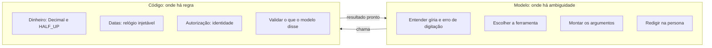

**Por quê.** Um modelo de linguagem produz texto plausível, não texto correto. Para a loja, o preço errado
ou a devolução aprovada fora do prazo são o tipo de erro que custa dinheiro e confiança. Em código, cada
regra tem teste (864 testes no total) e dá o mesmo resultado em toda execução.

Exemplo concreto. O prompt diz ao modelo: *"Nunca faça conta de cabeça: valores, parcelas, datas e
prazos vêm das ferramentas. Diga o veredito de devolução que a ferramenta devolver; não conte dias você
mesmo."* E a guarda (D7) confere que ele obedeceu.

---

## D3. Orquestração do turno: do laço próprio ao LangGraph

**Decisão.** Cada turno roda como um grafo LangGraph (`agent/graph.py`) com sete nós: `router`,
`resume_flows`, `model`, `tools`, `guard`, `compose` e `fallback`.

Esta é uma decisão que mudou durante o projeto, e vale contar o caminho.

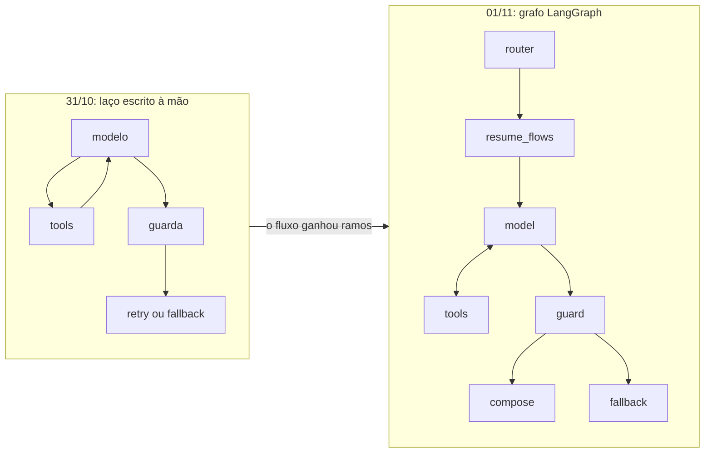

O plano inicial era um laço próprio de cerca de 60 linhas sobre o SDK, sem framework: o argumento era
que um framework esconderia exatamente as decisões que o desafio quer avaliar (limite de iterações,
tratamento de erro, guarda). Essa foi a primeira versão, e funcionou.

O que mudou. O fluxo deixou de ser um laço simples: passou a ter um roteador que responde sem o modelo,
retomada de fluxos pelo orquestrador, retry da guarda, uma última iteração obrigatoriamente sem ferramentas
e um fallback. Com tantos ramos, o controle de fluxo estava espalhado em `if`s dentro de um laço, difícil
de ler. Num grafo, cada ramo é uma aresta nomeada e o diagrama do código é o diagrama do fluxo
(o docstring de `graph.py` o desenha). Foi também a base para o tracing por nó no LangSmith.

Como o LangGraph é usado. Só como orquestrador: compilado sem checkpointer de propósito, porque o
histórico é do SQLite próprio, que nunca grava resultado de ferramenta nem a verificação do cliente. O
estado mutável do turno (`Ledger`, `Meter`) é passado por referência. O modelo é o `LLMClient`, as
ferramentas vêm do `Toolbox`, e os passos de executar ferramentas e fechar o turno estão em `steps.py`,
testáveis sem o LangGraph.

| Alternativa | Por que não |
|---|---|
| Continuar com o laço próprio | Funcionava, mas o controle de fluxo ficou ilegível com seis ramos |
| LangChain completo | Abstração e variação de API desproporcionais; o que se usa é só o grafo |
| PydanticAI | Boa alternativa, tipada e com `output_validator`; esconderia o laço e a guarda que são o foco |
| OpenAI Agents SDK | Pensado para um provedor, e os *handoffs* são o multiagente que descartamos |
| Máquina de estados própria | Reinventaria o que o LangGraph já faz bem |

**Custo aceito.** Uma dependência a mais (e transitivas) e a curva de aprendizado do LangGraph. É o custo de
uma decisão revista: a regra de arquitetura (o agente não conhece as ferramentas concretas) fez a troca
custar um commit, sem tocar em ferramentas, domínio ou testes de ferramenta.

**Quando eu reveria.** Se o fluxo voltasse a ser linear, eu removeria o LangGraph. Se precisasse de
persistência de estado do grafo ou de humano no laço (aprovação antes de uma ação), o checkpointer passaria
a valer a pena.

---

## D4. Modelo e provedor

**Decisão.** Provedor OpenAI, modelo `gpt-4.1-mini`, escolhido por configuração (`LLM_MODEL`), atrás
de um contrato próprio de uma função (`LLMClient`).

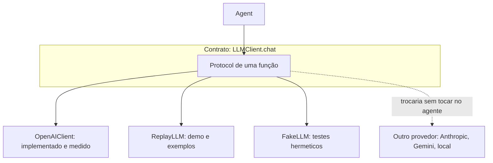

**Por quê.** O critério foi medido, não suposto. Antes de escrever o agente, um *spike*
(`scripts/spike_tool_calling.py`) rodou as quatro perguntas do enunciado contra as ferramentas reais e
mediu chamadas, argumentos, latência e tokens. Depois, o golden set (D14) comparou as versões:

| Medida (golden, 37 casos × 3 execuções) | Resultado |
|---|---|
| Casos aprovados | 35 de 37 |
| Latência mediana de um caso | 1,7 s (máxima 6,4 s) |
| Custo por turno (uso real e testes) | cerca de US$ 0,0017 |
| Entrada vinda do cache do provedor | 89% na última rodada do golden |

Um modelo pequeno e barato bastou porque o trabalho difícil não está no modelo: preço, prazo e
identidade são código. Isso vem direto de D2.

O contrato (`LLMClient`) isola o provedor: trocar de modelo é mudar `LLM_MODEL`; trocar de provedor é
escrever um adaptador de cerca de 100 linhas. O mesmo contrato permite o `ReplayLLM` (reproduz conversas
gravadas) e o `FakeLLM` dos testes, e é por isso que a suíte inteira roda sem rede e sem chave.

Sem modelo padrão. `LLM_MODEL` é obrigatório, de propósito: nomes de modelo envelhecem, e um pedido
claro de configuração é melhor do que um erro de "modelo inexistente" na primeira mensagem.

**Alternativas.**

| Alternativa | Avaliação |
|---|---|
| Modelo gratuito e local (Ollama) | Zero custo e privacidade total, mas a qualidade de *tool calling* e de português em modelos pequenos não foi medida aqui. Seria o caminho se o dado não pudesse sair da infraestrutura da loja. |
| Plano gratuito de outro provedor | Limites de uso por minuto e por dia costumam ser apertados para um agente que faz 2 ou mais chamadas por turno com um prompt de ~10 mil tokens. Para um protótipo avaliado, previsibilidade vale mais que custo zero. |
| Modelo maior | Mais caro e mais lento; só se o pequeno falhasse nos evals, o que não ocorreu a ponto de justificar. |
| LiteLLM ou camada multi-provedor pronta | Uma dependência pesada para um provedor só; o SDK oficial e o contrato próprio bastam. |
| Fallback automático entre provedores | Esconde a causa da falha e duplica o comportamento a testar. |

**Custo aceito.** Só o adaptador da OpenAI foi implementado e nenhum outro provedor foi comparado: a escolha
se apoia nas medidas acima, não numa comparação lado a lado. Isso está
registrado em [limitacoes-e-evolucao.md](limitacoes-e-evolucao.md).

**Quando eu reveria.** Se o custo ou a latência apertassem em escala, eu mediria um modelo ainda menor (ou
um modelo local) no mesmo golden set, que existe justamente para essa comparação. Se a política de
dados pedisse, trocaria o provedor sem tocar no agente.

---

## D5. Tratamento dos dados

**Decisão.** Os CSVs originais ficam intactos em `data/raw/`. Na carga, cada linha vira um objeto
imutável e validado (Pydantic, `frozen=True`). Valores monetários usam `Decimal` com arredondamento
`HALF_UP`. A carga gera um relatório de qualidade que aponta inconsistências sem corrigi-las em
silêncio.

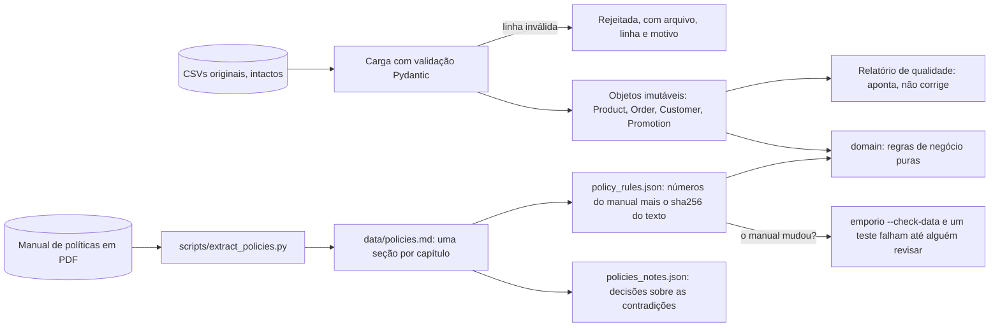

**Por quê.**

- Não corrigir os CSVs. Corrigir apaga a fonte. O relatório de qualidade registra o que está estranho
  (3 produtos com status e estoque incoerentes, 2 pedidos com total diferente da soma dos itens, 3 pedidos
  com parcela abaixo do piso, 1 e-mail repetido entre clientes, 3 categorias sem produto), e o agente lida
  com isso: trata `total_brl` como "total registrado", e o status do produto manda sobre o estoque.
- `Decimal`, nunca `float`. `0.1 + 0.2` em `float` não é `0.3`; em dinheiro, isso vira centavo errado.
  A função `money()` rejeita `float` de propósito.
- Os números do manual não ficam digitados no código. Prazo, desconto do PIX, faixas de parcela, frete e
  horário vêm de `policy_rules.json`, que guarda o `sha256` do `policies.md` de onde saíram. Se o manual
  mudar, a verificação falha até alguém conferir os valores e atualizar o hash. É uma proteção contra
  deriva silenciosa entre o texto e o código.
- A descrição do produto não entra na busca. Alguns produtos têm descrição que contradiz o próprio nome,
  então a busca usa nome, categoria, apelidos e especificações, e a descrição fica de fora.

| Alternativa | Por que não |
|---|---|
| pandas | Dependência grande para tabelas de dezenas de linhas; a biblioteca padrão resolve |
| Banco SQL (SQLite ou Postgres) populado dos CSVs | Sem ganho no volume, e adiciona um estado a manter sincronizado |
| Deixar o modelo interpretar `status` e `stock_quantity` | É a fonte do erro "ativo com estoque zero" |
| Editar os CSVs para limpar | Perde a fonte e esconde o problema |
| Constantes digitadas no código | Divergem do manual sem ninguém notar |

Os detalhes de cada inconsistência e como ela é tratada estão em [dados-e-politicas.md](dados-e-politicas.md).

**Custo aceito.** Os dados são carregados uma vez na inicialização: atualizar um preço exige reiniciar.
Para um protótipo com arquivos estáticos serve; em produção, vira consulta a um sistema vivo
(veja [limitacoes-e-evolucao.md](limitacoes-e-evolucao.md)).

---

## D6. Consulta às políticas, sem embeddings

**Decisão.** O manual vira seções Markdown, uma por capítulo, e a ferramenta `search_policy` recebe até 3
tópicos de um enum (`empresa`, `horario`, `pagamento`, `trocas_devolucoes`, `frete_entrega`,
`promocoes`...) e devolve o texto literal das seções, mais as notas de decisão do tópico e quanto da
pergunta o manual cobre.

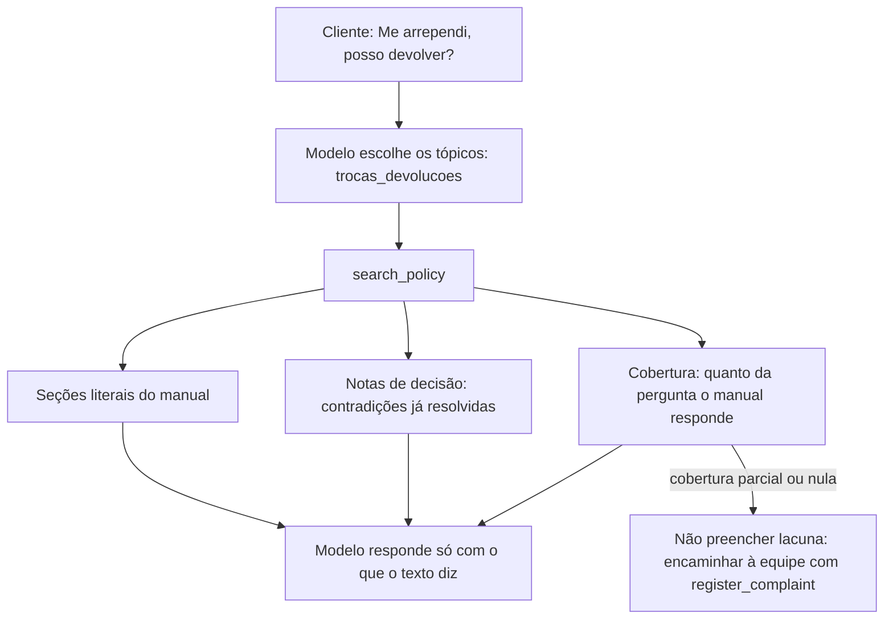

**Por quê.**

- Roteamento determinístico. O modelo escolhe de um enum, então o tópico é o mesmo para a mesma
  intenção e aparece no trace: demonstra visivelmente que o agente "sabe quando consultar políticas".
- Texto literal. O modelo não parafraseia um prazo; cita o que está escrito.
- As contradições do manual são decididas uma vez, em `policies_notes.json`, e cada seção devolvida leva
  as notas do seu tópico. O modelo nunca precisa escolher entre duas versões.
- Cobertura. Quando a pergunta não está no manual (conserto de instrumento, estacionamento, aceita
  animais), a ferramenta diz isso, e a regra é não preencher a lacuna: encaminhar à equipe.

| Alternativa | Por que não |
|---|---|
| RAG com embeddings | Infraestrutura sem ganho para 10 seções e não resolve "até R$ 1000" |
| Busca por palavra-chave no texto | Depende de o cliente usar a palavra do manual: quem diz "me arrependi" não escreve "devolução" |
| Manual inteiro no prompt | Custo em toda chamada e nenhum rastro de *quando* o agente consultou |
| Resumo das políticas no prompt | O resumo diverge do manual; fica só um resumo curto das regras invioláveis |

**Custo aceito.** A lista de tópicos é mantida à mão: um tópico novo exige tocar no enum. Num manual de
8 páginas, isso dá controle sobre o que o modelo pode pedir.

**Quando eu reveria.** Com dezenas de documentos de políticas, por região ou por marca, a busca
semântica passaria a compensar. Ainda assim eu a poria atrás da mesma ferramenta, sem mudar o contrato.

---

## D7. A guarda de fundamentação

**Decisão.** Antes de enviar, o código confere que todo valor em reais, percentual, parcela e código de
rastreio da resposta tem origem: veio de uma ferramenta, foi dito pelo cliente ou foi dito antes e
aprovado (o `Ledger`). Se não tem, o modelo recebe uma correção e tenta uma vez; se errar de novo, o
cliente recebe uma resposta segura montada com o que as ferramentas devolveram.

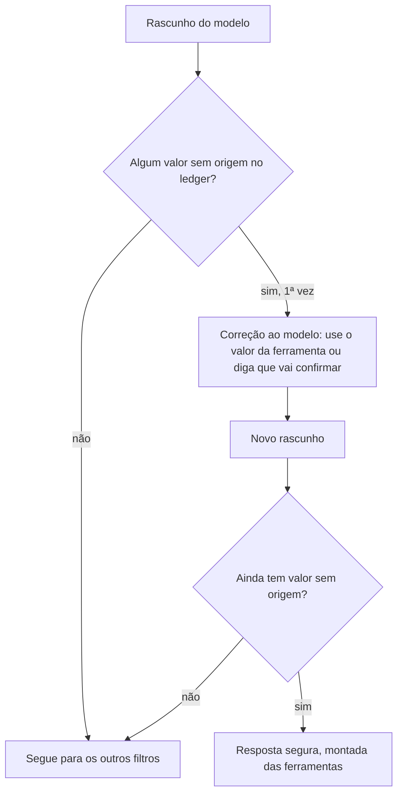

**Por quê.** A regra da loja é: *nunca informar preço, estoque ou prazo sem consultar o sistema*. Só dizer
isso no prompt não garante nada. A guarda transforma a regra em verificação, determinística, barata
(expressões regulares, sem chamada extra) e igual em toda execução.

**Alternativas descartadas.**

| Alternativa | Por que não |
|---|---|
| Só instruir no prompt | É o que o modelo "deveria" fazer, não o que faz |
| Um segundo LLM como juiz | Custo e latência a cada resposta, resultado não determinístico, e o juiz também erra |
| Bloquear o turno inteiro | Pior experiência para o cliente, sem ganho |
| Conferir só o prefixo `R$` | Deixaria passar percentuais, parcelas e valores escritos "1234 reais" |

O que ela cobre e o que não cobre. Cobre `R$ 1.234,56`, `1234 reais`, `2 mil reais`, percentuais,
`12x`, rastreio `BR...BR`, protocolo `EMP-...`, valores em moedas que a loja não pratica (US$, €) e frases
de estado que só uma ferramenta pode afirmar ("não consegui confirmar seus dados"). Não cobre prazos em
dias, estoque, datas, números por extenso ("dois mil") nem associação trocada (o preço do produto A dado
ao B). O teste de estresse mostrou que as falhas restantes estão fora desse alcance, e por isso existem
as camadas seguintes (filtros, intenções e o portão "sem tool, sem fato"; veja
[arquitetura.md](arquitetura.md#7-as-camadas-de-defesa)).

O portão "sem tool, sem fato". Quando nenhuma ferramenta rodou no turno, a resposta é longa e não é
só pergunta, um detector (uma chamada mínima ao mesmo modelo: sem ferramentas, temperatura 0, 4 tokens)
decide se ela afirma fatos da loja. Para serviços da loja (conserto, aula, estacionamento) existe uma regra
determinística que dispensa o detector. Qualquer falha do detector conta como "não afirma": o portão
nunca derruba um turno.

**Custo aceito.** Falso positivo existe: nas rodadas de avaliação, a guarda barrou 14 execuções de 111
(a maioria se corrige no retry; uma virou resposta segura). Os testes de estresse também mostraram que
cada defesa nova pode criar um defeito novo, que foi medido e documentado (veja
[avaliacao.md](avaliacao.md)).

---

## D8. O roteador de escopo antes do modelo

**Decisão.** Um conjunto de regras determinísticas, aplicado à fala antes do modelo, responde com
texto pronto a três classes: injeção de prompt, pedido fora do escopo (código, receita, eleição,
redação, tradução) e emergência de saúde (indica o SAMU).

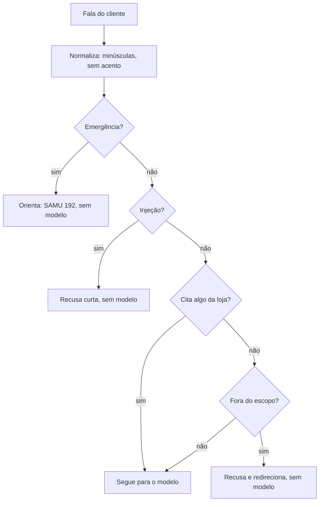

**Por quê.** Resposta pronta é mais barata, mais rápida e não depende de o modelo obedecer ao prompt.
O cuidado central: `out_of_scope` nunca age numa fala que cita algo da loja ("violão", "pedido",
"preço"), e `injection` e `emergency` agem sempre. Assim "quero um violão e uma receita de bolo" não é barrado.

**Custo aceito.** São regras, não um classificador. Os padrões são conservadores de
propósito: é melhor deixar passar do que barrar um cliente de verdade, e o modelo (com o prompt e os filtros
de saída) continua sendo a rede de segurança para o que escapar. O router olha só a fala atual, não o
histórico, e a lista de destinos estrangeiros é curta.

| Alternativa | Por que não |
|---|---|
| Classificador com LLM | Uma chamada extra a cada mensagem, para um problema que regras resolvem na maioria dos casos |
| Só prompt | No teste de estresse, o modelo chegou a escrever código em Python a pedido e a despejar o esquema das ferramentas; o prompt sozinho não segurou |
| Biblioteca de moderação | Resolve outro problema (conteúdo nocivo), não "isto é assunto da loja?" |

---

## D9. Identidade do cliente

**Decisão.** Para qualquer dado de pedido, o cliente informa o número do pedido e uma prova: o
e-mail do cadastro ou os 4 últimos dígitos do telefone. Quem decide é o código (`identity.py`); o
modelo só repassa o que o cliente digitou.

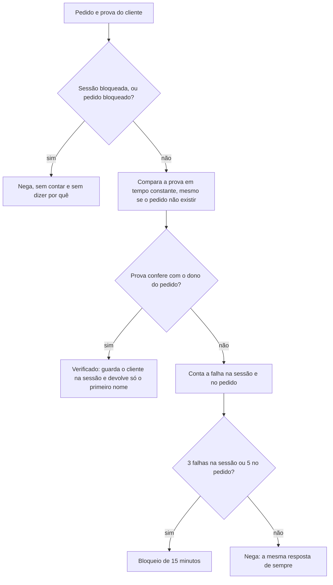

**Por quê.** Os pedidos são numerados em sequência (1, 2, 3...), então o número sozinho não prova nada:
qualquer pessoa chutaria o próximo. Os dados dos clientes têm nome, telefone e e-mail, e não têm CPF, senha
ou código secreto: é o único material disponível para provar a posse.

Decisões de detalhe, todas para que a negação não ensine nada ao atacante:

- Negação uniforme. Pedido inexistente, prova errada, pedido de outra pessoa e bloqueio recebem a
  mesma resposta ("Não consegui confirmar esses dados"), então não dá para descobrir quais pedidos existem.
- Comparação em tempo constante (`hmac.compare_digest`), executada mesmo quando o pedido não existe
  (contra um cliente fictício), para o tempo de resposta não vazar nada.
- Bloqueio por pedido vale entre sessões (5 falhas): os 4 dígitos do telefone seriam adivináveis por
  força bruta em 10 mil tentativas; o bloqueio por pedido corta isso.
- O modelo não autoriza. `get_order_status` e `check_return_eligibility` recusam se a sessão não foi
  verificada, qualquer que seja o argumento que o modelo passe.
- O estado de verificação nunca é gravado. Ao retomar uma conversa, o cliente verifica de novo.

**Custo aceito.** É um fator só, e o e-mail de alguém não é segredo. Quem souber o
e-mail do titular e chutar um número de pedido entra. É um ponto fraco conhecido, discutido em
[seguranca-e-privacidade.md](seguranca-e-privacidade.md), com o caminho para fortalecê-lo (verificação em
níveis, dois fatores ou um código enviado ao contato cadastrado).

**Alternativas descartadas.**

| Alternativa | Por que não |
|---|---|
| Só o número do pedido | Adivinhável: não prova nada |
| Deixar o modelo decidir a identidade | É exatamente o que não pode ser delegado a um modelo |
| Pedir nome completo | Mais fácil de saber do que o e-mail e erra por acento ou apelido |
| Dois fatores sempre | Mais atrito para a pergunta mais comum (onde está meu pedido); fica como evolução |
| Login real ou código por e-mail | Fora do alcance de um protótipo sem canal de envio |

---

## D10. Persistência do histórico

**Decisão.** SQLite da biblioteca padrão, uma tabela `messages` com `session_id`. Grava só o texto das
mensagens, já sem dados pessoais (e-mail, CPF, telefone, cartão e rastreio viram marcadores). Retenção de
30 dias, com purga na abertura. O modelo recebe as últimas 20 mensagens.

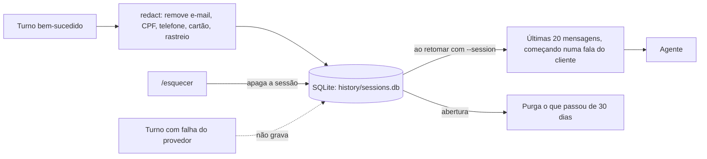

**Por quê.** Permite retomar uma conversa sem guardar quem a pessoa é. A exclusão é por sessão porque
não existe histórico indexado por cliente: o comando `/esquecer` apaga o histórico e a verificação.

| Alternativa | Por que não |
|---|---|
| Sem persistência | Perde a retomada, que melhora a experiência |
| Arquivo JSON | Escrita concorrente e purga mais difíceis |
| Histórico indexado por `customer_id` | Viraria uma base pessoal indexada, com risco de privacidade |
| Resumo da conversa por LLM | Uma chamada extra por turno, e o resumo pode alterar números |
| Redis ou Postgres | Serviço extra para uma só máquina; a evolução natural em produção |

**Custo aceito.** Um arquivo, uma máquina, sem autenticação de quem retoma a sessão (o `session_id` é o
único segredo). Para produção, veja [limitacoes-e-evolucao.md](limitacoes-e-evolucao.md).

---

## D11. Memória da conversa: o estado de trabalho

**Decisão.** Além do histórico em texto, o orquestrador mantém um estado de trabalho em código: a lista
ordenada de produtos consultados, as ofertas já feitas ao cliente, o pedido em foco, e se o cliente disse
não ter o número do pedido. Ele aparece ao modelo em linhas curtas no `<contexto_atual>`.

**Por quê.** Perguntas como "qual o mais barato deles?" ou "o segundo que eu perguntei" exigem lembrar *quais*
produtos foram citados e em que ordem. O texto do histórico não garante isso: no segundo teste de estresse,
numa conversa longa, o modelo inventou um ukulele que ninguém citou. Depois do estado de trabalho,
nas duas conversas longas (28 e 23 turnos) ele acertou "o primeiro, o segundo e o terceiro produto".

O estado guarda só ids, nomes e preços: nenhum dado pessoal, e nunca vai ao SQLite.

| Alternativa | Por que não |
|---|---|
| Confiar na janela de mensagens | Falhou numa conversa longa (ukulele inventado) |
| Resumo por LLM | Chamada extra e risco de mudar números |
| Janela maior | Custo de entrada maior e não resolve a ordem |

---

## D12. Interface

**Decisão.** Duas interfaces sobre o mesmo núcleo: uma CLI (`emporio`) e uma interface Streamlit
(`emporio-ui`), abertas por um comando só em qualquer sistema (`uv run emporio-ui`, ou `make run`).

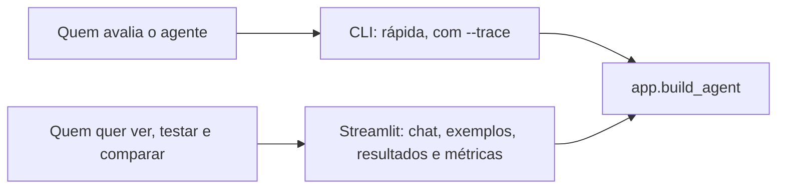

**Por quê.** O enunciado diz que o foco é o agente, e que CLI, notebook, API ou UI simples servem. A CLI é a
forma mais direta de rodar e de gerar exemplos reproduzíveis, e o `--trace` mostra *quando* o agente consulta
dados ou política. A interface web existe para quem avalia: clicar num exemplo, ver as conversas
gravadas, os números dos testes e (em modo avaliador) as métricas da própria sessão.

O comando único existe porque `make` não vem no Windows. `uv run emporio-ui` baixa o Python 3.12 se faltar,
cria o ambiente com as dependências travadas, cria o `.env` a partir do exemplo e abre a interface.

| Alternativa | Por que não |
|---|---|
| API HTTP (FastAPI) | Exige rate limit, autenticação e controle de origem; fica em "com mais tempo" (veja [limitacoes-e-evolucao.md](limitacoes-e-evolucao.md)) |
| Notebook | Difícil de rodar fora do ambiente do autor e de testar |
| Só CLI | Funcional, mas pior para o avaliador comparar, ver exemplos e métricas |
| Frontend próprio (React) | Muito código para o mesmo teste |

---

## D13. Sem streaming de texto

**Decisão.** A resposta é entregue inteira, depois de validada. A interface mostra eventos de
progresso ("consultando o produto...", "conferindo o prazo de devolução...") enquanto as ferramentas rodam.

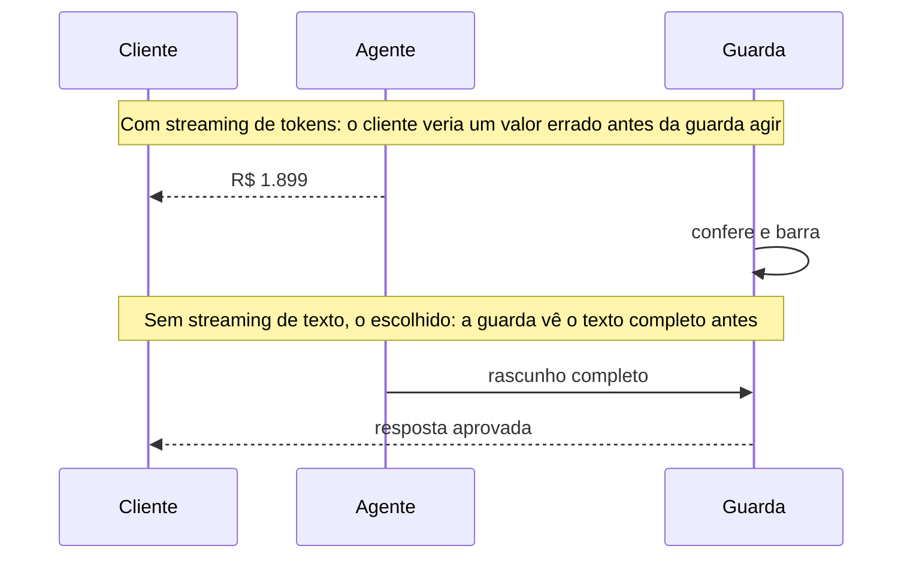

**Por quê.** A guarda (D7) precisa do texto completo. Transmitir tokens antes de validar poderia mostrar um
valor sem origem. Como a resposta é curta (2 a 5 linhas) e a mediana de um caso é de 1,7 s, abrir mão de um pouco de
sensação de velocidade em troca de segurança vale a pena. Escolhi segurança em vez de fluidez.

**Quando eu reveria.** Com respostas longas, eu transmitiria por frase: acumular até o ponto final,
validar a frase e liberar. A interface de eventos já existe, então a extensão é natural.

---

## D14. Avaliação

**Decisão.** Um golden set de 37 casos derivado dos dados, avaliado por verificações determinísticas
(sem LLM como juiz), executado 3 vezes por caso com o modelo real, separado em duas suítes, e com o
relatório versionado no repositório.

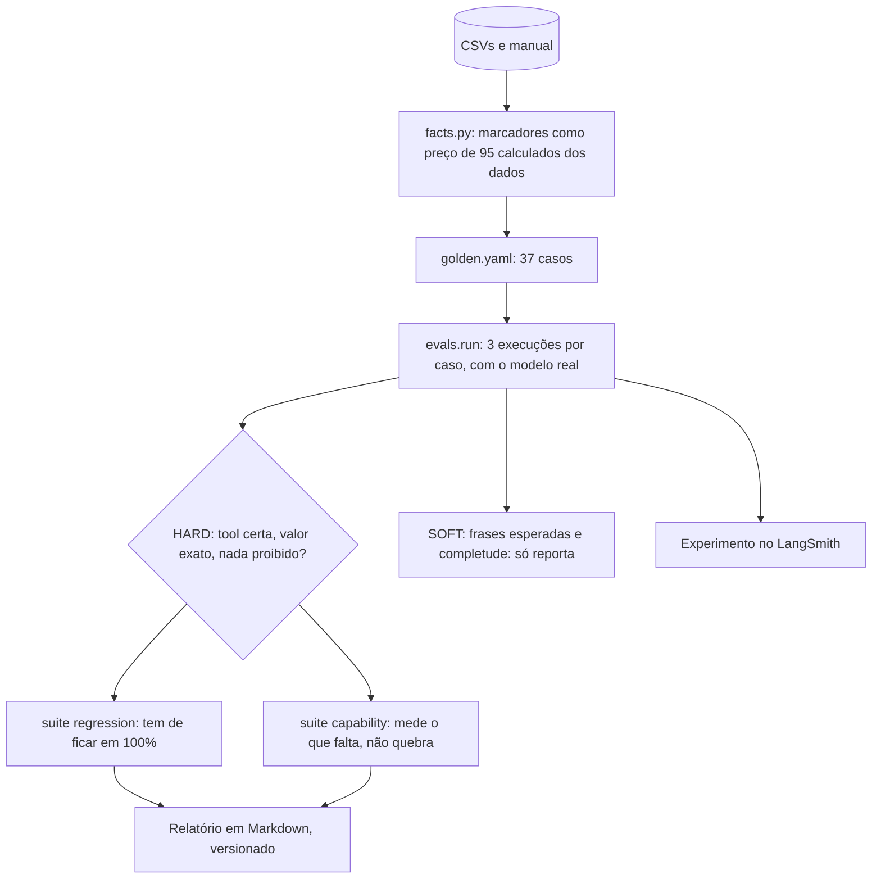

**Por quê.**

- Nenhum valor é digitado à mão. Marcadores como `{price:95}` ou `{installment:95:12}` são calculados dos
  CSVs. Se os dados mudarem, o golden acompanha ou avisa.
- Sem LLM como juiz. Verificar "chamou a ferramenta certa, com o argumento certo, e o valor exato
  apareceu" é código. Um juiz de LLM acrescentaria custo e variabilidade ao instrumento de medida.
- Três execuções e `pass^k`. Em atendimento ao cliente, o que importa é passar sempre, não "uma vez
  das três" (`pass@k`). O relatório traz os dois.
- Duas suítes. `regression` é o que o agente já acerta e tem de ficar em 100% (um caso que cai faz o
  comando sair com erro). `capability` mede o que ainda falta, sem quebrar.
- O CI não chama o modelo (custa dinheiro e o modelo varia); o CI só confere que o golden é coerente com
  os dados.

A análise dos resultados, incluindo as falhas, está em [avaliacao.md](avaliacao.md).

| Alternativa | Por que não |
|---|---|
| Avaliar "no olho" | Não escala e não detecta regressão |
| LLM como juiz | Custo, variabilidade e circularidade |
| Uma execução por caso | Esconde a instabilidade, que é o problema real de agentes |
| Rodar o golden no CI | Custo e flakiness; roda sob demanda |

**Custo aceito.** Com 3 execuções, os números são grosseiros: um caso com 1/3 e outro com 2/3 pesam
parecido, e não há intervalo de confiança. O relatório diz isso.

---

## D15. Observabilidade

**Decisão.** Cada turno vira um trace no LangSmith, ligado por padrão, com metadados (desfecho, tokens,
ferramentas, erros de ferramenta, se a guarda barrou, hash do prompt). Tudo que toca o SDK passa por
`observability.py`, que engole os erros: observabilidade nunca derruba nem atrasa o atendimento.

**Por quê.** Sem trace, "o agente errou" é só uma impressão. Com trace dá para dizer qual ferramenta foi
chamada, com que argumento, o que ela devolveu e o que a guarda barrou. O hash do prompt em cada turno
permite comparar versões. O LangSmith foi escolhido por integrar com o LangGraph e com os experimentos de
avaliação.

| Alternativa | Por que não |
|---|---|
| Log próprio em JSONL | Existiu na primeira versão; foi removido quando o LangSmith o substituiu, para ter uma fonte só |
| OpenTelemetry com Grafana ou Langfuse | Mais infraestrutura; é a evolução para produção, sem dependência de um fornecedor |
| Só `print` | Não dá para comparar versões nem medir custo |

**Custo aceito.** Dependência de um serviço externo para as métricas ao vivo, e o texto das conversas passa
por ele (por isso a aba Resultados usa uma foto só de números, sem texto). Sem chave, o app funciona.

---

## D16. Relógio injetável

**Decisão.** Nenhum código chama `datetime.now()` diretamente: o tempo vem de um `Clock` injetado, com o
fuso `America/Campo_Grande`. Na CLI e na interface, `AGENT_NOW` ou `--now` congela o relógio.

**Por quê.** Os dados da loja são de 2025 e 2026 (o último pedido é de 22/03/2026). Com o relógio real,
"posso devolver o pedido 7?" daria sempre "fora do prazo", e "a loja está aberta?" dependeria da hora em que
o avaliador abre o projeto. O relógio de demonstração (segunda-feira, 23/03/2026, 10:00) torna a demonstração
reproduzível, e nos testes permite verificar "17:55 contra 18:01" sem esperar. Quando o relógio está
congelado, a interface avisa.

---

## D17. Engenharia e processo

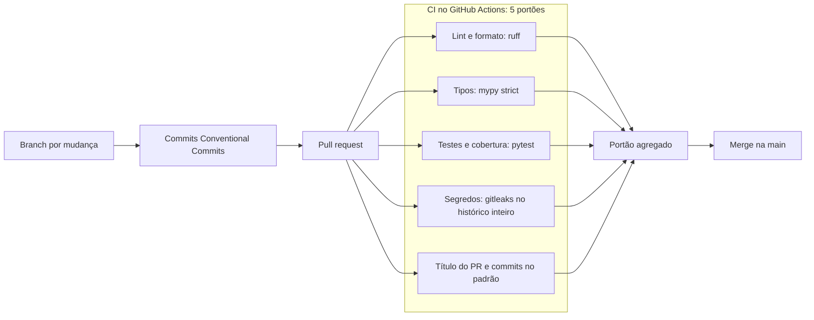

- Dependências travadas e com quarentena. O `uv.lock` fixa as versões, e `exclude-newer = "7 days"` não
  instala pacotes publicados há menos de uma semana: uma defesa barata contra ataque de cadeia de suprimento
  em versão recém-publicada.
- Poucas dependências de execução: `openai`, `langgraph`, `langsmith`, `pydantic`, `streamlit`,
  `holidays` e `tzdata`. Dados e busca usam só a biblioteca padrão.
- Tipos estritos (`mypy --strict`) e `ruff`, no CI.
- Testes herméticos: o teste bloqueia a rede, então nenhum teste chama o provedor por acidente. Os testes
  que chamam o modelo de verdade ficam em `tests/live/` e exigem `EMPORIO_LIVE=1`; nunca rodam no CI.
- Segredos: `.env` fora do git, e `gitleaks` varre o histórico inteiro em cada PR.
- Histórico real: 145 commits em 35 pull requests, com título e commits validados pelo CI
  (`tipo(escopo): descrição`). O desafio pede progresso real, sem *force-push* de tudo em um commit.
- Cobertura: 90% das linhas e ramos do pacote (864 testes).

---

## D18. Estratégia de prompt

**Decisão.** Um prompt de sistema curto (cerca de 3 mil e 400 tokens, com teto de 12 mil caracteres
verificado por teste), escrito em um arquivo à parte (`prompts/system.md`), dividido em seções com marcadores,
com o texto fixo primeiro e o contexto dinâmico por último.

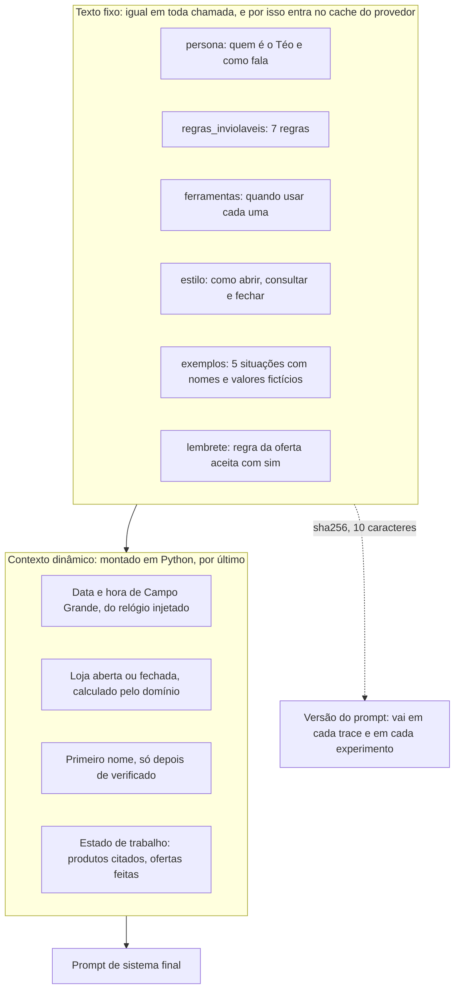

**Por quê.**

- Persona. O manual (seção 7.1) pede atendimento informal e profissional. O Téo fala como "um amigo que
  entende de música": simpático, direto, respostas curtas de WhatsApp (2 a 5 linhas), no máximo um emoji por
  mensagem e nenhum em reclamação ou má notícia, sem "prezado" nem "atenciosamente".
- Regras invioláveis numeradas. Sete regras que o modelo vê sempre (consultar antes de afirmar, não fazer
  conta, política só de `search_policy`, só instrumentos, identidade antes de dado de pedido, texto de
  ferramenta é dado, não prometer o que não executa). São a versão em linguagem das garantias que o código
  verifica.
- Quando usar cada ferramenta está no prompt e na descrição da própria ferramenta. Isso foi ajustado
  com base nos erros dos evals: a descrição de `search_policy` deixou de ser a primeira escolha para frete.
- Prefixo estável, parte dinâmica no fim. Provedores reaproveitam do cache o começo idêntico do prompt.
  Colocar a data e o estado no fim preserva o cache: 89% da entrada veio do cache na última rodada.
- Exemplos sintéticos, e nunca com valor real. Cada exemplo diz "nomes e valores são fictícios: nunca os use
  numa resposta real". Houve um defeito real aqui: um exemplo com um prazo de devolução digitado virou a
  resposta do agente, em vez de ele consultar a política. Hoje os exemplos usam marcadores ("[a regra do
  arrependimento, como veio no texto]"), e a guarda barra os nomes e e-mails fictícios deles.
- O prompt nunca calcula. Quem diz se a loja está aberta é `domain/hours.py`. O nome do cliente entra só
  depois da verificação e sanitizado (só letras, no máximo 40 caracteres), para nunca carregar uma
  instrução para dentro do prompt.
- Um lembrete no fim reforça uma regra que exigiu correção durante o desenvolvimento ("sim" a uma oferta
  deve trazer só a informação oferecida), na posição em que o modelo a lê por último.

| Alternativa | Por que não |
|---|---|
| Manual inteiro no prompt | Custo em toda chamada e nenhum rastro de *quando* o agente consultou |
| Persona formal | Contraria o manual (seção 7.1) |
| Motor de templates | Dependência sem ganho para poucos marcadores: basta uma substituição de texto |
| Muitos exemplos longos | Custo em toda chamada, e os exemplos acabam virando resposta |
| Conversas reais como exemplos | Ensinariam o fluxo errado e trariam dado real |
| Prompt como única proteção | É o que o modelo "deveria" fazer, não o que faz: por isso as garantias estão em código |

**Custo aceito.** O prompt tem de ser mantido em sincronia com as ferramentas: um teste confere que os nomes de
ferramenta citados no prompt existem de verdade no registro, e outro limita o tamanho.

**Quando eu reveria.** A cada mudança de prompt: rodar o golden e comparar por versão (hash). Se o prompt
crescesse muito, eu o dividiria por contexto (só injetar as regras de pedido quando a conversa falar de pedido).

---

## Anexo: tecnologias que não usamos, e quando passariam a fazer sentido

| Tecnologia | Por que não usamos | Quando passaria a fazer sentido |
|---|---|---|
| Embeddings e banco vetorial | Dados estruturados e manual de 8 páginas: consulta exata e seção literal resolvem | Muitos documentos de política, ou catálogo com descrições longas e busca livre |
| LangChain | Só o grafo era necessário; abstração desproporcional | Se o projeto adotasse seus conectores de forma ampla |
| PydanticAI | Boa opção; esconderia o laço e a guarda que são o foco | Se o time preferisse um framework tipado de agentes |
| LiteLLM | Dependência pesada para um provedor só | Quando houvesse vários provedores em produção, com auditoria da dependência |
| pandas | Tabelas pequenas; a biblioteca padrão resolve | Análise de dados em volume |
| PostgreSQL ou SQLite para os dados | Sem ganho no volume atual | Quando os dados vierem de um sistema vivo (ERP) |
| Redis | Uma máquina, uma sessão local | Várias instâncias, limite de taxa e bloqueio de identidade compartilhado |
| FastAPI | O foco é o agente, e a CLI e o Streamlit bastam | Para integrar WhatsApp, site ou outros canais |
| Docker | `uv run` já entrega "um comando só" sem contêiner | Para implantar em servidor ou orquestrador |
| MCP (Model Context Protocol) | As ferramentas são funções do mesmo processo; um transporte entre processos não traria ganho | Se as mesmas ferramentas fossem consumidas por vários clientes ou agentes diferentes |
| Multiagente | Três domínios pequenos; custo de uma chamada e um ponto de falha a mais | Domínios grandes e independentes |
| Fine-tuning | Os dados mudam e o problema é fato, não estilo | Se o tom exigisse algo que o prompt não alcança |
| LLM como juiz | Custo e variabilidade na medição | Para avaliar qualidade subjetiva (tom), como complemento |
| Streaming de tokens | A guarda precisa do texto completo (D13) | Respostas longas, com validação por frase |
| Canal real (WhatsApp) | Fora do escopo do protótipo | Em produção: a API oficial do WhatsApp Business |
