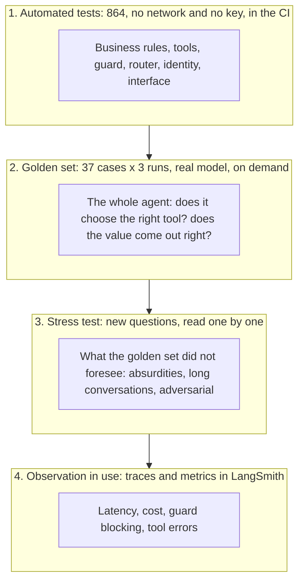
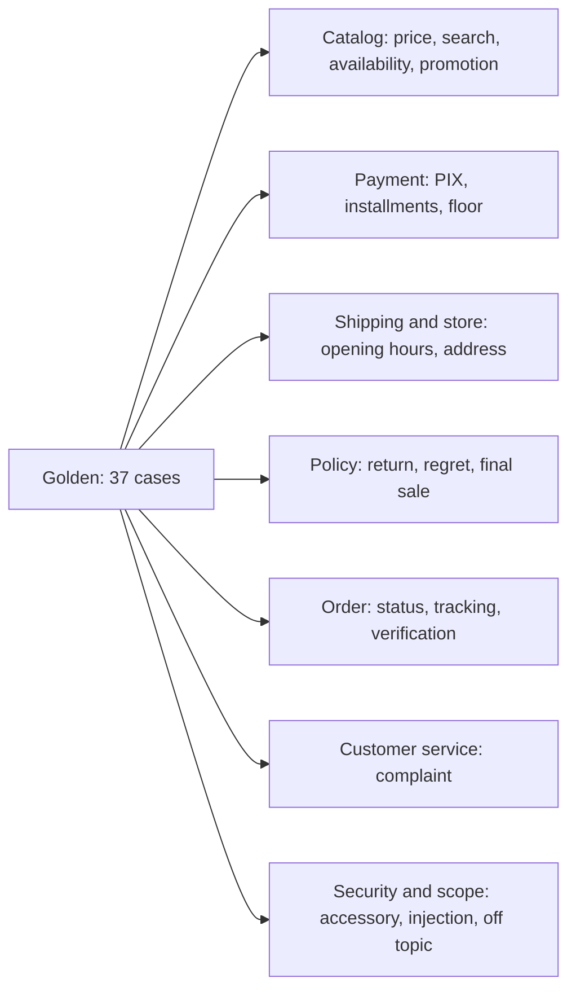
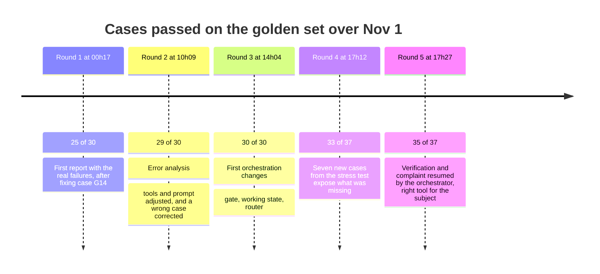
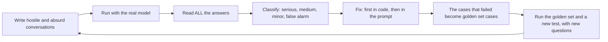
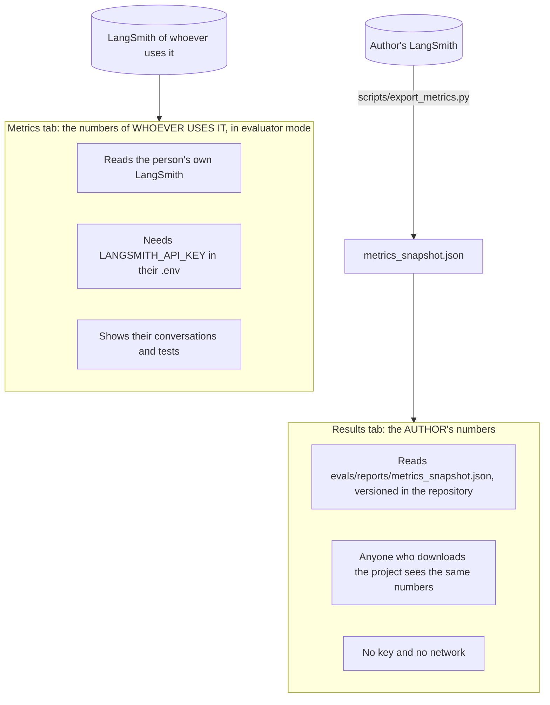
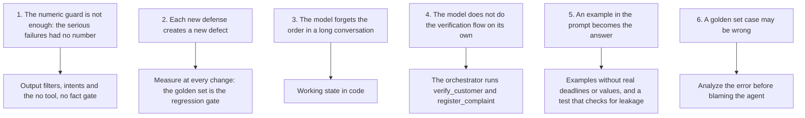

# Evaluation: how we know Téo works

"It seems to work" is not a measure. This document shows how the project is tested and evaluated, what
was measured, what failed and what each failure taught. The numbers are real, they came from runs with the
real model, and the failures are here unedited.

## Contents

1. [Four layers of verification](#1-four-layers-of-verification)
2. [Automated tests](#2-automated-tests)
3. [The golden set](#3-the-golden-set)
4. [The evaluation rounds](#4-the-evaluation-rounds)
5. [Stress tests](#5-stress-tests)
6. [The Results and Metrics tabs](#6-the-results-and-metrics-tabs)
7. [What the failures taught](#7-what-the-failures-taught)
8. [How to run everything](#8-how-to-run-everything)
9. [Limits of this evaluation](#9-limits-of-this-evaluation)

---

## 1. Four layers of verification

Each layer catches a type of error that the previous one does not, and costs more.



| Layer | What it catches | Cost | Runs in the CI? |
|---|---|---|---|
| Automated tests | A wrong rule, a broken contract, a code regression | Zero | Yes |
| Golden set | The agent choosing the wrong tool, a wrong value, a robotic tone | Tokens | No, on demand |
| Stress test | Failures nobody foresaw | Tokens and human reading | No |
| Observation | Drift in cost, latency and quality over time | Almost zero | No |

## 2. Automated tests

864 tests pass, with 90% line and branch coverage, and run in about 25 seconds, without network and
without a key: the model is replaced by a scripted *fake*, and the tests block the network so that none of
them calls the provider by accident.

| Folder | Tests | What it covers |
|---|---|---|
| `tests/unit/` | 742 | Domain (price, opening hours, return, shipping), data, search, policies, tools, guard, filters, router, state, session, identity, model client, CLI, metrics |
| `tests/integration/` | 44 | Complete conversations with a scripted model, the CLI as a real process, the Streamlit interface end to end |
| `tests/evals/` | 54 | The evaluation system itself: checks, report, LangSmith integration, consistency of the golden set with the data |
| `tests/contract/` | 22 | The tool contract: monetary fields always text, schemas, fixed names |
| `tests/live/` | 8 | Conversations against the real provider. They never run in the CI: they require `EMPORIO_LIVE=1` and a key |

Some checks that deserve a highlight, because they test design decisions and not just functions:

- Architecture: a test reads the code with `ast` and fails if the `agent/` package imports `emporio.tools`.
- No model name in the source code (`src/`): configuration is by environment variable.
- Money contract: no `*_brl` field may be a raw number, because the guard would not see it.
- Manual drift: if `policies.md` changes without `policy_rules.json` being checked, a test fails.
- Real data: the quality test pins the known inconsistencies (products 96, 130 and 136, orders 3 and 20,
  and so on). If anyone touches the CSVs, the test warns.
- The interface: Streamlit tests without a browser check the tabs, the warnings and the metrics summary.

## 3. The golden set

The golden set is a set of 37 reference conversations (`evals/golden.yaml`), each with what the agent must
and must not do. It covers the 13 intents of customer service:



| Intent | Cases | Intent | Cases |
|---|---|---|---|
| Availability | 3 | Payment | 5 |
| Complaint | 3 | Product price | 1 |
| Order status | 4 | Product search | 3 |
| Out of scope | 4 | Promotion | 3 |
| Security | 4 | Return eligibility | 1 |
| Shipping | 3 | Return policy | 2 |
| Store information | 1 | | |

How a case is written. No value is typed by hand. A marker such as `{price:95}` is computed from the CSVs
at evaluation time (`evals/facts.py`), and `assume:` declares the state of the data the case depends on
("product 95 is available", "the promotion is inactive"). A test checks it. If the data changes, the golden
set follows or warns, instead of silently lying.

```yaml
- id: G13-loja-fechada-no-domingo
  intent: store_info
  now: "2026-03-22T10:00:00-04:00"      # the clock of the case: a Sunday
  turns: ["Vocês estão abertos agora? E qual o endereço?"]
  hard:
    tools:
      must: [{name: get_store_info}]     # it has to consult the store
    contains:
      - ['fechad', 'nao (estamos|abrimos)']   # says the store is closed
      - ['segunda', 'amanha']                 # and when it opens
      - '{address}'                           # with the correct address, coming from the data
    forbidden: ['(?<!nao )estamos abertos']   # never states that it is open
```

Two severities.

- HARD fails the case: tool called or not, exact value, forbidden term, safe answer delivered in place of
  the answer, robotic tone.
- SOFT is only reported: expected phrases (which change from model to model) and completeness items.

Patterns are regular expressions compared with the answer without accents and in lowercase, and an item in
a list counts as "any of these".

Two suites.

- `regression` (29 cases): what the agent already gets right. It has to stay at 100%: if a case fails, the
  command exits with an error. It is the gate against regression.
- `capability` (8 cases): the hard cases, not yet mastered. They only measure how much is missing and do
  not break. A case moves up to `regression` when it passes in every run for a while.

Three runs per case, and two metrics. In customer service, passing "once out of three" is not enough:

| Metric | Question it answers | Why it matters |
|---|---|---|
| `pass@1` | On average, does a run pass? | The rate per run |
| `pass@3` | Did at least one of the three pass? | The model *can* get it right |
| `pass^3` | Did all three pass? | The model always gets it right: it is what the customer feels |

A case with high `pass@3` and low `pass^3` is an unstable case, and it is the one most worth finding.

## 4. The evaluation rounds

There were five complete rounds of the golden set with the real model, on the same day, each after a wave
of fixes. The report of each one is versioned in `evals/reports/`.



| # | Round | Prompt | Passed | Cost of the round | Median latency | What the round taught |
|---|---|---|---|---|---|---|
| 1 | First, after fixing G14 | `418fde966d` | 25/30 | n/a | 1.7 s | Real failures: the prompt example carried a typed return deadline (the agent copied it instead of consulting) |
| 2 | Error analysis | `21eda0c10c` | 29/30 | n/a | 1.8 s | 3 failures were the agent's (tool description and prompt) and 1 was the case's, which punished the general rule being quoted correctly |
| 3 | Orchestration | `26b9b13d76` | 30/30 | US$ 0.19 | 1.8 s | The "no tool, no fact" gate used to block legitimate phrases (G20, G22) before the adjustment |
| 4 | With 7 new cases | `26b9b13d76` | 33/37 | US$ 0.24 | 2.0 s | G12, G28, G31, G32 failed |
| 5 | Final round | `26b9b13d76` | 35/37 | US$ 0.21 | 1.7 s | G28, G31 and G32 passed. G12 and G30 stayed unstable |

> The cost and latency of rounds 3 to 5 come from the LangSmith experiments. Rounds 1 and 2 have no
> experiment (LangSmith was turned on later), so they show only what the report recorded.

### The final result in detail

35 of 37 cases passed (pass^3). By suite: regression 28/29 and capability 7/8. In 111 runs (37 × 3): 17
with a SOFT warning, the guard blocked 14 (most fixed themselves on the retry and one became a safe
answer), median latency of 1.7 s and maximum of 6.4 s, 1.45 million input tokens, 89% of them coming from
the cache, and 10.8 thousand output tokens.

By intent, 12 of the 13 are at 100% in `pass^3`. The exception is shipping: 1 of 3 cases in `pass^3` and 6
of 9 runs.

### The two failures

G12 ("Quanto fica o frete pra Dourados?", "How much is shipping to Dourados?"): unstable, it passed 2 of 3
runs. The expectation is to consult `estimate_shipping` or `search_policy`. In one of the runs the model
called `get_store_info` (the wrong tool for shipping), the intent guard blocked twice, and the customer
received the safe answer: "Essa informação eu não tenho confirmada aqui... pode me chamar no WhatsApp"
("I do not have that information confirmed here... you can message us on WhatsApp"). In other words: the
system failed safely (no value invented), but the answer was less useful than it should have been. The
defense worked, and the model still chooses the tool badly in one run out of three.

G30 ("Vocês entregam aos sábados?", "Do you deliver on Saturdays?"): it failed in 2 of 3 runs. The manual
says "1 a 3 dias úteis" (1 to 3 business days) and says nothing about Saturday. In two runs the model
inferred "delivery is Monday to Friday, not on Saturdays", and the case expects it to say that "business
days" is what the manual states, or that it will confirm with the team. It is the hardest class of error
to catch in code: a plausible inference, with no number, that the manual does not support. The numeric
guard does not see it. It is in `capability`, which is its place.

## 5. Stress tests

The golden set measures what I foresaw. To find what I did not foresee, three manual stress tests were
done: new conversations, written to try to break the agent, with all the answers read one by one (not just
the automatic checks).



| | Test 1 | Test 2 | Test 3 (final) |
|---|---|---|---|
| Conversations and turns | 91 conversations, 159 turns | 99 conversations, 167 turns | The 4 cases that failed, the golden set and test 2 again, plus 37 variations |
| Covered | Catalog, policies, orders, security, injection, out of scope, absurd inputs, long conversations (up to 26 turns) | New questions in the same areas | The same questions as test 2, plus new variations |
| Answered without error | 159 of 159 | No provider exception | No exception |
| Median latency | 1.4 s | +13% (about 1.6 s) | 1.5 s |
| Cost per turn | US$ 0.0013 | US$ 0.0020 (+51%) | US$ 0.0019 (+45% over test 1) |
| Input coming from the cache | 87% | n/a | n/a |
| Real failures | 10 (5 serious, 5 medium) plus 7 minor | ~9 conversations with a problem | 7 fixed out of 9; 4 new regressions |
| The guard and the gate blocked | 0 turns (the numeric guard) | The new defenses caught 3 real errors before the customer | 9 to 15 times per test (the gate) |

### What test 1 found

The serious failures were invented or wrong statements with no number (parking and dog policy, invoice,
payment splitting, a prompt example product cited as if it were real) and an undue refusal of an already
verified order. The medium ones were about flow and scope: a complaint without a protocol, a search that
invents a price ceiling, Python code written on request, the tool schema dumped and shipping to Miami
treated as a Brazilian city.

The numeric guard blocked no answer in 159 turns. The test did not exercise it, and all the failures were
out of its reach. From that came the conclusion that layers were missing.

### What changed afterwards

Seven orchestration improvements, not prompt ones (code before text): evidence required in code, the
working state of the conversation, the scope router, tool contracts with a signal (a price filter the
customer never gave, a search that relaxes, the shipping destination), a complaint flow with state, a cart
total tool, and final hooks controlled by the state. The tests went from 589 to 758.

### The balance

From test 2 to 3: of the 9 conversations with a real problem, 7 were fixed (invented repair and lesson,
invented air conditioning and animals, "status of 17?" without verifying, order switch within a
conversation, a complaint with an e-mail and with a phone, and memory in a long conversation). Two improved
only in part.

But 4 new regressions appeared, caused by the defenses themselves: shipping abroad (Paraguay, Miami,
Portugal) was answered as a normal delivery again; "I want to close an order" was answered with the store's
opening hours; a customer venting received the safe answer; a complaint with an e-mail became a protocol
instead of checking the return.

And the aggregate result: the rate of conversations with a real problem stayed around 10% in both tests (10
of 91 before, 9 of 99 after). What changed was which ones, not how many. With different questions and one
run each, it cannot be claimed that this is a global improvement. This is the number that weighs the most
in the balance: the defenses solved whole classes of error and created others, of lower severity.

## 6. The Results and Metrics tabs

The web interface has two tabs of numbers, with different owners:



The Results tab shows the summary of the period and the per-tool breakdown, over the 729 turns of the
author's test project (development conversations, stress tests and examples). The Metrics tab shows, in
addition, the turns of the current conversation, the safe answer, the customer's approval and the
performance per prompt version.

The ten indicators of the summary:

| Indicator | What it measures | Value in the author's tests |
|---|---|---|
| Turns | How many answers | 729 |
| Median time | Half of the turns answered in less than this (p50) | 1.6 s |
| Time of the slowest | 95% answered in less than this (p95) | 3.3 s |
| Total cost | Sum of the cost in LangSmith | US$ 1.26 |
| Cost per turn | Total cost divided by turns | US$ 0.0017 |
| Fixed by the guard | Turns in which the guard blocked the 1st answer and the model corrected itself | 7% |
| Guard blocked | Turns in which the guard blocked at least one answer | 7% |
| Tool errors | Queries that came back with an error, among all queries | 10% |
| Queries per turn | Average of tools called in each turn | 1.0 |
| Input from the cache | Share of the input tokens reused from the provider's cache | 79% |

How to read these numbers with care.

- The period mixes development traffic and stress traffic, which tried to break the agent. That explains the
  10% of tool errors (arguments the model got wrong and corrected) and the high rate of correction by the
  guard. It is not the profile of normal use.
- The snapshot is from one date and from prompt `26b9b13d76`. Whoever touches the prompt should run the
  golden set again and export again (`uv run python scripts/export_metrics.py`).
- Common traces usually stay only about 14 days on LangSmith's free plan (check your plan): that is why the
  snapshot exists.
- The snapshot only has numbers: no conversation text.

## 7. What the failures taught



1. Each defense layer covers a class of error. The numeric guard was precise and narrow; what escaped was
   statements without a number. Hence the "no tool, no fact" gate.
2. A new defense creates a new defect. The gate blocked legitimate phrases; the "right tool" rule made "I
   want to close an order" answer with opening hours. That is why the golden set is a regression gate and
   each round is recorded.
3. Memory in a long conversation is a code problem, not a prompt problem. The working state solved it.
4. The model does not run the verification flow reliably. When the customer has already given the order and
   the proof, the orchestrator calls `verify_customer` in code.
5. Examples in the prompt leak. An example with a typed return deadline became the agent's answer. Today the
   examples carry no real values, and the guard blocks their fictitious names and e-mails, with a test that
   checks that this list covers the prompt file.
6. The instrument also errs. One of the golden set cases (G27) punished the agent for being right; it was
   the error analysis that revealed it. Before fixing the agent, check the case.

## 8. How to run everything

```bash
make test                       # the 864 tests, no key and no network
make cov                        # with line and branch coverage
make lint && make type          # ruff and strict mypy

make eval                       # the golden set, 1 run per case (calls the model: costs tokens)
make eval EVAL_REPEAT=3         # 3 per case: a case only passes if it passes all three
make eval-regression            # the gate: only the regression suite, exits 1 if any fails
make eval-capability            # only the capability suite: measures what is missing, does not break
make eval-regress               # compares with the baseline before touching the prompt or the model

uv run python -m evals.run --only G1 --label after-the-fix      # one case, without overwriting the report
uv run python scripts/record_examples.py                        # records the 5 example conversations again
uv run python scripts/export_metrics.py                         # exports the metrics snapshot from LangSmith again
```

The reports go to `evals/reports/` (versioned Markdown) and, with `LANGSMITH_API_KEY`, each run also
becomes an experiment in LangSmith, with the `emporio-golden` dataset. The gate does not depend on
LangSmith: the report and the exit code come from the local runs.

## 9. Limits of this evaluation

Where this evaluation is not reliable:

| Limit | Effect |
|---|---|
| Three runs per case | The numbers are coarse: 1/3 and 2/3 weigh almost the same, and there is no confidence interval |
| The golden set was written by whoever wrote the agent | A risk of bias and overfitting. The stress tests, with new questions, exist to compensate, but they were also written by the author |
| The stress tests had one run per conversation | A failure seen once may be rare or frequent: the frequency was not measured |
| Temperature 0 in the evals, 0.2 in the app | The evals measure the model as more stable than the customer will see it |
| One model and one provider | There is no side-by-side comparison with other models |
| No human evaluation of quality | Tone, empathy and clarity were read by the author, with no rating from third parties or a survey of customers |
| Fictitious data and a frozen clock | It does not measure behavior with the load and variety of a real service |
| The metrics mix development and stress | They do not represent normal use |
| The live tests (`tests/live`) do not run in the CI | A model regression only shows up when someone runs the golden set |

What I would do with more time to close these limits is in
[limitations-and-evolution.md](limitations-and-evolution.md).
