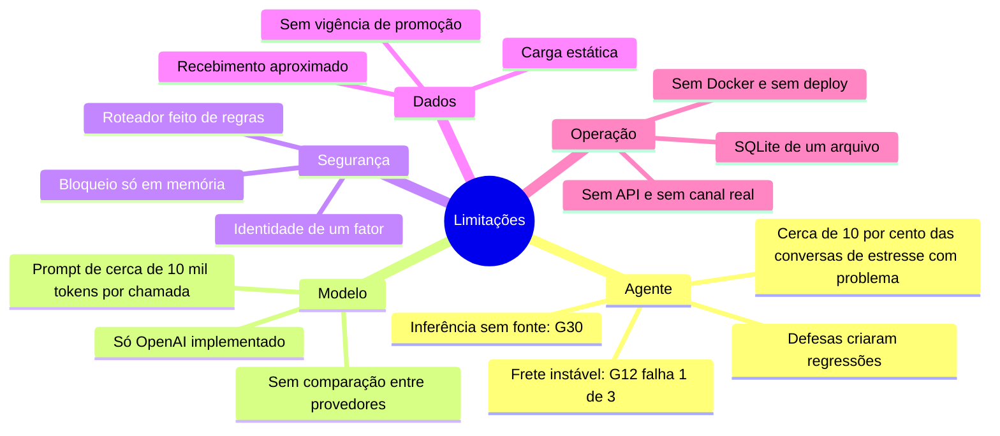
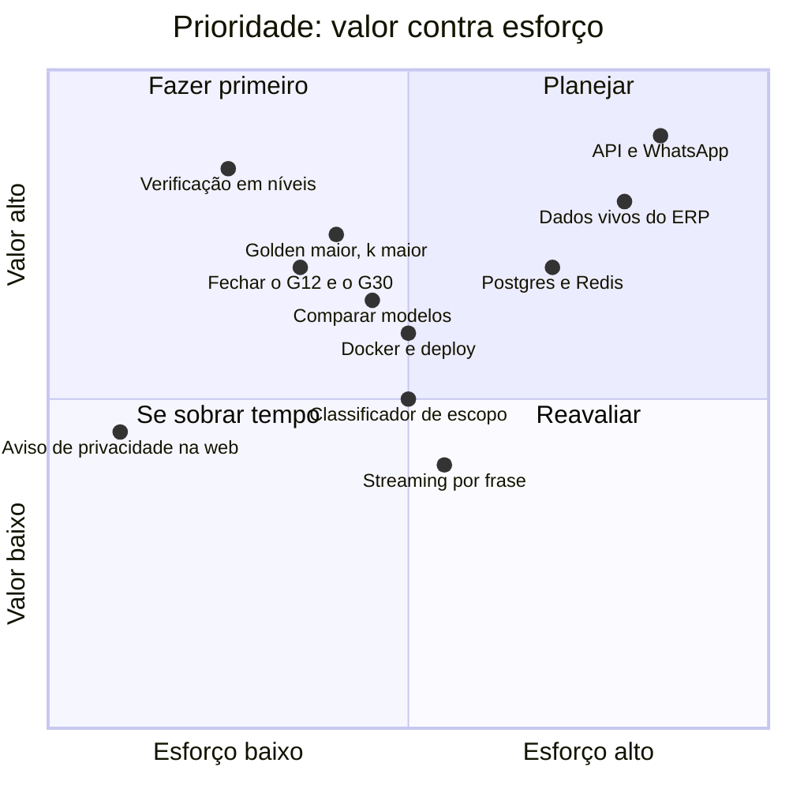
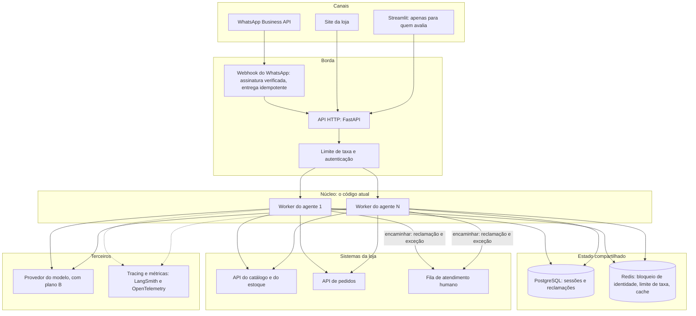
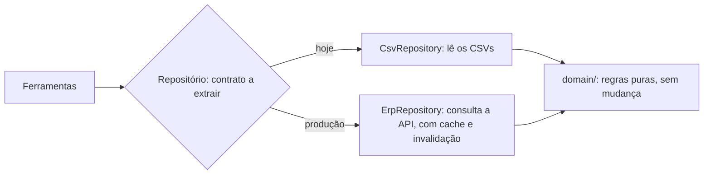
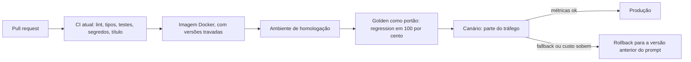
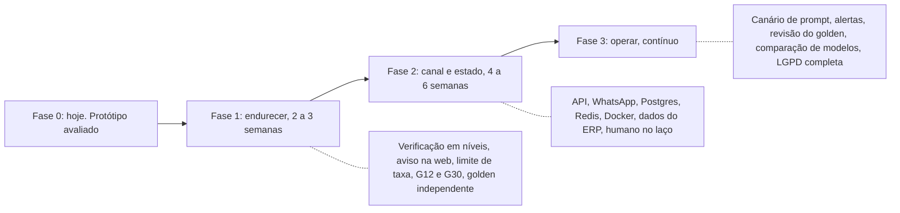
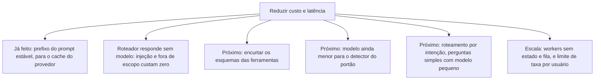
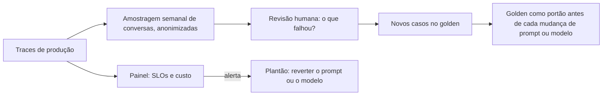

# Limitações e evolução

O desafio pede as limitações conhecidas e o que se faria com mais tempo. Aqui está o que não
ficou pronto, o que mudaria para levar o Téo a produção de verdade e em que ordem.

## Sumário

1. [Limitações conhecidas](#1-limitações-conhecidas)
2. [O que eu faria com mais tempo](#2-o-que-eu-faria-com-mais-tempo)
3. [Rumo à produção: a arquitetura alvo](#3-rumo-à-produção-a-arquitetura-alvo)
4. [Roadmap em fases](#4-roadmap-em-fases)
5. [Custo, latência e escala](#5-custo-latência-e-escala)
6. [Operar em produção](#6-operar-em-produção)
7. [Checklist antes de colocar no ar](#7-checklist-antes-de-colocar-no-ar)

---

## 1. Limitações conhecidas

Organizadas por área, com o que acontece hoje. As que o teste de estresse e o golden mediram trazem o número.

### 1.1 O agente

| Limitação | Como aparece | Impacto |
|---|---|---|
| Frete para outra cidade é instável (caso G12) | Em 1 de cada 3 execuções o modelo chama `get_store_info` em vez de `estimate_shipping` ou `search_policy`; a guarda barra, e o cliente recebe a resposta segura ("não tenho isso confirmado, chame no WhatsApp") | Falha segura: nenhum valor inventado, mas resposta menos útil. A suíte `regression` não está em 100% por causa dele |
| Inferência plausível sem fonte (caso G30) | "Vocês entregam aos sábados?" recebe "de segunda a sexta, não aos sábados", mas o manual só diz "1 a 3 dias úteis" | Não é número, então a guarda numérica não vê. Está em `capability` |
| As defesas criaram regressões | Frete para o exterior respondido como entrega normal, "quero fechar um pedido" respondido com o horário, desabafo recebendo a resposta segura, queixa com e-mail virando protocolo em vez de checar a devolução | Medidas e documentadas em [avaliacao.md](avaliacao.md), não corrigidas |
| Cerca de 10% das conversas de estresse têm algum problema real | 10 de 91 antes das melhorias, 9 de 99 depois: mudou *quais*, não *quantas* | Não há garantia de que um uso real seja melhor que isso |
| A guarda de fundamentação é estreita | Cobre R$, percentual, parcela, rastreio e protocolo. Não cobre prazos em dias, estoque, datas, números por extenso nem associação trocada (preço do produto A dado ao B) | Erros nesses campos passam, a não ser que as outras camadas os peguem |
| O portão "sem tool, sem fato" depende de um detector | Uma chamada mínima ao mesmo modelo decide se a resposta afirma fatos; falha do detector conta como "não afirma" | Pode deixar passar (por desenho, para nunca derrubar um turno) e custa uma chamada a mais |
| O roteador de escopo é feito de regras | Variações que as expressões não preveem escapam para o modelo | Conservador de propósito; a lista de destinos estrangeiros é curta |
| Memória em conversa muito longa | Resolvida nos casos testados (até 28 turnos), mas, acima de 12 produtos perguntados, o estado mostra ao modelo só os 4 primeiros e os 6 mais recentes | Conversas ainda maiores podem perder detalhe do meio |
| Só pt-BR, só texto | Sem áudio, imagem ou outros idiomas | Cliente que mande foto do defeito não é atendido |

### 1.2 Modelo e provedor

| Limitação | Detalhe |
|---|---|
| Um só provedor implementado (OpenAI) | O contrato `LLMClient` permite trocar, mas só existe um adaptador, e nenhum outro modelo foi comparado no golden |
| Sem fallback entre provedores | Se a OpenAI cair, o cliente recebe uma mensagem amigável de indisponibilidade; não há plano B automático |
| Prompt grande | Cada chamada leva cerca de 10 mil tokens de entrada (prompt mais os esquemas das 11 ferramentas). O cache do provedor reduz o custo (89% da entrada nos evals), mas é uma dependência do comportamento de cache |
| Temperatura 0,2 no app, 0,0 nos evals | O avaliado é mais estável que o servido |
| Sem streaming | A resposta chega inteira, validada. Mediana de 1,6 s |

### 1.3 Identidade e segurança

O detalhe está em [seguranca-e-privacidade.md](seguranca-e-privacidade.md#8-riscos-residuais). Em uma linha: a
prova é de um fator (e-mail ou 4 dígitos), o bloqueio vive em memória e por processo, o `session_id` é
o único segredo de quem retoma uma conversa, e não há limite de taxa por usuário.

### 1.4 Dados e regras

| Limitação | Detalhe |
|---|---|
| Dados estáticos | CSVs carregados uma vez na inicialização. Mudar um preço exige reiniciar |
| Promoções sem vigência | O CSV só tem `is_active`; não há datas de início e fim |
| Recebimento aproximado | A loja só guarda a *previsão* de entrega. O veredito de devolução usa essa data e avisa, e a data informada pelo cliente tem precedência (mas não é verificada) |
| Feriados municipais | Só nacionais e de Mato Grosso do Sul. O aniversário de Campo Grande não entra |
| Exclusões de troca não estão nos dados | "Venda final", itens personalizados e boquilhas não têm marcação nos CSVs: o agente avisa e encaminha, em vez de afirmar |
| Dependência da estrutura deste manual | A extração do PDF e as notas de decisão são feitas para este documento; outro formato exigiria rever |
| Dois clientes com o mesmo e-mail | O catálogo de clientes tem um caso (11 e 43); a identidade por e-mail é ambígua para eles |

### 1.5 Integração e operação

| Limitação | Detalhe |
|---|---|
| Sem canal real | Não há integração com WhatsApp nem API HTTP. A interface é CLI e Streamlit |
| Reclamação simulada | Grava em `logs/complaints.jsonl`; o envio à gerência é simulado |
| Sem humano no laço | O agente "encaminha à equipe" registrando um protocolo, mas não há fila nem atendente do outro lado |
| O agente não executa ações | Não cancela, não reserva, não fecha pedido, não recebe pagamento: por regra, quem fecha é a equipe |
| Uma máquina, um arquivo | SQLite local, sem concorrência entre processos, sem backup |
| Sem contêiner e sem deploy | Não há `Dockerfile`, nem pipeline de entrega |
| Windows e macOS não testados | O comando único (`uv run emporio-ui`) é o mesmo nos três sistemas, mas o projeto foi desenvolvido e testado em Linux (WSL e Ubuntu) |
| Os testes ao vivo não rodam no CI | Uma regressão de modelo só aparece quando alguém roda o golden |
| O `--demo` não tem conversa gravada versionada | O modo existe (reproduz um cassete sem chave), mas nenhum cassete acompanha o repositório. As conversas de exemplo (Markdown e aba Exemplos) cumprem esse papel |
| O aviso de privacidade está só na CLI | A interface web não repete o aviso de que as mensagens vão à OpenAI |

### 1.6 A avaliação

Os limites da medição (três execuções, golden escrito pelo autor, uma execução por conversa de estresse,
sem avaliação humana) estão em [avaliacao.md](avaliacao.md#9-limites-desta-avaliação).

---

## 2. O que eu faria com mais tempo

Ordenado por valor para o cliente e para a loja contra esforço. Segurança e medição vêm antes de
funcionalidade nova. Se eu pudesse fazer uma coisa só, seria a verificação de identidade em níveis: é a que
mais reduz risco por esforço.

### Segurança e confiança

1. Verificação de identidade em níveis. Uma prova libera status e rastreio; duas provas liberam devolução
   e reclamação ligada ao pedido. Depois dela, o código de uso único
   enviado ao e-mail ou telefone cadastrado.
2. Bloqueio compartilhado e limite de taxa. Hoje o contador de falhas vive no processo.
3. Aviso de privacidade também na interface web, e máscara configurável dos dados pessoais no trace.
4. Revisão de segurança e *red team* feitos por outra pessoa, para quebrar o viés do autor.

### Qualidade do agente

5. Fechar o G12. A causa é conhecida: o modelo escolhe a ferramenta errada para frete. Duas opções: forçar
   `tool_choice` quando a intenção é inequívoca (frete, horário), ou resolver a intenção em código antes de
   chamar o modelo, como já se faz com a verificação.
6. Tratar a inferência sem fonte (G30) com uma regra: pergunta sobre algo que o manual não afirma deve
   ser respondida com o que o manual diz e encaminhada, nunca com a dedução.
7. Ampliar a guarda para prazos em dias, datas e estoque, medindo o falso positivo no golden.
8. Consertar as quatro regressões que as defesas criaram, com casos de golden próprios.
9. Classificador leve de escopo como segunda camada do roteador, medido contra o golden.

### Medição

10. Golden maior e independente, com casos escritos por quem não escreveu o agente, e `k` maior (por
    exemplo 10) para ter intervalo de confiança.
11. Comparar modelos no mesmo golden: um menor e mais barato, um maior, e um local. É o experimento que
    justificaria, com números, manter ou trocar o modelo.
12. Avaliação humana de tom e empatia, e uma pesquisa de satisfação (o 👍/👎 já existe na interface).
13. Teste de carga para medir a latência com várias conversas ao mesmo tempo.

### Produto

14. API HTTP e o canal WhatsApp (veja a seção 3).
15. Dados vivos: catálogo, estoque e pedidos vindos do sistema da loja, com cache e invalidação.
16. Atendente humano de verdade para onde o agente encaminha, com fila e histórico.
17. Streaming por frase, validando cada frase antes de liberar.
18. Multimodal: aceitar foto de defeito, com consentimento.
19. Promoções com vigência e feriados municipais.

---

## 3. Rumo à produção: a arquitetura alvo

O núcleo (grafo, ferramentas, domínio, guarda) continua o mesmo. O que muda é o que está em volta dele.
O estado de cada conversa vive num objeto `Session` que entra e sai de cada turno, então o núcleo pode ficar
em vários *workers*. O único estado compartilhado entre sessões é o bloqueio por pedido do `IdentityVerifier`,
que é justamente o que iria para o Redis.

O que cada mudança resolve:

| Mudança | Resolve a limitação |
|---|---|
| API HTTP (FastAPI) e webhook do WhatsApp | Sem canal real |
| Workers sem estado, atrás da API | Uma máquina só; permite escalar na horizontal |
| PostgreSQL para sessões e reclamações | SQLite local; sem backup; sem concorrência |
| Redis para bloqueio e limite de taxa | Contador em memória; reinício zera |
| API do ERP no lugar dos CSVs | Dados estáticos e promoções sem vigência |
| Fila de atendimento humano | Reclamação simulada |
| Provedor do modelo com plano B | Dependência de um só provedor |
| Verificação em níveis ou código de uso único | Identidade de um fator |

### Como os dados deixam de ser CSV

O domínio (`domain/`) não sabe de onde vêm os dados: ele recebe objetos. O `CsvRepository` é a única
peça que lê arquivos. Em produção, ele seria trocado por um repositório que consulta o ERP. Hoje as
ferramentas dependem da classe concreta, então o primeiro passo seria extrair o contrato dela:

### Entrega

O hash do prompt que cada turno e cada experimento já carregam é a peça que torna isso possível: dá
para comparar a métrica de uma versão contra a anterior e voltar atrás.

---

## 4. Roadmap em fases

| Fase | Objetivo | Entregas | Critério de saída |
|---|---|---|---|
| 1. Endurecer | Tornar o protótipo seguro e confiável | Verificação em níveis; aviso de privacidade na web; G12 e G30 resolvidos; as 4 regressões corrigidas; golden escrito por outra pessoa e com `k` maior; comparação de modelos | `regression` em 100% com `k = 10`; nenhum risco de gravidade alta aberto |
| 2. Canal e estado | Sair do terminal | API HTTP; integração com o WhatsApp Business; PostgreSQL e Redis; `Dockerfile`; repositório de dados do ERP; fila de atendimento humano | Uma conversa real, de ponta a ponta, num ambiente de homologação |
| 3. Operar | Manter funcionando e melhorando | Canário e rollback de prompt; alertas; revisão mensal do golden com conversas reais (anonimizadas); LGPD completa | Metas de nível de serviço cumpridas por um mês |

---

## 5. Custo, latência e escala

Números medidos neste projeto, e o que se pode projetar a partir deles (com a ressalva de que são
estimativas, não garantias).

| Medida | Valor | Fonte |
|---|---|---|
| Custo por turno | cerca de US$ 0,0017 | 729 turnos no LangSmith |
| Tokens de entrada por chamada | cerca de 10 mil, 80 a 90% vindos do cache | Evals e métricas |
| Latência mediana de um turno | 1,6 s (p95 3,3 s) | Métricas |
| Chamadas ao modelo por turno | 0 a 3 (zero quando o roteador responde; tipicamente 2 com uma ferramenta) | Traces |

Projeção grosseira: uma conversa de 4 turnos custa em torno de US$ 0,007, então mil conversas
custam cerca de US$ 7. Para a loja, é uma fração do custo de um atendente por hora. O custo real em produção
dependerá do tamanho das conversas, da taxa de acerto do cache e do preço vigente do modelo.

Gargalos esperados em produção: o limite de uso por minuto do provedor (um agente faz várias chamadas
por turno), o contador de bloqueio compartilhado (Redis) e a latência do ERP. A solução é fila, tentativas
com recuo e o plano B de provedor.

---

## 6. Operar em produção

Um agente em produção é medido o tempo todo. As métricas que já existem nos traces são a base:

| Indicador | Já existe? | Meta de exemplo | Alerta quando |
|---|---|---|---|
| Latência p95 | Sim | abaixo de 4 s | passar de 6 s por 10 min |
| Taxa de resposta segura (fallback) | Sim | abaixo de 2% | dobrar contra a semana anterior |
| Guarda barrou | Sim | acompanhar a tendência | subir de forma brusca depois de uma mudança de prompt |
| Erros de ferramenta | Sim | abaixo de 3% em uso real | subir |
| Custo por turno | Sim | abaixo de US$ 0,003 | passar de 2× a média |
| Aprovação do cliente (👍/👎) | Sim, na interface web | acima de 85% | cair |
| Taxa de encaminhamento a humano | Não | a definir | subir sem motivo |
| Tentativas de verificação falhas | Parcial | acompanhar | pico em um pedido ou origem |

Práticas que o projeto já adota e que valem em produção: prompt versionado por hash, métricas por versão
de prompt, golden como portão de regressão, testes herméticos e observabilidade que nunca derruba
o atendimento. Faltam: alertas, *runbook* de incidente e a revisão periódica do golden com conversas reais.

---

## 7. Checklist antes de colocar no ar

| Área | Item | Estado hoje |
|---|---|---|
| Segurança | Verificação de identidade além de um fator | Pendente |
| Segurança | Limite de taxa e bloqueio compartilhado | Pendente |
| Segurança | Revisão externa e *red team* | Pendente |
| Segurança | Segredos fora do repositório e varredura no CI | Feito |
| LGPD | Política de privacidade, base legal e contratos com operadores | Pendente |
| LGPD | Atendimento ao titular (acesso, correção, eliminação) de ponta a ponta | Parcial (`/esquecer`, retenção de 30 dias) |
| Qualidade | `regression` em 100% e golden independente | Parcial (28/29 e golden do autor) |
| Qualidade | Comparação de modelos | Pendente |
| Operação | Contêiner, homologação, canário e rollback | Pendente |
| Operação | Alertas e *runbook* | Pendente |
| Operação | Observabilidade com versão de prompt | Feito |
| Produto | Canal real e atendente humano | Pendente |
| Produto | Dados vivos | Pendente |
| Engenharia | Testes herméticos, tipos estritos, CI e histórico de PRs | Feito |
