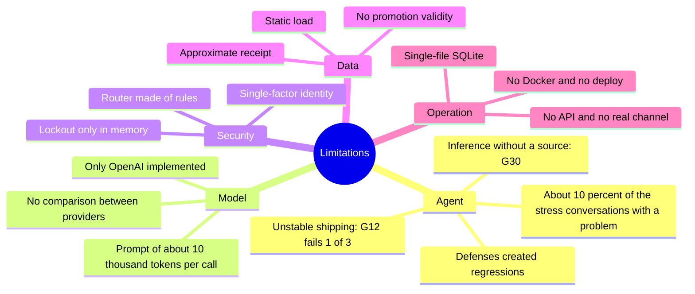
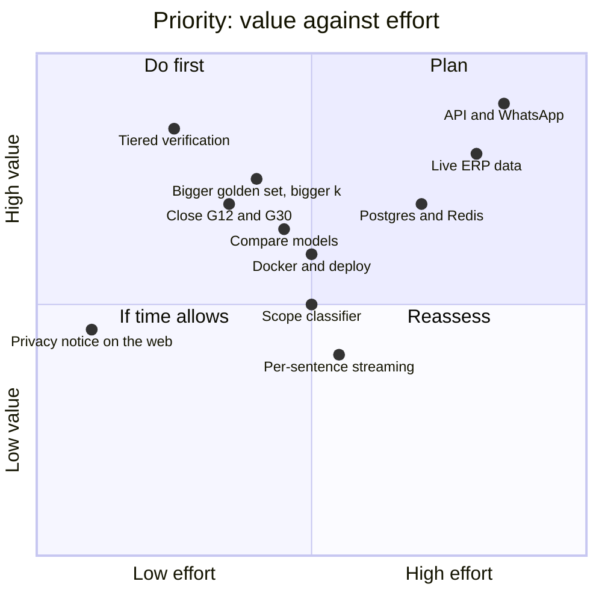
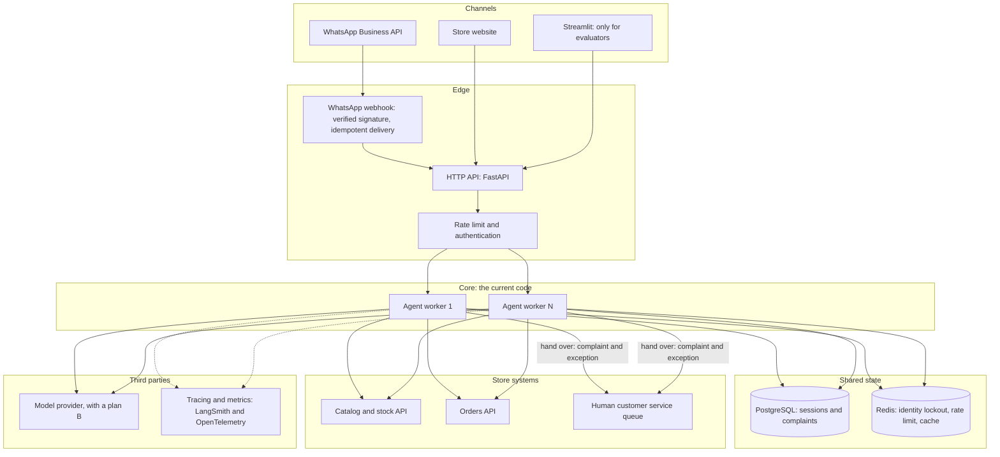
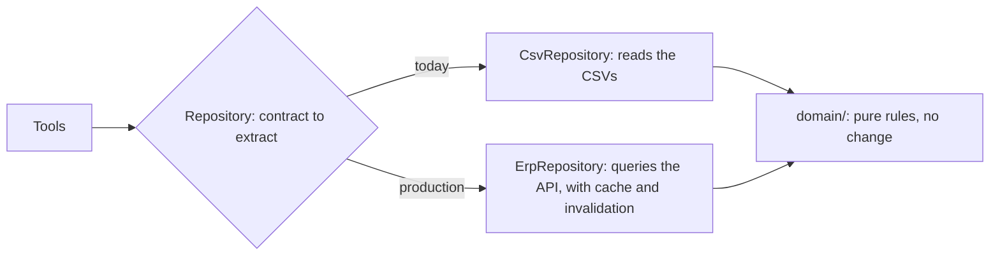
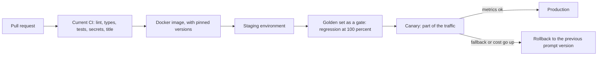
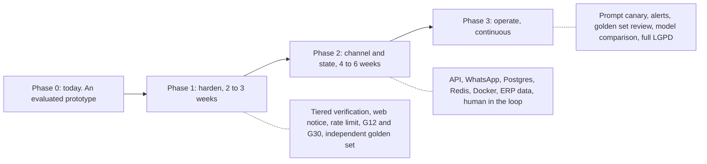
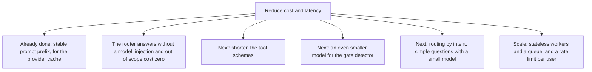
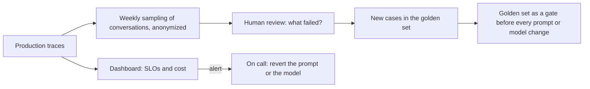

# Limitations and evolution

The challenge asks for the known limitations and what would be done with more time. Here is what was left
unfinished, what would change to take Téo to real production and in what order.

## Contents

1. [Known limitations](#1-known-limitations)
2. [What I would do with more time](#2-what-i-would-do-with-more-time)
3. [Towards production: the target architecture](#3-towards-production-the-target-architecture)
4. [Roadmap in phases](#4-roadmap-in-phases)
5. [Cost, latency and scale](#5-cost-latency-and-scale)
6. [Operating in production](#6-operating-in-production)
7. [Checklist before going live](#7-checklist-before-going-live)

---

## 1. Known limitations

Organized by area, with what happens today. The ones that the stress test and the golden set measured carry
the number.

### 1.1 The agent

| Limitation | How it shows up | Impact |
|---|---|---|
| Shipping to another city is unstable (case G12) | In 1 of every 3 runs the model calls `get_store_info` instead of `estimate_shipping` or `search_policy`; the guard blocks it, and the customer receives the safe answer ("I don't have that confirmed, message us on WhatsApp") | A safe failure: no invented value, but a less useful answer. The `regression` suite is not at 100% because of it |
| Plausible inference without a source (case G30) | "Vocês entregam aos sábados?" ("Do you deliver on Saturdays?") gets "Monday to Friday, not on Saturdays", but the manual only says "1 to 3 business days" | It is not a number, so the numeric guard does not see it. It is in `capability` |
| The defenses created regressions | Shipping abroad answered as a normal delivery, "I want to close an order" answered with the opening hours, a customer venting receiving the safe answer, a complaint with an e-mail becoming a protocol instead of checking the return | Measured and documented in [evaluation.md](evaluation.md), not fixed |
| About 10% of the stress conversations have a real problem | 10 of 91 before the improvements, 9 of 99 after: *which ones* changed, not *how many* | There is no guarantee that real use will be better than this |
| The grounding guard is narrow | It covers R$, percentage, installment, tracking and protocol. It does not cover deadlines in days, stock, dates, numbers written out in words or a swapped association (price of product A given for B) | Errors in these fields get through, unless the other layers catch them |
| The "no tool, no fact" gate depends on a detector | A minimal call to the same model decides whether the answer states facts; a detector failure counts as "does not state" | It may let things through (by design, to never take a turn down) and costs one extra call |
| The scope router is made of rules | Variations that the expressions do not foresee escape to the model | Conservative on purpose; the list of foreign destinations is short |
| Memory in a very long conversation | Solved in the cases tested (up to 28 turns), but, above 12 products asked about, the state shows the model only the first 4 and the 6 most recent | Even longer conversations may lose detail from the middle |
| Only pt-BR, only text | No audio, image or other languages | A customer who sends a photo of the defect is not served |

### 1.2 Model and provider

| Limitation | Detail |
|---|---|
| A single provider implemented (OpenAI) | The `LLMClient` contract allows swapping, but there is only one adapter, and no other model was compared on the golden set |
| No fallback between providers | If OpenAI goes down, the customer receives a friendly unavailability message; there is no automatic plan B |
| Large prompt | Each call carries about 10 thousand input tokens (prompt plus the schemas of the 11 tools). The provider cache reduces the cost (89% of the input in the evals), but it is a dependency on cache behavior |
| Temperature 0.2 in the app, 0.0 in the evals | What is evaluated is more stable than what is served |
| No streaming | The answer arrives whole, validated. Median of 1.6 s |

### 1.3 Identity and security

The detail is in [security-and-privacy.md](security-and-privacy.md#8-residual-risks). In one line: the proof
is a single factor (e-mail or 4 digits), the lockout lives in memory and per process, the `session_id` is
the only secret of whoever resumes a conversation, and there is no rate limit per user.

### 1.4 Data and rules

| Limitation | Detail |
|---|---|
| Static data | CSVs loaded once at startup. Changing a price requires a restart |
| Promotions without validity | The CSV only has `is_active`; there are no start and end dates |
| Approximate receipt | The store only keeps the delivery *estimate*. The return verdict uses that date and warns about it, and the date given by the customer takes precedence (but is not verified) |
| Municipal holidays | Only national and Mato Grosso do Sul ones. Campo Grande's anniversary is not included |
| Exchange exclusions are not in the data | "Final sale", customized items and mouthpieces have no marking in the CSVs: the agent warns and hands over, instead of asserting |
| Dependence on the structure of this manual | The PDF extraction and the decision notes are made for this document; another format would require a review |
| Two customers with the same e-mail | The customer table has one case (11 and 43); identity by e-mail is ambiguous for them |

### 1.5 Integration and operation

| Limitation | Detail |
|---|---|
| No real channel | There is no WhatsApp integration or HTTP API. The interface is the CLI and Streamlit |
| Simulated complaint | It writes to `logs/complaints.jsonl`; the forwarding to management is simulated |
| No human in the loop | The agent "hands over to the team" by registering a protocol, but there is no queue or agent on the other side |
| The agent does not execute actions | It does not cancel, reserve, close an order or receive payment: by rule, the team closes |
| One machine, one file | Local SQLite, no concurrency between processes, no backup |
| No container and no deploy | There is no `Dockerfile` or delivery pipeline |
| Windows and macOS not tested | The single command (`uv run emporio-ui`) is the same on the three systems, but the project was developed and tested on Linux (WSL and Ubuntu) |
| The live tests do not run in the CI | A model regression only shows up when someone runs the golden set |
| `--demo` has no versioned recorded conversation | The mode exists (it replays a cassette without a key), but no cassette ships with the repository. The example conversations (Markdown and the Examples tab) fill that role |
| The privacy notice is only in the CLI | The web interface does not repeat the notice that messages go to OpenAI |

### 1.6 The evaluation

The limits of the measurement (three runs, golden set written by the author, one run per stress
conversation, no human evaluation) are in [evaluation.md](evaluation.md#9-limits-of-this-evaluation).

---

## 2. What I would do with more time

Ordered by value for the customer and for the store against effort. Security and measurement come before new
functionality. If I could do only one thing, it would be tiered identity verification: it is the one that
reduces the most risk per effort.

### Security and trust

1. Tiered identity verification. One proof releases status and tracking; two proofs release return and a
   complaint tied to the order. After it, a one-time code sent to the e-mail or phone on file.
2. Shared lockout and rate limit. Today the failure counter lives in the process.
3. A privacy notice on the web interface too, and a configurable mask for personal data in the trace.
4. A security review and *red team* done by someone else, to break the author's bias.

### Quality of the agent

5. Close G12. The cause is known: the model chooses the wrong tool for shipping. Two options: force
   `tool_choice` when the intent is unambiguous (shipping, opening hours), or resolve the intent in code
   before calling the model, as is already done with verification.
6. Treat inference without a source (G30) with a rule: a question about something the manual does not state
   must be answered with what the manual says and handed over, never with the deduction.
7. Widen the guard to deadlines in days, dates and stock, measuring the false positives on the golden set.
8. Fix the four regressions that the defenses created, with golden set cases of their own.
9. Layered input protection. Today the scope router is only rules, and with more time I would evolve it in
   two directions:
   - **Improve the regex layer.** Remove what is too specific (proper names, fixed lists of languages, dishes
     and types of text) and write the patterns by the structure of the request (verb plus object). Normalize
     the message before matching (accents, invisible characters, spaced-out letters, words with scrambled
     middles, text in Base64 or hex), limit the length of the text against ReDoS, derive the store vocabulary
     from the CSVs themselves and keep a labeled set of phrases, in Portuguese, to measure false positives
     and false negatives before every change.
   - **Add layered protection with smaller models.** The rules would stay as the first layer, cheap and
     predictable, and a small model would give a second opinion only on the messages the rules do not decide
     (the ones that mention nothing about the store and carry no clear sign of attack), failing open (if the
     model fails, the conversation goes on) and with personal data replaced by markers before leaving the
     machine. The same goes for the output of the answer. Paths to evaluate, always measured on the same
     golden set before adopting:
     - **Jev** (TypeSafe AI), a typed-decision model: it does not generate text, it only returns answers
       inside a schema (decisions, classifications, probabilities), designed for input and output guardrails.
       It is a hosted API, which brings one more provider.
     - **Models similar to Jev**, such as **Laya** (Convai Innovations, open weights, which runs locally and
       would need training with examples in Portuguese) and safety classifiers, such as Llama Guard and
       Prompt Guard.
     - **A small, cheap general-purpose model**, called only in uncertain cases.
     In every case, the choice would depend on Brazilian Portuguese, latency, cost, privacy (the customer's
     text would leave the store) and the provider's usage limits.

### Measurement

10. A bigger and independent golden set, with cases written by someone who did not write the agent, and a
    bigger `k` (for example 10) to have a confidence interval.
11. Compare models on the same golden set: a smaller and cheaper one, a bigger one, and a local one. It is
    the experiment that would justify, with numbers, keeping or changing the model.
12. Human evaluation of tone and empathy, and a satisfaction survey (the 👍/👎 already exists in the
    interface).
13. A load test to measure latency with several conversations at the same time.

### Product

14. An HTTP API and the WhatsApp channel (see section 3).
15. Live data: catalog, stock and orders coming from the store's system, with cache and invalidation.
16. A real human agent to hand over to, with a queue and history.
17. Per-sentence streaming, validating each sentence before releasing it.
18. Multimodal: accept a photo of the defect, with consent.
19. Promotions with validity and municipal holidays.

---

## 3. Towards production: the target architecture

The core (graph, tools, domain, guard) stays the same. What changes is what surrounds it. The state of each
conversation lives in a `Session` object that goes in and out of each turn, so the core can run on several
*workers*. The only state shared between sessions is the per-order lockout of the `IdentityVerifier`, which
is exactly what would go to Redis.

What each change solves:

| Change | Solves the limitation |
|---|---|
| HTTP API (FastAPI) and WhatsApp webhook | No real channel |
| Stateless workers, behind the API | A single machine; it allows horizontal scaling |
| PostgreSQL for sessions and complaints | Local SQLite; no backup; no concurrency |
| Redis for lockout and rate limit | An in-memory counter; a restart resets it |
| ERP API in place of the CSVs | Static data and promotions without validity |
| Human customer service queue | Simulated complaint |
| Model provider with a plan B | Dependence on a single provider |
| Tiered verification or a one-time code | Single-factor identity |

### How the data stops being CSV

The domain (`domain/`) does not know where the data comes from: it receives objects. The `CsvRepository` is
the only piece that reads files. In production, it would be replaced by a repository that queries the ERP.
Today the tools depend on the concrete class, so the first step would be to extract its contract:

### Delivery

The prompt hash that each turn and each experiment already carry is the piece that makes this possible: it
lets you compare the metric of one version against the previous one and go back.

---

## 4. Roadmap in phases

| Phase | Goal | Deliverables | Exit criterion |
|---|---|---|---|
| 1. Harden | Make the prototype safe and reliable | Tiered verification; privacy notice on the web; G12 and G30 solved; the 4 regressions fixed; a golden set written by someone else and with a bigger `k`; model comparison | `regression` at 100% with `k = 10`; no high-severity risk open |
| 2. Channel and state | Leave the terminal | HTTP API; WhatsApp Business integration; PostgreSQL and Redis; `Dockerfile`; ERP data repository; human customer service queue | One real conversation, end to end, in a staging environment |
| 3. Operate | Keep it running and improving | Prompt canary and rollback; alerts; monthly golden set review with real (anonymized) conversations; full LGPD | Service level targets met for a month |

---

## 5. Cost, latency and scale

Numbers measured in this project, and what can be projected from them (with the caveat that they are
estimates, not guarantees).

| Measure | Value | Source |
|---|---|---|
| Cost per turn | about US$ 0.0017 | 729 turns in LangSmith |
| Input tokens per call | about 10 thousand, 80 to 90% coming from the cache | Evals and metrics |
| Median latency of a turn | 1.6 s (p95 3.3 s) | Metrics |
| Model calls per turn | 0 to 3 (zero when the router answers; typically 2 with one tool) | Traces |

A rough projection: a 4-turn conversation costs around US$ 0.007, so a thousand conversations cost about
US$ 7. For the store, it is a fraction of the cost of an hour of a human agent. The real cost in production
will depend on the size of the conversations, the cache hit rate and the model's current price.

Bottlenecks expected in production: the provider's usage limit per minute (an agent makes several calls per
turn), the shared lockout counter (Redis) and the latency of the ERP. The solution is a queue, retries with
backoff and the provider plan B.

---

## 6. Operating in production

An agent in production is measured all the time. The metrics that already exist in the traces are the base:

| Indicator | Exists already? | Example target | Alert when |
|---|---|---|---|
| p95 latency | Yes | below 4 s | it exceeds 6 s for 10 min |
| Safe answer rate (fallback) | Yes | below 2% | it doubles against the previous week |
| Guard blocked | Yes | follow the trend | it rises sharply after a prompt change |
| Tool errors | Yes | below 3% in real use | it rises |
| Cost per turn | Yes | below US$ 0.003 | it exceeds 2× the average |
| Customer approval (👍/👎) | Yes, in the web interface | above 85% | it falls |
| Hand-over-to-human rate | No | to be defined | it rises for no reason |
| Failed verification attempts | Partial | follow | a spike on one order or origin |

Practices that the project already adopts and that hold in production: a prompt versioned by hash, metrics
per prompt version, the golden set as a regression gate, hermetic tests and observability that never takes
the service down. Missing: alerts, an incident *runbook* and the periodic review of the golden set with
real conversations.

---

## 7. Checklist before going live

| Area | Item | State today |
|---|---|---|
| Security | Identity verification beyond a single factor | Pending |
| Security | Rate limit and shared lockout | Pending |
| Security | External review and *red team* | Pending |
| Security | Secrets out of the repository and a scan in the CI | Done |
| LGPD | Privacy policy, legal basis and contracts with operators | Pending |
| LGPD | Service to the data subject (access, correction, erasure) end to end | Partial (`/esquecer`, 30-day retention) |
| Quality | `regression` at 100% and an independent golden set | Partial (28/29 and the author's golden set) |
| Quality | Model comparison | Pending |
| Operation | Container, staging, canary and rollback | Pending |
| Operation | Alerts and *runbook* | Pending |
| Operation | Observability with prompt version | Done |
| Product | A real channel and a human agent | Pending |
| Product | Live data | Pending |
| Engineering | Hermetic tests, strict types, CI and PR history | Done |
