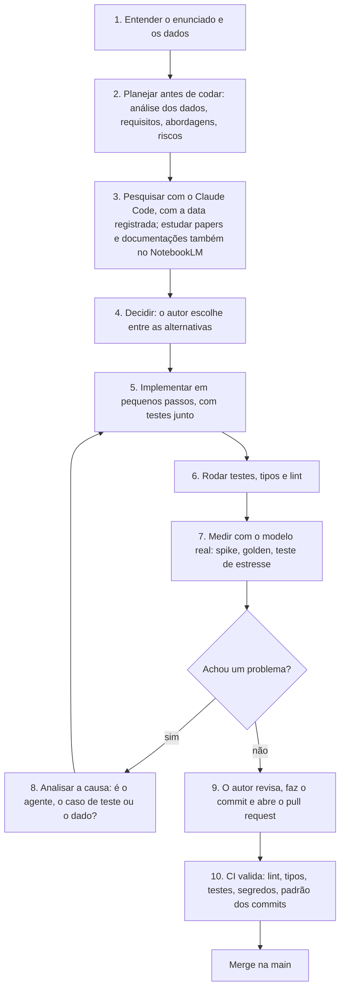
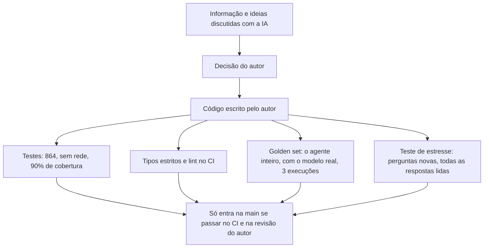

# Uso de assistentes de código

O desafio pede: *"caso faça uso de algum recurso de IA (Copilot, Claude, Cursor, etc.), explique qual a
escolha e como utilizou. Queremos entender o seu workflow."* Este documento responde com franqueza.

**Resumo.** A ideia, as decisões e o código são meus. Usei o **Claude Code** (Anthropic) como **apoio**, e
não como autor: para **pesquisar e reunir informações**, **relacionar e conectar** o que eu encontrava com o
problema da loja, e como interlocutor para **raciocinar e idealizar a orquestração do agente e o
planejamento do projeto**. **Também usei o NotebookLM** (Google) para **ler papers, artigos e
documentações**, tirar dúvidas e **encontrar conexões** entre essas fontes, o que me ajudou a planejar **o
que fazer, quando fazer e como fazer** com as tecnologias que eu escolhi.

O ponto de partida de cada etapa veio de mim; a IA ajudou a pensar melhor e mais rápido sobre ele. O que
importa aqui é **em que momentos** a usei e **o que fiz para não confiar cegamente nela**.

## Sumário

1. [As ferramentas e o papel de cada uma](#1-as-ferramentas-e-o-papel-de-cada-uma)
2. [O fluxo de trabalho](#2-o-fluxo-de-trabalho)
3. [Quem fez o quê](#3-quem-fez-o-quê)
4. [Como validei o que veio da IA](#4-como-validei-o-que-veio-da-ia)
5. [Onde a IA não bastou](#5-onde-a-ia-não-bastou)
6. [Pontos de atenção](#6-pontos-de-atenção)

---

## 1. As ferramentas e o papel de cada uma

| Ferramenta | Para que usei | Por que ela |
|---|---|---|
| **Claude Code** | Pesquisar, relacionar o que achei com o problema da loja e raciocinar sobre a orquestração e o planejamento | **Enxerga o projeto inteiro**: as perguntas dependiam do contexto real (os CSVs, o manual, o que já existia) |
| **NotebookLM** (também) | Ler papers, artigos e documentações; tirar dúvidas; achar conexões entre as fontes; planejar o quê, quando e como fazer | Responde **a partir das fontes que eu carrego**, citando o trecho, então a dúvida se resolve no texto original |

### Claude Code: pesquisar e raciocinar sobre o projeto

O **Claude Code**, agente de linha de comando da Anthropic, trabalha dentro do repositório: lê o código e os
dados, e pesquisa na web quando preciso. O papel dele, em ordem de importância para o projeto:

1. **Pesquisa e levantamento de informação.** Comparar modelos, provedores, frameworks e abordagens, ler
   documentação, e registrar a data de cada consulta.
2. **Relacionar as informações.** Ajudar a ligar o que a pesquisa trazia ao problema concreto da loja:
   dados, manual, riscos e restrições.
3. **Raciocinar junto.** Servir de interlocutor para eu **idealizar a orquestração do agente** e o
   **planejamento do projeto**: discutir as alternativas que eu levantava, apontar riscos e testar os meus
   argumentos.

### Também: NotebookLM, para estudar as fontes e planejar

Além do Claude Code, **também usei o NotebookLM**, do Google, que trabalha sobre um conjunto de fontes que eu
escolho. Montei cadernos com **papers, artigos da internet e as documentações das tecnologias que escolhi**
(por exemplo, LangGraph, a API da OpenAI, LangSmith, Streamlit e Pydantic) e usei para:

1. **Ler e tirar dúvidas.** Perguntar sobre um conceito ou um trecho de documentação e receber a resposta
   com a citação da fonte, para conferir no original.
2. **Encontrar conexões.** Cruzar o que papers e artigos dizem sobre agentes, *tool calling*, avaliação e
   alucinação com o que as documentações oferecem na prática.
3. **Planejar o uso das tecnologias.** Transformar essa leitura em um plano: **o que fazer, quando fazer e
   como fazer** com cada tecnologia, e em que ordem ela entraria no projeto.

As duas se complementam: o NotebookLM para **estudar as fontes**, o Claude Code para **trazer isso para o
projeto** e raciocinar sobre ele.

### O meu papel

O resto, e o principal: **ter a ideia** e definir o problema e o escopo, **escolher as tecnologias**,
**decidir entre as alternativas**, **escrever o código**, os testes e os evals, rodar os experimentos, e
**controlar o repositório**.

## 2. O fluxo de trabalho

A IA entrou sobretudo nas etapas **2, 3 e 8**: planejar, pesquisar, e pensar sobre a causa de um problema. A
implementação, os testes e as medições foram trabalho meu. Na prática:

1. **Planejar antes de codar.** Antes da primeira linha de código houve uma fase de planejamento, com
   relatórios por tema: requisitos, análise dos dados, arquitetura do agente, prompts, segurança e LGPD,
   estratégia de testes e avaliação, CI, riscos. Eu definia o tema e a pergunta; a IA ajudava a levantar
   informação e a confrontar as opções. Foi nesse momento que as armadilhas dos dados e as contradições do
   manual foram mapeadas.
2. **Pesquisar com data.** A comparação de modelos, provedores e frameworks foi feita com pesquisa na web e
   registrou a **data da consulta**, porque preço e versão envelhecem. As lacunas de verificação foram
   declaradas no próprio relatório.
3. **Estudar as fontes, também no NotebookLM.** Com as tecnologias escolhidas, li também no **NotebookLM**
   os papers, artigos e documentações sobre elas, tirei as dúvidas no texto original e montei a ordem de
   trabalho: o que fazer, quando e como.
4. **Pequenos passos.** O projeto tem **145 commits em 35 pull requests**, cada um com uma intenção (domínio,
   ferramentas, guarda, CLI, avaliação...). O histórico é real, em **dois dias**, e não um único commit.
5. **Medir antes de acreditar.** Um *spike* testou o *tool calling* contra as ferramentas reais antes de
   construir o agente, e o golden e os testes de estresse mediram o resultado depois.

## 3. Quem fez o quê

```mermaid
flowchart LR
    subgraph AUT["O autor: idealiza, decide, implementa e controla"]
        A1["Tem a ideia e define o problema, o escopo e as prioridades"]
        A2["Escolhe as tecnologias e decide entre as alternativas"]
        A3["Escreve o código, os testes e os evals"]
        A4["Executa o git: branches, commits e pull requests"]
    end
    subgraph IA["Claude Code: apoio à pesquisa e ao raciocínio"]
        I1["Pesquisa e reúne informações"]
        I2["Relaciona o que achou com o problema"]
        I3["Discute a orquestração e o planejamento"]
    end
    subgraph NB["Também: NotebookLM, apoio ao estudo"]
        N1["Lê papers, artigos e documentações"]
        N2["Tira dúvidas citando a fonte"]
        N3["Ajuda a planejar o quê, quando e como"]
    end
    AUT -->|"perguntas, hipóteses e direção"| IA
    IA -->|"informações, conexões e contrapontos"| AUT
    AUT -->|"fontes escolhidas e dúvidas"| NB
    NB -->|"respostas com citação e conexões"| AUT
```

Exemplos concretos do que ficou **com o autor**, e não com a IA:

- **A orquestração.** A forma do turno (roteador antes do modelo, ferramentas determinísticas, guarda antes
  de responder, fallback) partiu de mim. A IA serviu para discutir e pressionar essa ideia, não para
  propô-la pronta.
- **O código.** O domínio, as ferramentas, o grafo, a guarda, a CLI, a interface e os testes foram escritos
  por mim.
- **O git.** **Branches, commits e pull requests são meus**, e eu escolho o que entra em cada commit. Por isso
  o histórico segue o padrão do projeto (Conventional Commits, validado no CI).
- **O que fica fora do repositório.** Decidi manter **fora** do repositório os relatórios de planejamento e
  os rascunhos dos testes de estresse; entra o código, os dados, os evals e a documentação.
- **Recusar atalhos.** Recusei acrescentar à solução peças experimentais (como MCP ou um RAG de
  demonstração) que não resolviam um problema do projeto. A solução ficou no que o problema pede.
- **Aceitar o que a medição mostrou.** Quando o teste de estresse revelou que as defesas criavam defeitos
  novos, a decisão foi **documentar com os números** e não esconder.

## 4. Como validei o que veio da IA

Informação vinda de IA é **ponto de partida, não verdade**. Nada do que a pesquisa ou a discussão trazia
entrava no projeto sem passar por um destes filtros:

- **Conferir na fonte.** Preço, versão e capacidade de modelo foram reconferidos na documentação oficial, e o
  que não deu para confirmar ficou declarado como lacuna. No NotebookLM, cada resposta aponta o trecho de
  origem, e era ali que eu conferia antes de usar.
- **Escolher bem as fontes.** O NotebookLM só sabe o que está nos cadernos, então a qualidade da resposta
  dependia das fontes que eu escolhia: documentação oficial e papers primeiro, artigos como complemento.
- **Medir no próprio projeto.** A escolha do modelo não ficou na pesquisa: foi decidida com o **golden e o
  modelo real** (veja [D4](decisoes-tecnicas.md#d4-modelo-e-provedor)).
- **Testes que testam decisões, não só funções.** Por exemplo, um teste de arquitetura impede o agente de
  importar as ferramentas concretas, e outro garante que nenhum nome de modelo está escrito no código.
- **Ler tudo.** No teste de estresse, **todas as respostas foram lidas** (159 no primeiro, 167 no segundo),
  não só as checagens automáticas.
- **O CI como terceiro.** Lint, tipos, testes, varredura de segredos no histórico inteiro e o padrão dos
  commits, em todo pull request.

## 5. Onde a IA não bastou

Um relato honesto de uso de IA inclui os limites dela. Alguns, reais:

| O que aconteceu | O que mostrou |
|---|---|
| Os **primeiros relatórios de pesquisa** tinham preços e versões a reconferir | A pesquisa de IA é ponto de partida: as lacunas foram declaradas e as decisões finais se apoiaram em **medidas do próprio projeto** |
| A discussão de arquitetura tendia a **acrescentar peças** (mais camadas, mais tecnologia) | Mais componentes não é mais solução. O critério foi sempre o problema da loja, e o que não resolvia nada ficou de fora, com o motivo no [anexo das decisões](decisoes-tecnicas.md#anexo-tecnologias-que-não-usamos-e-quando-passariam-a-fazer-sentido) |
| As **regras do negócio** (o que a loja aceita, como resolver as contradições do manual) não têm resposta numa pesquisa | Essas decisões foram minhas, tomadas a partir dos dados, e estão registradas em [dados-e-politicas.md](dados-e-politicas.md#9-suposições-assumidas) |
| Os **defeitos do agente** só apareceram com o modelo real e com perguntas novas | Nenhuma discussão substitui a medição. O golden virou portão de regressão, e o balanço está em [avaliacao.md](avaliacao.md#o-balanço) |

## 6. Pontos de atenção

- **A IA acelera a pesquisa, não a substitui.** Ela traz informação rápido, mas a responsabilidade de
  conferir é de quem decide. Por isso cada pesquisa tem data e lacunas declaradas.
- **Um plano de estudo não é um plano de projeto.** O NotebookLM ajudou a organizar o quê, quando e como
  fazer com cada tecnologia, mas a ordem real foi ajustada pelo que os testes e as medições mostravam.
- **A IA conhece o que está no contexto.** Decisões que dependem de conhecimento do negócio (o que a loja
  aceita, o que o cliente real pergunta) precisam de gente da loja: aqui foram assumidas e documentadas em
  [dados-e-politicas.md](dados-e-politicas.md#9-suposições-assumidas).
- **Um bom interlocutor não é um bom juiz.** Discutir com a IA ajudou a enxergar alternativas e riscos, mas o
  veredito sobre o que funciona veio dos testes e das medições, e mesmo assim restaram limites (veja
  [limitacoes-e-evolucao.md](limitacoes-e-evolucao.md)).
- **Na documentação, a IA ajudou a organizar e revisar o texto.** O conteúdo, as decisões e os números são
  meus; os números vêm dos relatórios de avaliação e das métricas exportadas, que estão no repositório
  (`evals/reports/`) e podem ser conferidos.
